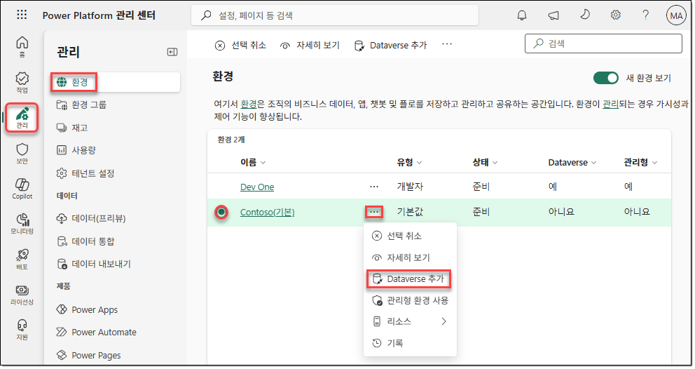
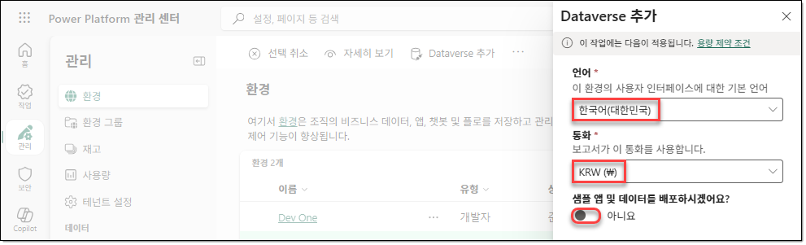
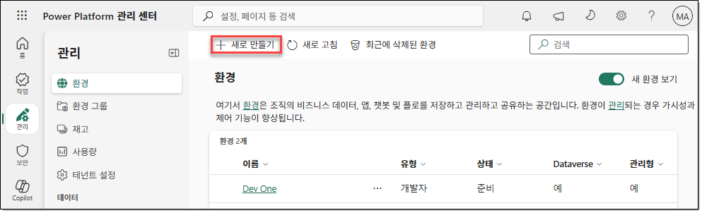
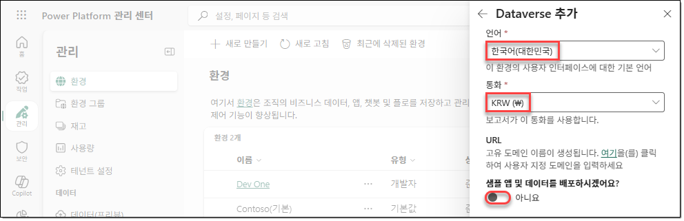
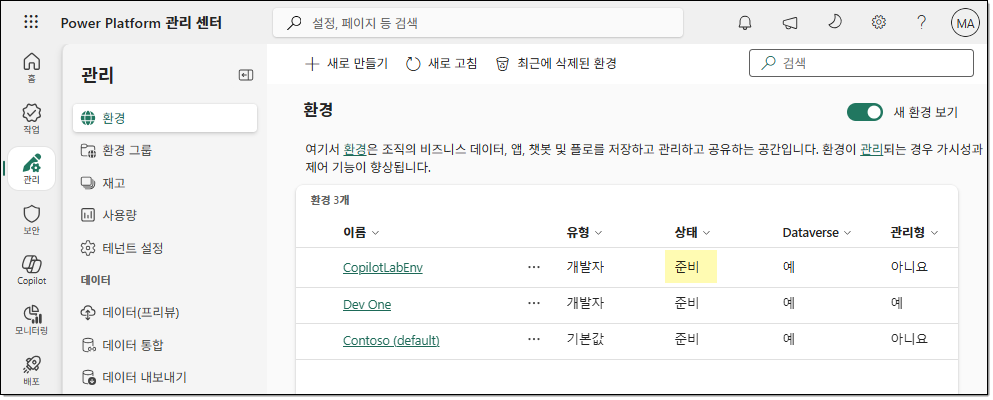
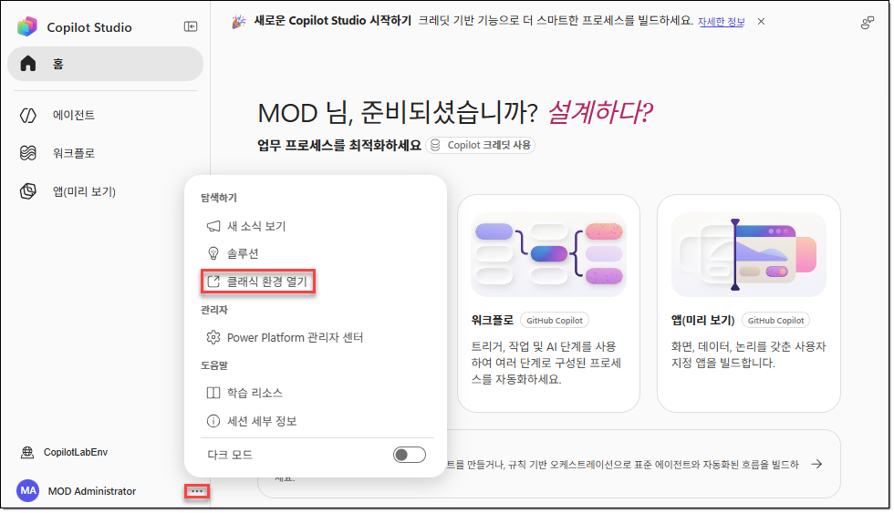
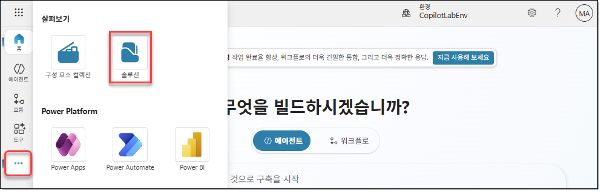
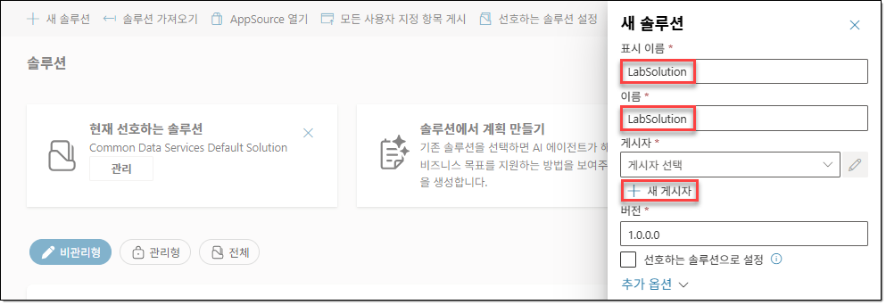

---
---

# LAB 00. Power Platform 환경 만들기

## 개요

이 실습에서는 실습에 필요한 Power Platform 환경을 만듭니다.

## TASK 01. Power Platform 환경 만들기

1. 브라우저를 열고 [https://admin.powerplatform.com](https://admin.powerplatform.com) 사이트에 실습 환경에서 제공하는 계정과 암호를 사용하여 액세스합니다.

2. 기본 환경에 Dataverse를 추가해야 합니다. `관리 > 환경`으로 이동한 후 `Contoso(기본)` 환경을 선택하고 `… > Dataverse 추가`를 클릭합니다.

   

3. `Dataverse 추가` 창에서 다음과 같이 구성한 후 `추가`를 클릭합니다.

   | 항목 | 값 |
   |---|---|
   | `언어` | `한국어(대한민국)` |
   | `통화` | `KRW (₩)` |
   | `샘플 앱 및 데이터를 배포하시겠어요` | `아니요` |

   

4. 실습에서 사용할 새 환경을 만들기 위해 `관리 > 환경`의 메뉴에서 `+ 새로 만들기`를 클릭합니다.

   

5. `새 환경` 창에서 다음과 같이 구성한 후 `다음`을 클릭합니다.

   | 항목 | 값 |
   |---|---|
   | `유형` | `개발자` |
   | `매크로 지역 지리` | `아시아 태평양` |
   | `이름` | `CopilotLabEnv` |
   | `기본 설정 변경 > 환경 그룹` | `없음` |
   | `기본 설정 변경 > 관리형 환경으로 설정` | `아니요` |
   | `기본 설정 변경 > 대신 만들기` | `아니요` |
   | `기본 설정 변경 > Dataverse 데이터 저장소를 추가하시겠습니까` | `예` |
   | `기본 설정 변경 > Azure 종량제를 이용하시겠습니까` | `아니요` |

   

6. `Dataverse 추가` 창에서 다음과 같이 구성한 후 `저장`을 클릭합니다.

   | 항목 | 값 |
   |---|---|
   | `언어` | `한국어(대한민국)` |
   | `통화` | `KRW (₩)` |
   | `샘플 앱 및 데이터를 배포하시겠어요` | `아니요` |

   

7. `관리 > 환경` 페이지의 메뉴에서 `새로 고침`을 클릭하여 새로 만든 환경이 `준비` 상태로 표시될 때까지 기다립니다.

   > [!NOTE]
   > 환경이 `준비` 상태로 표시될 때까지 몇 분이 걸릴 수 있습니다.

   

## TASK 02. Copilot Studio의 표준 하네스 시작하기

1. 브라우저에서 새 탭을 열고 [https://copilotstudio.microsoft.com](https://copilotstudio.microsoft.com) 사이트로 이동합니다.

2. 새로운 Copilot Studio 환경이 표시되면 왼쪽 아래의 환경을 클릭한 후 `CopilotLabEnv` 환경을 선택합니다.

   

3. 왼쪽 하단의 계정 우측에서 `… > 클래식 환경 열기`를 클릭합니다. 피드백 창이 표시되면 `피드백 건너뛰기`를 클릭합니다.

   

## TASK 03. 솔루션 만들기

1. Copilot Studio의 클래식 포털에서 새로운 솔루션을 만들어야 합니다. 왼쪽 내비게이션 메뉴에서 `… > 솔루션`을 클릭합니다.

   

2. `솔루션` 페이지의 메뉴에서 `+ 새 솔루션`을 클릭합니다.

   

3. `새 솔루션` 창에서 다음과 같이 구성합니다.

   | 항목 | 값 또는 작업 |
   |---|---|
   | `표시 이름` | `LabSolution` |
   | `이름` | `LabSolution` |
   | `게시자` | `+ 새 게시자`를 클릭합니다. |

   

4. `새 게시자` 창의 `속성` 탭에서 다음과 같이 구성하고 `저장`을 클릭합니다.

   | 항목 | 값 |
   |---|---|
   | `표시 이름` | `Fabrikam` |
   | `이름` | `fabrikam` |
   | `접두사` | `fab` |
   | `선택 값 접두사` | 기본값을 사용합니다. |

   

5. `새 솔루션` 창이 다시 표시되면 `게시자`에 앞서 만들었던 `Fabrikam (fabrikam)` 게시자를 선택하고 `선호하는 솔루션으로 설정` 옵션을 선택한 후 `만들기`를 클릭합니다.

   

## 문서 정보

- 과정: `PL-7008`
- 작성자: [우진환](https://github.com/313mlclub), [유승호](https://github.com/hahaysh)
- 기관 및 프로그램: 한국 마이크로소프트 · Microsoft Technical Trainer · Enterprise Skills Initiative
- 표지 표기: Worldwide Learning | Microsoft Technical Trainer

### 문서 작성 연혁

| 날짜 | 버전 | 작성자 | 변경 내용 |
|---|---|---|---|
| 2026.10.14 | 0.9.0 | [우진환](https://github.com/313mlclub) | 문서 초안 작성 |
| 2026.10.17 | 1.0.0 | [우진환](https://github.com/313mlclub) | 문서 서식 적용 |
| 2026.10.24 | 1.1.0 | [유승호](https://github.com/hahaysh) | PDF 기반 Markdown 정리 및 검토 |
