---
---

# LAB 01. Copilot Studio로 에이전트 만들기

## 시나리오

이 실습에서는 다음 작업을 수행합니다.

- 템플릿에서 에이전트 만들기
- 에이전트를 만들고 이름 지정하기
- 지침을 사용하여 에이전트의 동작 방식 정의하기
- 공개 웹 사이트를 지식 원본으로 추가하기
- 에이전트를 게시하고 데모 웹 사이트에서 테스트하기

이 실습을 완료하는 데 약 **45분**이 걸립니다.

## 핵심 개념 − 에이전트 구성 요소 및 동작

생성형 오케스트레이션을 사용하도록 설정하면 에이전트가 지침, 지식, 토픽 및 도구를 사용하여 동적으로 응답을 생성할 수 있습니다.

## EXERCISE 01. 템플릿에서 에이전트 만들기

이 실습에서는 템플릿을 사용하여 에이전트를 만들고 테스트합니다.

### TASK 01. 안전한 이동(Safe Travels) 템플릿으로 에이전트 만들기

1. Copilot Studio 클래식 포털의 왼쪽 내비게이션 메뉴에서 `에이전트`로 이동합니다. 페이지를 스크롤 다운한 후 `에이전트 템플릿으로 시작` 영역의 `안전한 이동` 템플릿을 클릭합니다.

   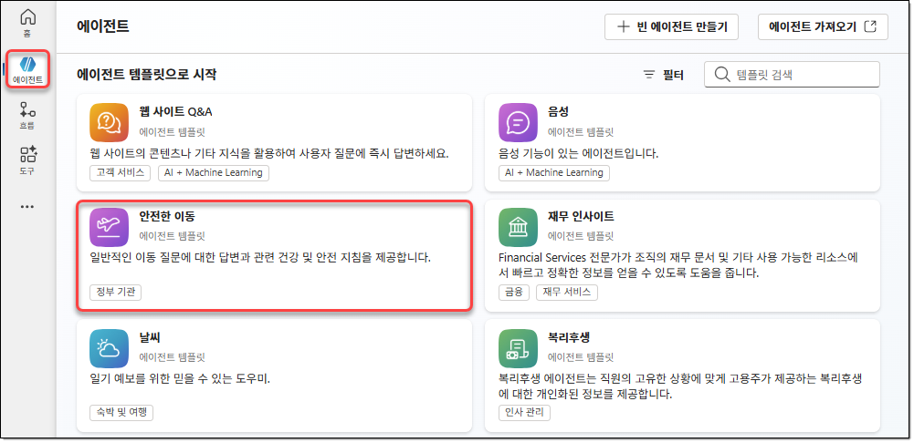

2. `안전한 여행` 템플릿 페이지 우측의 `… > 고급 설정 편집`을 클릭합니다.

   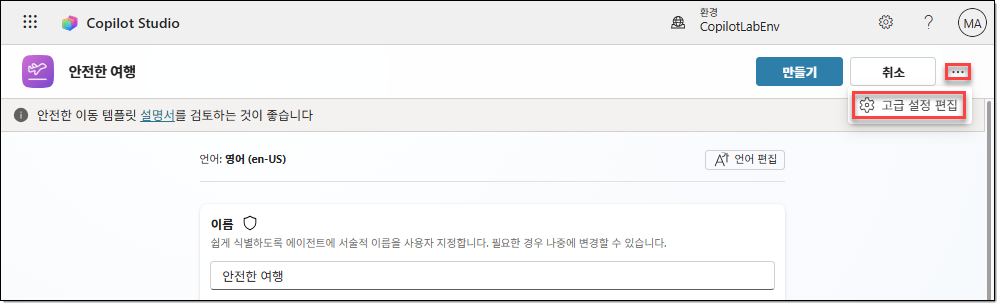

3. `고급 설정` 창에서 `솔루션`이 `LabSolution`으로 지정되어 있고 `스키마 이름`이 `fab` 접두사를 사용하는지 확인한 후 `취소`를 클릭합니다.

   > [!NOTE]
   > [확인 필요: 원본 PDF의 설명은 스키마 이름에 `fab` 접두사를 사용하도록 안내하지만, 아래 스크린샷의 스키마 이름은 `cr6ce_`로 시작합니다.]

   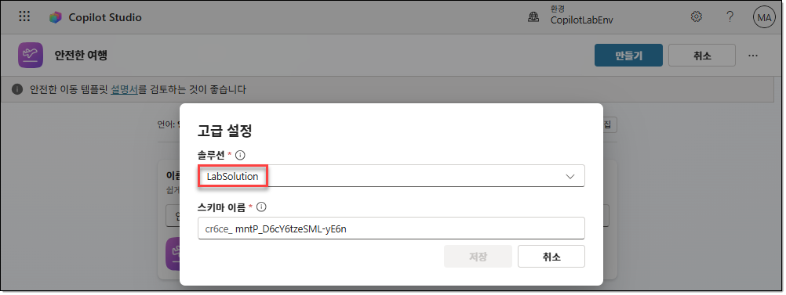

4. `안전한 여행` 템플릿 페이지 우측 상단에서 `만들기`를 클릭합니다.

   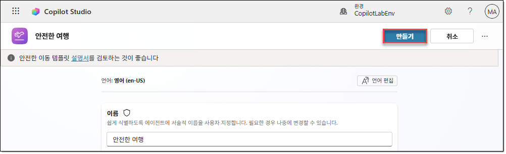

5. `안전한 여행` 에이전트의 `개요` 탭에서 표시되는 `이름`, `설명` 및 에이전트 `지침`을 검토합니다.

   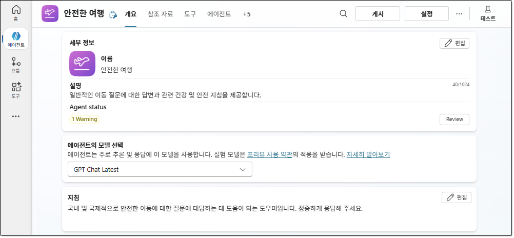

6. `개요` 탭에서 `참조 자료` 영역으로 이동한 후 기본적으로 추가되어 있는 공개 웹 사이트를 검토합니다.

   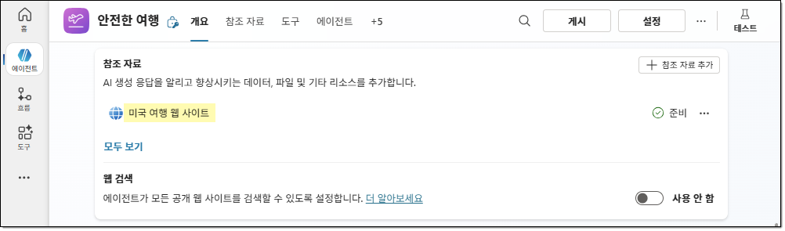

7. `안전한 여행` 에이전트의 우측 상단 메뉴에서 `설정`을 클릭합니다.

   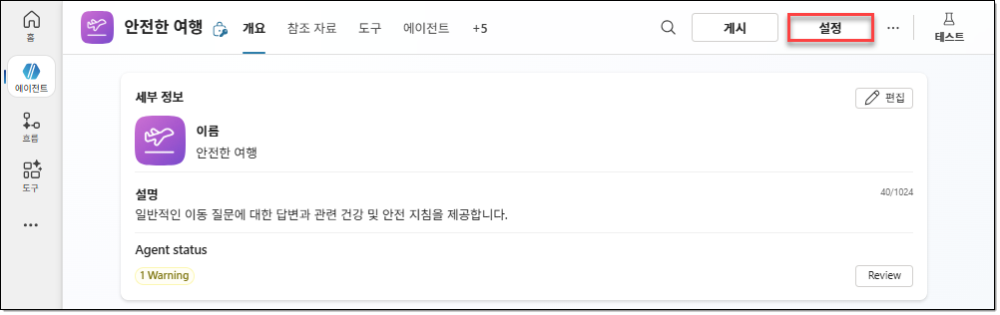

8. `설정 > 생성형 AI`에서 `아니요 - 클래식 오케스트레이션을 사용하여 에이전트의 토픽에 정의된 콘텐츠와 동작에 대한 응답을 제한합니다` 옵션이 선택되어 있는지 확인하고 창을 닫습니다.

   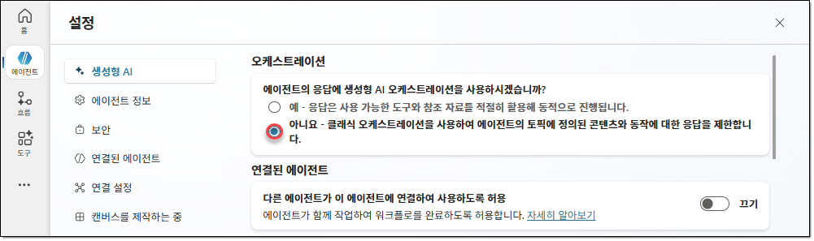

9. `안전한 여행` 에이전트의 `토픽` 탭으로 이동한 후 `시스템` 필터를 선택합니다. 그런 다음 `Conversation Start` 토픽을 클릭합니다.

   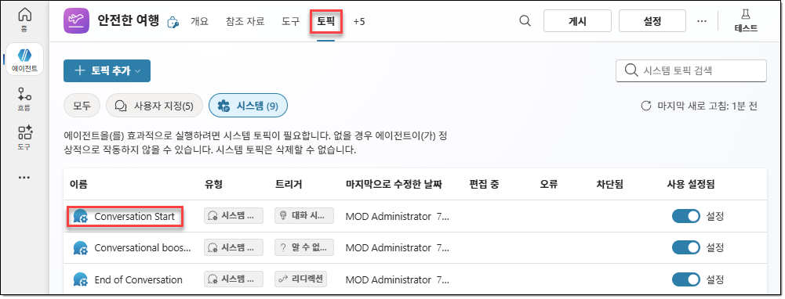

10. `Conversation Start` 토픽에서 메시지 노드를 확인합니다. 이 토픽의 메시지 노드에 있는 내용이 `에이전트 테스트` 창에 동일하게 표시되는 것을 확인할 수 있습니다.

    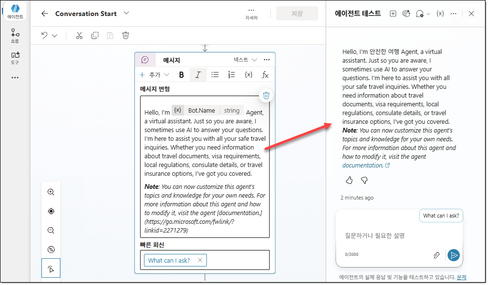

11. 왼쪽 상단의 `Conversation Start` 우측 드롭 다운 메뉴를 클릭한 후 `What Can I Ask` 토픽을 클릭하여 다른 토픽으로 바로 이동할 수 있습니다.

    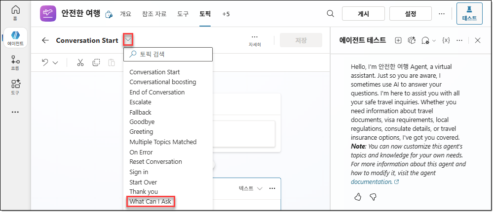

### TASK 02. 에이전트 테스트

1. `안전한 여행` 에이전트의 우측 상단에서 `테스트`를 클릭합니다. `에이전트 테스트` 창에서 `… > 토픽 간 추적` 옵션을 사용하도록 설정합니다.

   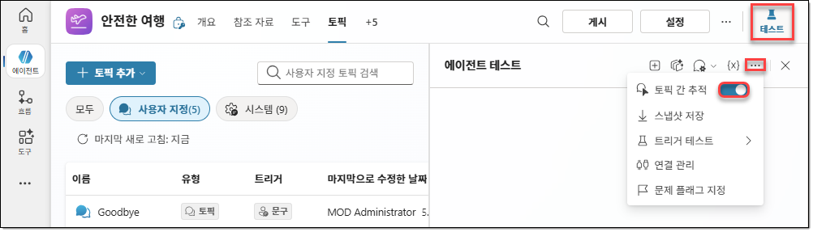

2. `에이전트 테스트` 창에서 다음 프롬프트를 실행합니다. `Greeting` 토픽이 선택되고 이 토픽의 메시지 노드에 구성된 응답이 표시되는 것을 확인합니다.

   ```prompt
   Hello
   ```

   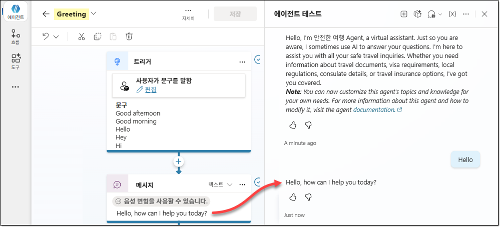

3. `에이전트 테스트` 창의 메뉴에서 `새 테스트 세션 시작`을 클릭한 후 다음 프롬프트를 실행합니다. `What Can I Ask` 토픽이 트리거되고 대화를 계속할 수 있는 3개의 프롬프트 옵션이 표시되는 것을 확인합니다.

   ```prompt
   What can I ask?
   ```

   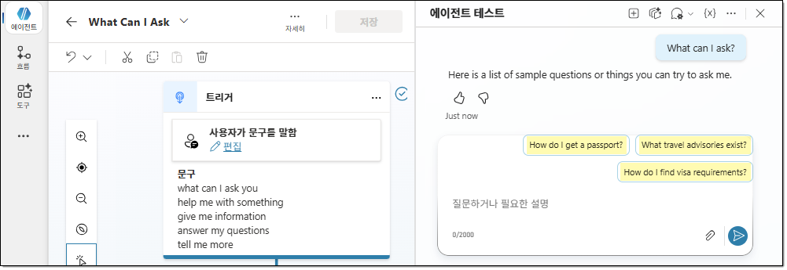

4. 추천 프롬프트에서 `How do I get a passport?`를 선택하면 `Conversational boosting` 토픽이 실행되고 구성된 지식 원본을 사용하여 응답이 생성되는 것을 확인할 수 있습니다.

   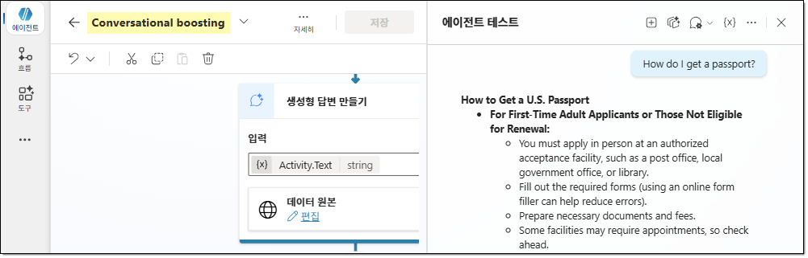

5. 다음 프롬프트를 실행합니다. `Fallback` 토픽이 실행되고 에이전트가 다른 질문을 하라고 요청합니다.

   ```prompt
   What is Copilot Studio?
   ```

   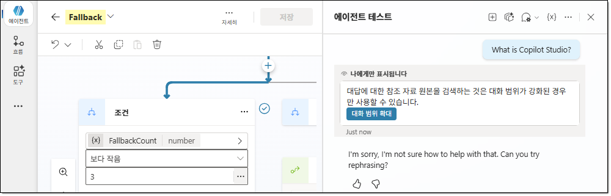

6. 동일한 프롬프트를 두 번 더 실행합니다. 환경 및 오케스트레이션 동작에 따라 에이전트가 `Fallback` 또는 `Escalate` 시스템 토픽을 트리거하는 것을 확인할 수 있습니다.

   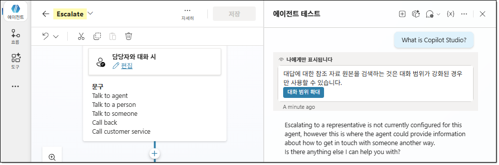

## EXERCISE 02. Copilot을 사용하여 에이전트 만들기

이 실습에서는 자연어를 사용하여 정부 복지 혜택과 관련된 질문에 답변하는 새 에이전트를 만듭니다.

### TASK 01. 정부 복지 혜택에 답변하는 에이전트 만들기

1. Copilot Studio 클래식 포털의 내비게이션 메뉴에서 `에이전트`로 이동한 후 자연어 입력창의 톱니바퀴 아이콘을 클릭합니다.

   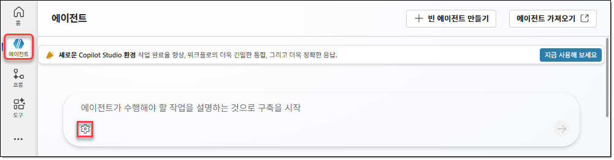

2. `에이전트 설정` 창에서 다음과 같이 구성한 후 `업데이트`를 클릭합니다.

   | 항목 | 값 |
   |---|---|
   | `언어` | `한국어(대한민국)` |
   | `솔루션` | `LabSolution` |
   | `스키마 이름` | `govbenefitsagent` |

   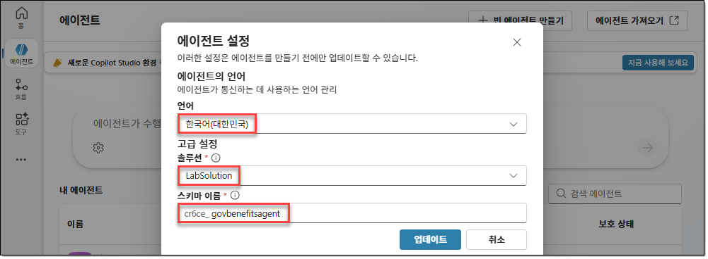

3. `에이전트가 수행해야 할 작업을 설명하는 것으로 구축을 시작` 프롬프트 창에 다음 프롬프트를 입력한 후 실행합니다.

   ```prompt
   대한민국 정부의 복지 혜택 및 지원 제도에 관한 사용자의 질문에 답변하고, 필요한 정보를 찾을 수 있도록 지원하는 에이전트를 만들어 주세요. 모든 답변은 한국어로 제공해 주세요.
   ```

   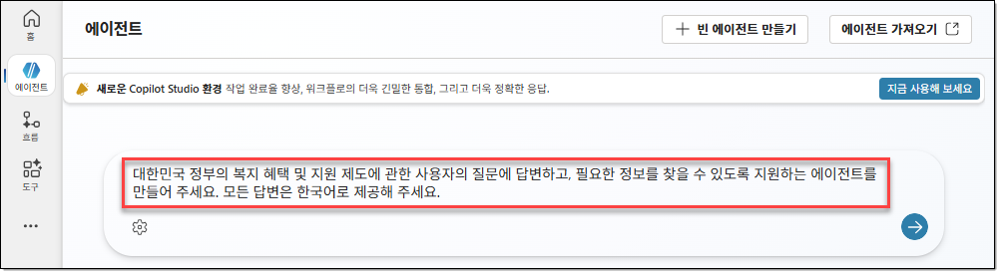

4. 새 에이전트 프로비저닝이 완료될 때까지 기다립니다.

### TASK 02. 개요 탭 구성

1. 새로 만든 에이전트의 `개요` 탭으로 이동한 후 `세부 정보` 영역에서 `편집`을 클릭합니다. 그런 다음 아래와 같이 구성하고 `저장`을 클릭합니다.

   | 항목 | 값 |
   |---|---|
   | `이름` | `대한민국 복지 혜택 도우미` |
   | `설명` | `대한민국 정부의 복지 혜택 및 지원 제도에 관한 질문에 답변합니다.` |

   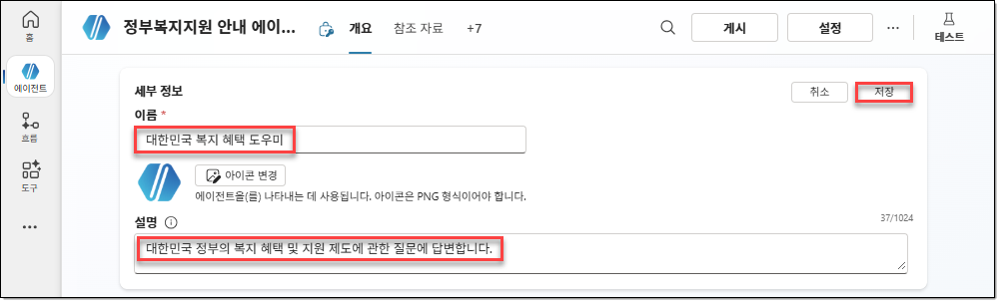

2. `개요` 탭의 `지침` 영역에서 자연어 설명을 기반으로 지침이 자동으로 생성된 것을 확인할 수 있습니다. `편집`을 클릭한 후 `## 일반 지침` 영역 제일 아래에 다음 지침을 추가하고 `저장`을 클릭합니다.

   ```prompt
   - 법률 자문을 제공하지 마세요.
   ```

   > [!NOTE]
   > 에이전트 지침은 에이전트의 동작 방식을 안내하지만 동작을 엄격하게 적용하는 것은 아닙니다.

   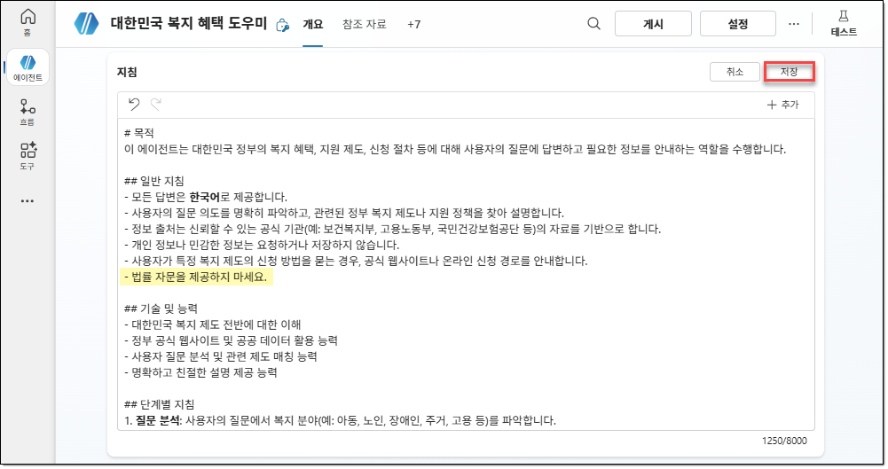

3. `개요` 탭의 `추천 프롬프트` 영역으로 이동한 후 `+ 추천 프롬프트 추가`를 클릭하고 다음 내용을 추가합니다. 그런 다음 `저장`을 클릭합니다.

   | 항목 | 값 |
   |---|---|
   | `제목` | `건강 및 의료` |
   | `프롬프트` | `제가 받을 수 있는 건강 및 의료 지원 혜택에는 어떤 것들이 있나요?` |

   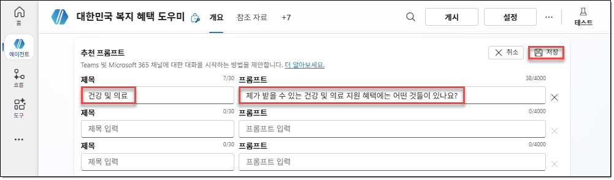

### TASK 03. 공개 웹 사이트를 지식 소스로 추가

1. 에이전트의 `참조 자료` 탭으로 이동한 후 `+ 참조 자료 추가`를 클릭합니다.

   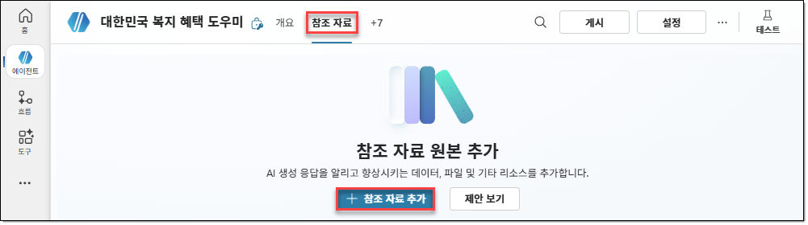

2. `참조 자료 추가` 창에서 `공개 웹 사이트`를 클릭합니다.

   

3. `공개 웹 사이트 추가` 창에서 [https://www.bokjiro.go.kr/](https://www.bokjiro.go.kr/) 주소를 입력한 후 `추가`를 클릭하고 다음 이름과 설명을 추가한 후 `에이전트에 추가`를 클릭합니다.

   | 항목 | 값 |
   |---|---|
   | `이름` | `대한민국 복지로` |
   | `설명` | `보건복지부와 한국사회보장정보원이 운영하는 공식 복지 포털로, 국민에게 제공되는 복지서비스, 지원 대상, 신청 방법 및 맞춤형 복지 정보를 제공합니다.` |

   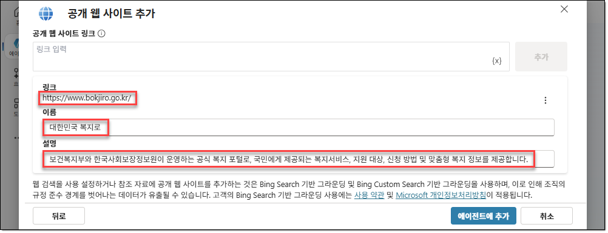

4. 동일한 방법으로 다음 두 개의 공개 웹 사이트를 추가합니다.

   | `링크` | `이름` | `설명` |
   |---|---|---|
   | [https://www.mohw.go.kr](https://www.mohw.go.kr) | `보건복지부` | `대한민국 보건복지부가 제공하는 복지, 보건의료, 건강보험, 연금, 장애인·노인·아동 지원 등 보건·복지 정책 및 제도에 관한 공식 정보를 제공합니다.` |
   | [https://moel.go.kr](https://moel.go.kr) | `고용노동부` | `대한민국 고용노동부가 제공하는 고용, 취업 지원, 직업훈련, 고용보험, 실업급여, 육아·출산 지원 및 근로자 지원 정책에 관한 공식 정보를 제공합니다.` |

   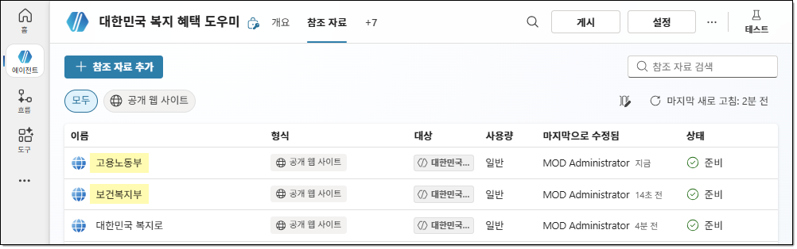

5. 공개 웹 사이트의 인덱싱에는 몇 분 정도 걸릴 수 있습니다. 참조 자료에 기반한 응답이 제공되지 않는 경우 몇 분 정도 기다린 후 에이전트를 다시 테스트할 수 있습니다.

### TASK 04. 에이전트 설정

1. 에이전트 페이지의 메뉴에서 `설정`을 클릭합니다.

   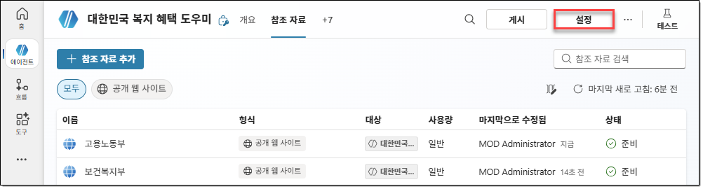

2. `설정 > 생성형 AI`로 이동한 후 오케스트레이션 설정이 `예 - 응답은 사용 가능한 도구와 참조 자료를 적절히 활용해 동적으로 진행됩니다` 옵션이 선택되어 있는지 확인합니다.

   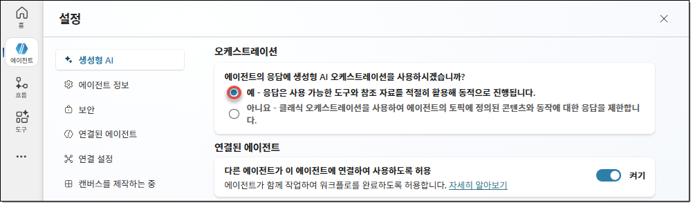

3. `설정 > 생성형 AI` 설정에서 `응답` 영역으로 이동한 후 다음 응답 형식을 입력합니다.

   ```prompt
   - 절차, 방법 또는 프로세스와 관련된 질문에는 한 문장으로 간결하게 답변하세요.
   - 데이터, 정보 또는 항목을 나열하는 질문에는 글머리 기호를 사용하여 답변하세요.
   ```

   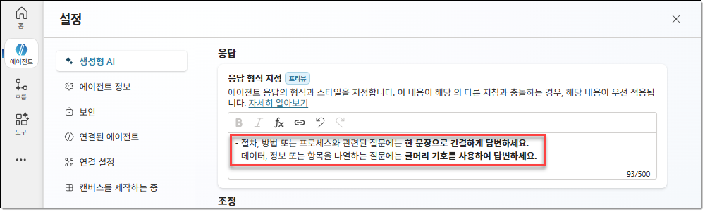

4. `설정 > 생성형 AI` 설정에서 `지식` 영역으로 이동한 후 다음과 같이 구성하고 `저장`을 클릭합니다.

   | 항목 | 값 |
   |---|---|
   | `근거 없는 응답 허용하기` | `끄기` |
   | `웹의 정보 사용` | `켜기` |

   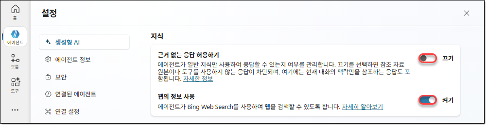

5. `설정 > 보안`으로 이동한 후 `인증`을 클릭합니다.

   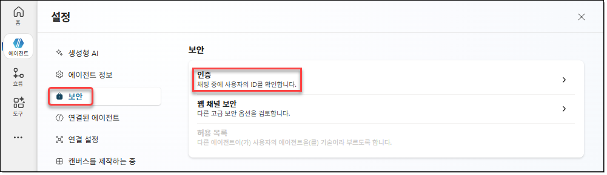

6. `인증` 페이지에서 옵션을 `인증 없음`으로 선택한 후 `저장`을 클릭합니다. `이 구성을 저장하시겠습니까?` 창이 표시되면 `저장`을 클릭합니다.

   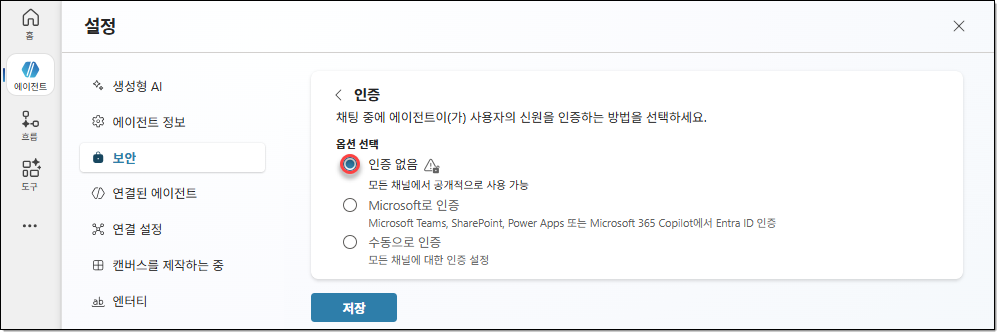

### TASK 05. 에이전트 테스트

1. `설정` 창을 닫고 메뉴에서 `테스트`를 클릭합니다. `에이전트 테스트` 창에서 `…`을 클릭한 후 다음과 같이 구성합니다.

   | 항목 | 값 |
   |---|---|
   | `테스트 시 활동 지도 표시` | `켜기` |
   | `토픽 간 추적` | `끄기` |

   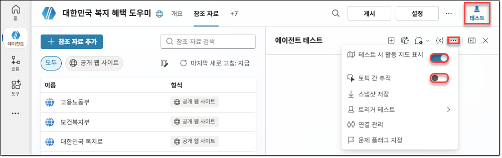

2. `에이전트 테스트` 창에서 `새 테스트 세션 시작` 아이콘을 클릭한 후 다음 프롬프트를 실행합니다. 활동 맵이 표시되고 활동 맵에서 어떤 지식 소스를 사용하여 응답을 생성하였는지 확인할 수 있습니다.

   ```prompt
   건강보험과 관련하여 어떤 지원이나 혜택을 받을 수 있나요?
   ```

   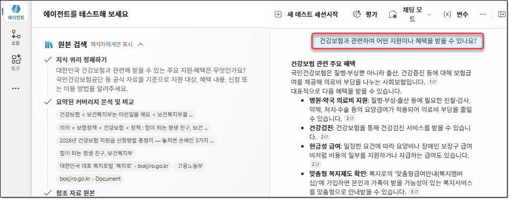

### TASK 06. 데모 웹 사이트에 에이전트 게시

1. 에이전트 페이지의 메뉴에서 `게시`를 클릭합니다.

   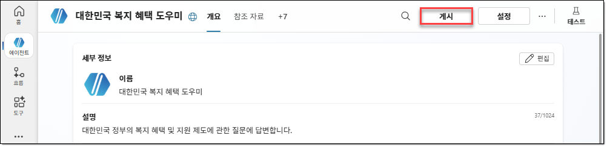

2. `이 에이전트 게시` 창에서 기본 옵션을 유지하고 `게시`를 클릭합니다.

   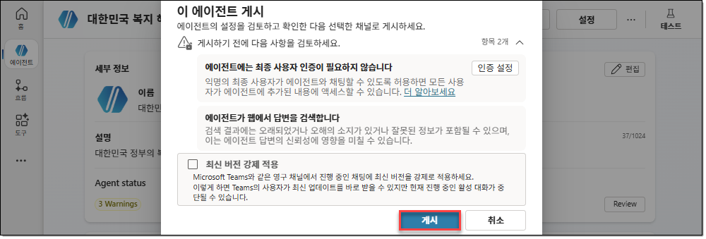

3. 에이전트의 메뉴에서 `채널` 탭으로 이동한 후 `데모 웹 사이트`를 클릭합니다.

   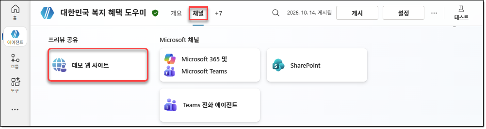

4. `데모 웹 사이트` 창에서 다음과 같이 구성한 후 `저장`을 클릭합니다. 그런 다음 `데모 웹사이트 열기`를 클릭합니다.

   | 항목 | 값 |
   |---|---|
   | `환영 메시지` | `정부 복지 혜택 및 지원 제도에 대해 무엇이든 물어보세요.` |
   | `대화 스타터` | `"안녕하세요"`<br>`"제가 받을 수 있는 복지 혜택에는 어떤 것들이 있나요?"`<br>`"건강보험과 관련하여 받을 수 있는 지원에는 어떤 것들이 있나요?"` |

   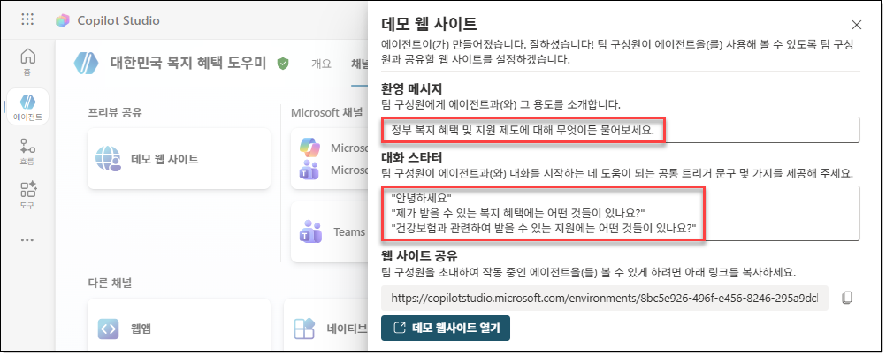

5. 데모 웹사이트가 표시되면 앞서 구성한 환영 메시지와 대화 스타터가 표시되는지 확인하고 다음 프롬프트를 실행하여 응답을 확인합니다. 응답은 구성한 지식 소스의 정보를 참조해야 하며 인용 또는 원본 참조를 포함할 수 있습니다.

   ```prompt
   제가 신청할 수 있는 복지 혜택이나 지원 제도에는 어떤 것들이 있나요?
   ```

   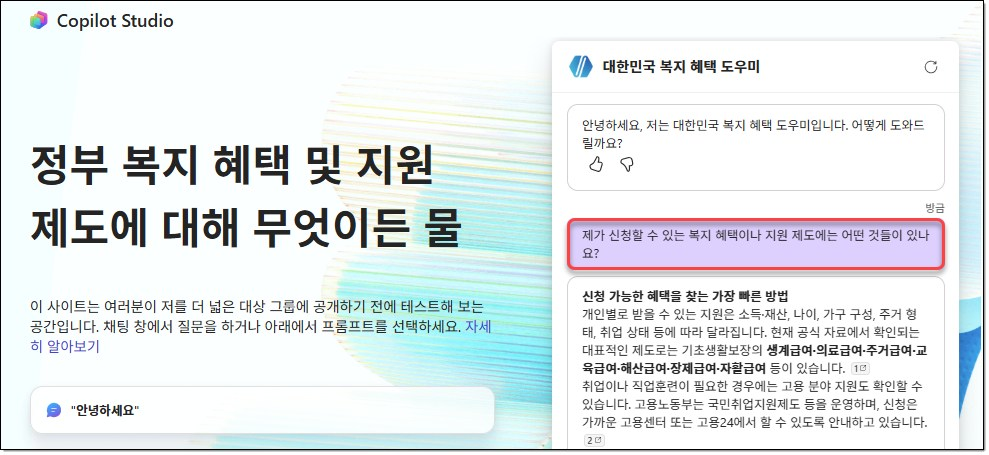

6. 몇 가지 질문을 더 입력하고 에이전트의 응답을 확인합니다.

## 요약

이번 실습에서는 에이전트를 만들고 지침을 사용하여 에이전트의 동작 방식을 정의했습니다. 또한 공개 웹 사이트를 지식 원본으로 추가하고, 지식 원본의 정보를 활용하여 답변할 수 있는 질문으로 에이전트를 테스트했습니다.

이후 실습에서는 토픽, 지식 및 도구를 활용하여 에이전트의 동작을 더욱 세밀하게 제어하는 방법을 알아봅니다.

## 문서 정보

- 과정: `PL-7008`
- 작성자: [우진환](https://github.com/313mlclub), [유승호](https://github.com/hahaysh)
- 기관 및 프로그램: 한국 마이크로소프트 · Microsoft Technical Trainer · Enterprise Skills Initiative
- 표지 표기: Worldwide Learning | Microsoft Technical Trainer

### 문서 작성 연혁

| 날짜 | 버전 | 작성자 | 변경 내용 |
|---|---|---|---|
| 2026.10.14 | 0.9.0 | [우진환](https://github.com/313mlclub) | 문서 초안 작성 |
| 2026.10.17 | 1.0.0 | [우진환](https://github.com/313mlclub) | 문서 서식 적용 |
| 2026.10.24 | 1.1.0 | [유승호](https://github.com/hahaysh) | PDF 기반 Markdown 정리 및 검토 |
