---
---

# LAB 02. Copilot Studio 에이전트에서 토픽 관리

## 시나리오

이 실습에서는 다음 작업을 수행합니다.

- 에이전트 만들기
- 기존 토픽 관리
- Copilot을 사용하여 토픽 만들기 및 편집
- 변수 범위 구성
- 수동으로 토픽 만들기
- 노드 만들기 및 편집
- 에이전트 테스트

이 실습을 완료하는 데 약 **45분**이 소요됩니다.

## 핵심 개념 − 에이전트 구성 요소 및 동작

생성형 오케스트레이션을 사용하도록 설정하면 에이전트가 지침, 지식, 토픽 및 도구를 사용하여 응답을 동적으로 생성할 수 있습니다.

토픽은 특히 다음 작업이 필요한 경우에 유용합니다.

- 필수 정보를 단계별로 수집
- 질문 순서 제어
- 변수에 응답 저장
- 예측 가능한 결과 보장

## EXERCISE 01. 에이전트 만들기

이 실습에서는 자연어를 사용하여 보험 청구 검토를 지원하는 새 에이전트를 만듭니다.

1. Copilot Studio 클래식 포털의 내비게이션 메뉴에서 `에이전트`로 이동한 후 `에이전트가 수행해야 할 작업을 설명하는 것으로 구축을 시작` 영역의 톱니바퀴 아이콘을 클릭합니다.

   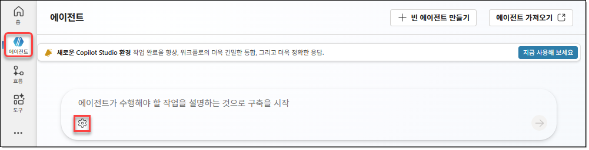

2. `에이전트 설정` 창에서 다음과 같이 구성한 후 `업데이트`를 클릭합니다.

   | 항목 | 값 |
   |---|---|
   | `언어` | `한국어(대한민국)` |
   | `솔루션` | `LabSolution` |
   | `스키마 이름` | `insuranceagent` |

   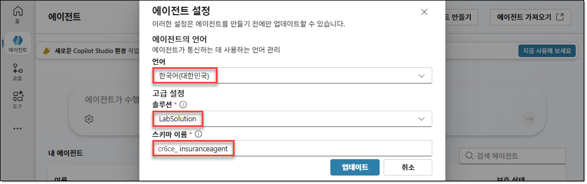

3. 다음 프롬프트를 입력하고 제출하여 새 에이전트를 만듭니다. 에이전트 프로비저닝이 완료되면 에이전트 구성을 계속할 수 있습니다.

   ```prompt
   보험금 청구 건을 검토하고, 손해 평가 세부 정보와 수리 견적을 확인하여 보험금 청구 검토를 지원하는 에이전트를 만들어 주세요.
   ```

   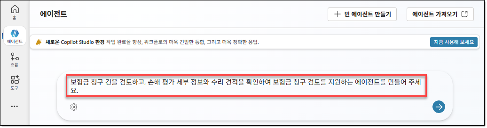

## EXERCISE 02. 토픽 관리

이 실습에서는 에이전트가 대화를 인계할 인간 상담원을 제공하지 않기 때문에 에스컬레이션 시스템 토픽을 비활성화합니다. 사용하지 않는 시스템 토픽을 비활성화하면 생성형 오케스트레이션이 사용자 요청에 어떻게 응답할지 결정하는 과정에서 발생할 수 있는 모호성을 줄일 수 있습니다.

1. 에이전트의 `토픽` 탭으로 이동한 후 `시스템` 토픽으로 필터링합니다.

   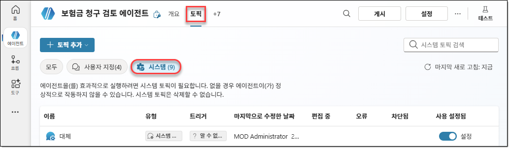

2. `에스컬레이션` 토픽을 `끄기`로 설정합니다.

   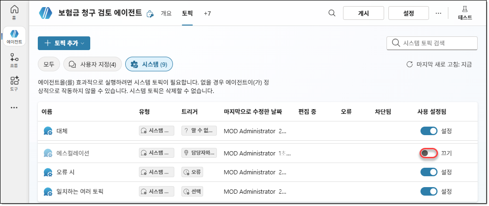

## EXERCISE 03. 자연어로 토픽 만들기

이 실습에서는 Copilot을 사용하여 설명을 기반으로 토픽을 만듭니다. 생성형 AI가 토픽의 초기 구조를 자동으로 작성하도록 하고 이후 필요에 따라 해당 구조를 수정하고 개선할 수 있습니다.

### TASK 01. 설명으로 토픽 추가

1. 에이전트의 `토픽` 탭에서 `+ 토픽 추가 > Copilot을 사용하여 설명에서 추가`를 클릭합니다.

   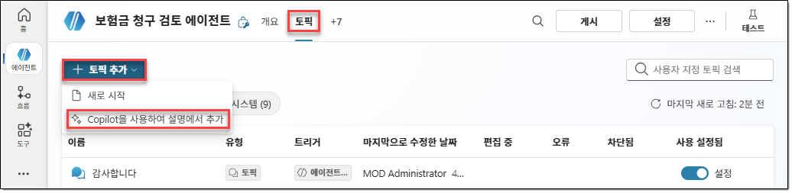

2. `Copilot을 사용하여 설명에서 추가` 창에서 다음과 같이 구성한 후 `만들기`를 클릭합니다.

   | 항목 | 값 |
   |---|---|
   | `토픽 이름 지정` | `고객 세부 정보` |
   | `에 대한 토픽 만들기` | `고객에게 이름과 이메일 주소를 입력해 달라고 요청합니다.` |

   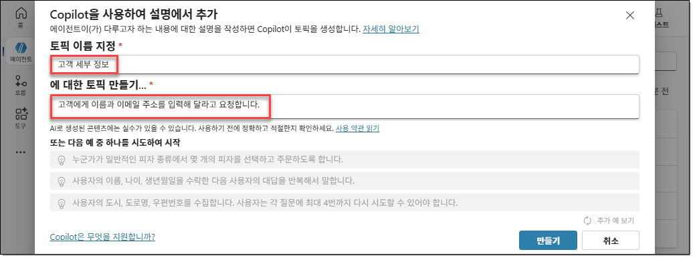

3. 새로운 토픽이 생성된 것을 확인하고 `저장`을 클릭합니다.

   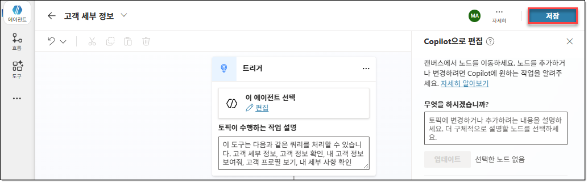

### TASK 02. 자연어를 사용하여 노드 편집

1. `고객 세부 정보` 토픽에서 이메일 주소를 묻는 노드를 선택합니다. `Copilot으로 편집` 창에서 `1개 노드 선택됨`이 표시되는지 확인하고 다음 프롬프트를 입력한 후 `업데이트`를 클릭합니다.

   ```prompt
   - 선택한 기존 질문 노드를 수정하세요.
   - 새 노드를 추가하지 마세요.
   - 현재 질문 텍스트만 수정하여, 이전 노드에서 저장한 Name 변수를 사용해 사용자에게 감사 인사를 한 다음 이메일 주소를 요청하도록 변경하세요.
   - 기존 이메일 응답 저장 변수와 나머지 노드 설정은 변경하지 마세요.
   ```

   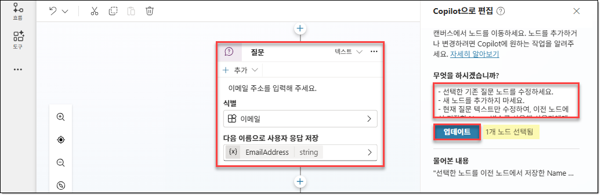

2. 기존 질문 노드가 아래와 유사하게 변경된 것을 확인합니다. 업데이트된 메시지는 이전 질문 노드에서 수집한 `Name` 변수를 참조해야 합니다. `저장`을 클릭합니다.

   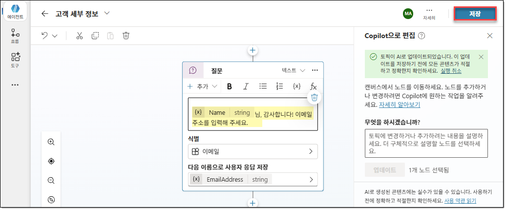

### TASK 03. 자연어를 사용하여 적응형 카드 노드 추가

기존 노드를 수정하는 것 외에도 Copilot을 사용하여 새 노드를 추가할 수 있습니다.

1. 작성 캔버스에서 빈 공간을 선택합니다. `Copilot으로 편집` 창에서 `선택한 노드 없음`이 표시되는지 확인하고 다음 프롬프트를 입력한 후 `업데이트`를 클릭합니다.

   ```prompt
   지금까지 수집한 정보를 요약하여 적응형 카드로 표시해주세요.
   ```

   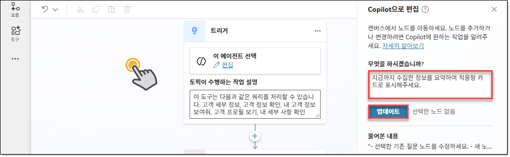

2. 토픽의 제일 아래에 새로운 노드가 추가된 것을 확인할 수 있습니다. 적응형 카드에서 `미디어` 상자를 선택하면 우측에 `적응형 카드 속성`이 표시됩니다. 적응형 카드의 기존 `수식 카드` 내용을 모두 삭제하고 다음 수식을 입력합니다.

   ```powerfx
   {
       type: "AdaptiveCard",
       body: [
           {
               type: "TextBlock",
               size: "Medium",
               weight: "Bolder",
               text: "📋 요약 정보"
           },
           {
               type: "FactSet",
               facts: [
                   {
                       title: "👤 이름",
                       value: Text(Topic.Name)
                   },
                   {
                       title: "📧 이메일 주소",
                       value: Text(Topic.EmailAddress)
                   }
               ]
           },
           {
               type: "TextBlock",
               text: "🙏 필요한 정보를 제공해 주셔서 감사합니다."
           }
       ]
   }
   ```

   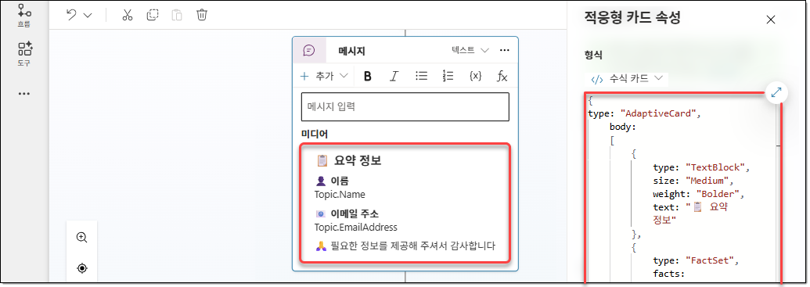

### TASK 04. 자연어를 사용하여 질문 노드 추가

1. 토픽의 작성 캔버스에서 빈 공간을 클릭한 후 `Copilot으로 편집` 창에서 `선택한 노드 없음`이 표시되는지 확인합니다. 다음 프롬프트를 입력하고 `업데이트`를 클릭합니다.

   ```prompt
   - 사용자에게 입력한 정보가 올바른지 확인하는 새로운 객관식 질문 노드를 추가해주세요.
   - 선택지는 "예"와 "아니요" 두 가지로 구성해주세요.
   ```

   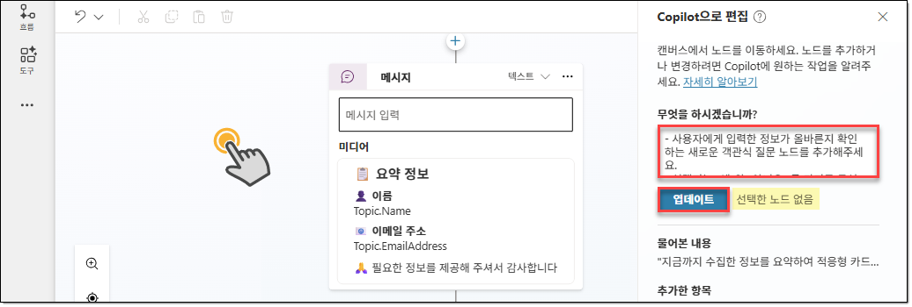

2. 새로운 질문 노드가 추가된 것을 확인하고 `저장`을 클릭합니다.

   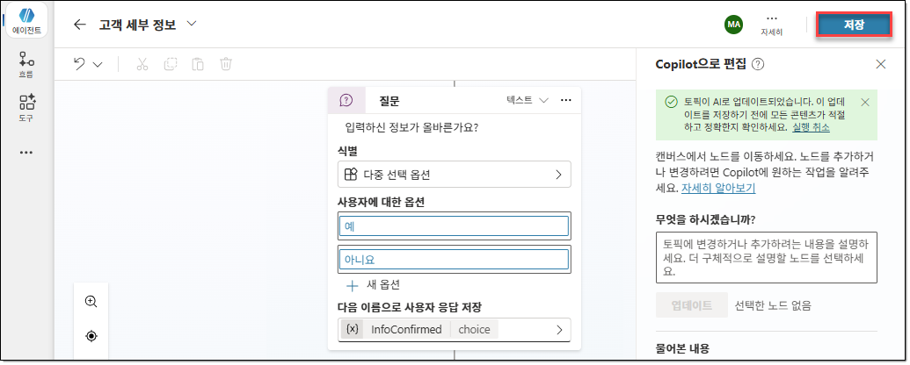

## EXERCISE 04. 변수 범위

이 실습에서는 토픽에서 만든 변수를 다른 토픽에서 액세스할 수 있도록 설정합니다.

1. `고객 세부 정보` 토픽의 메뉴에서 `변수`를 클릭합니다.

   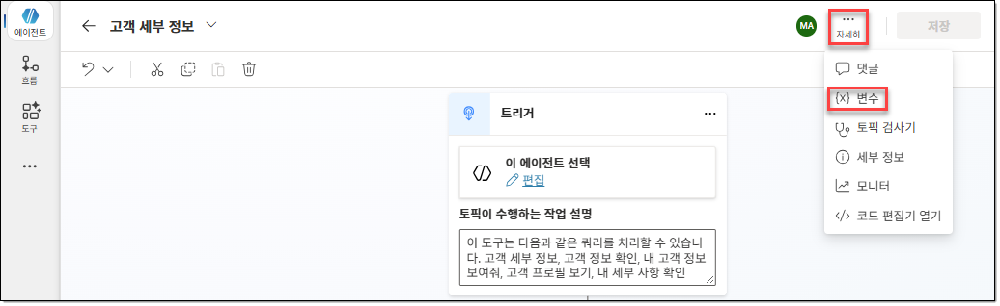

2. `변수` 창의 `찾아보기` 탭에서 `토픽` 변수를 확장합니다. 그런 다음 `원본 토픽으로 값 반환` 옵션을 모두 선택합니다. 이 옵션을 선택하면 현재 토픽의 변수값을 다른 토픽에서 사용할 수 있습니다. `저장`을 클릭합니다.

   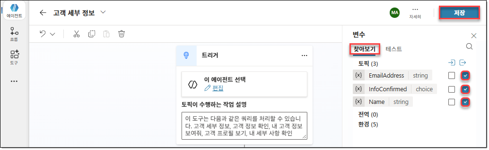

## EXERCISE 05. 빈 토픽 만들기

### TASK 01. 빈 토픽 만들기

1. 에이전트의 `토픽` 탭으로 이동한 후 `+ 토픽 추가 > 새로 시작`을 클릭합니다.

   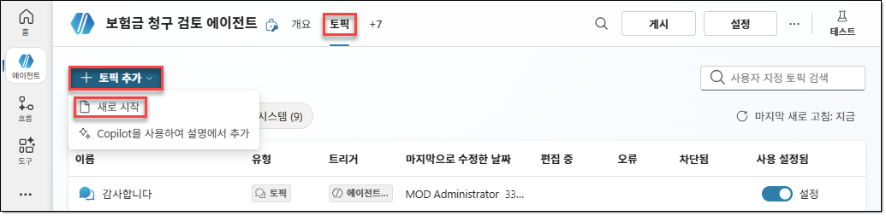

2. 새로 만든 토픽의 메뉴에서 `트리거` 노드가 `이 에이전트 선택`으로 표시되는지 확인합니다. 트리거가 `이 에이전트 선택`으로 표시되면 생성형 오케스트레이션을 사용하도록 설정된 것을 의미합니다. 메뉴에서 `세부 정보`를 클릭합니다.

   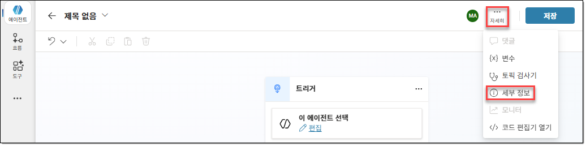

3. `토픽 세부 정보` 창의 `토픽 세부 정보` 탭에서 다음과 같이 구성한 후 `저장`을 클릭합니다. `이름`에 값을 입력하면 `모델 표시 이름`은 자동으로 채워집니다.

   | 항목 | 값 |
   |---|---|
   | `이름` | `손해 평가 일정 예약` |
   | `모델 설명` | `보험금 청구와 관련된 손해 평가가 필요한 경우 고객과 평가 일정을 예약하기 위해 이 토픽을 사용합니다.` |

   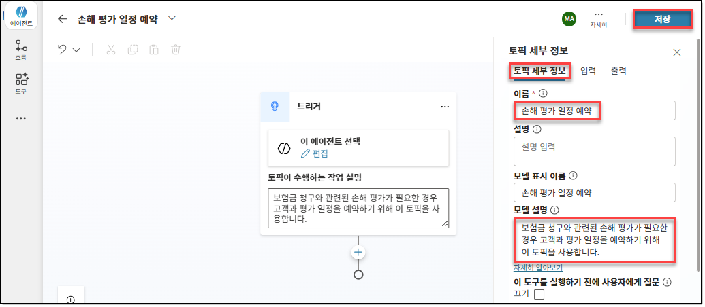

### TASK 02. 메시지 노드 추가

1. `트리거` 노드 아래의 `+` 아이콘을 클릭한 후 `메시지 보내기`를 선택합니다.

   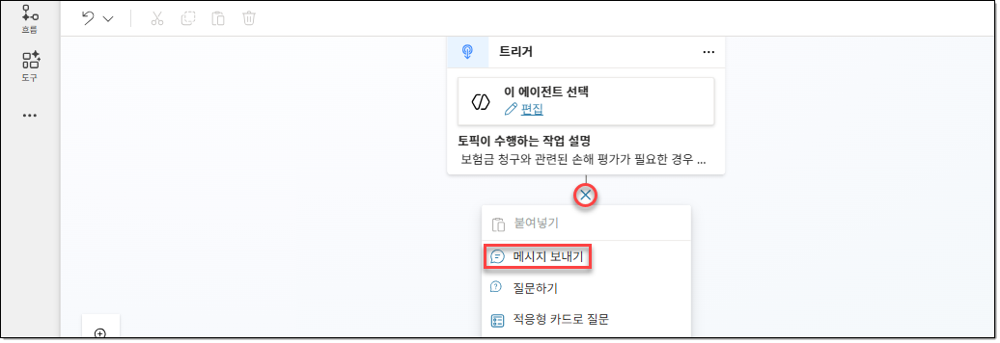

2. 추가한 메시지 노드의 `메시지 입력` 필드에 다음을 입력하고 `저장`을 클릭합니다.

   ```prompt
   안녕하세요. 보험금 청구와 관련된 손해 평가 일정을 예약할 수 있도록 도와드리겠습니다.
   ```

   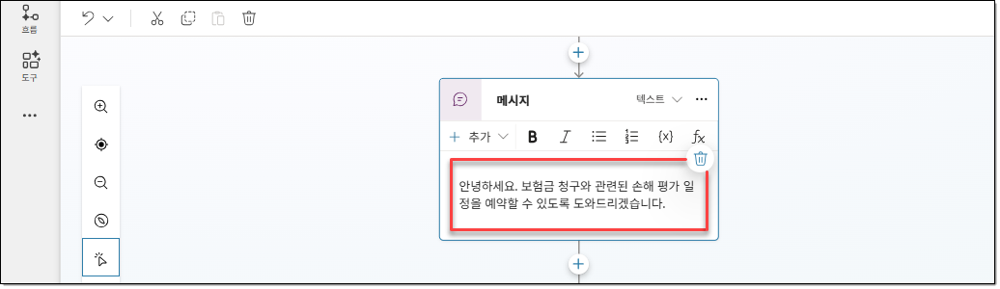

### TASK 03. 고객 세부 정보 토픽으로 라우팅

1. `메시지` 노드 아래의 `+` 아이콘을 클릭한 후 `토픽 관리 > 다른 토픽으로 이동 > 고객 세부 정보`를 선택합니다.

   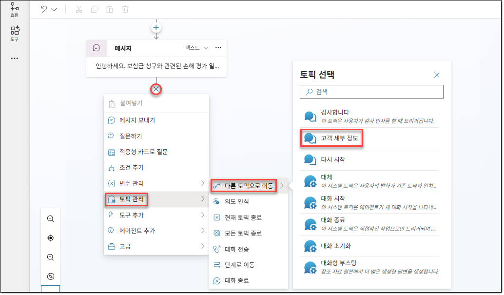

2. `고객 세부 정보` 토픽이 표시되고 이 토픽의 변수가 출력으로 표시되는 것을 확인한 후 `저장`을 클릭합니다.

   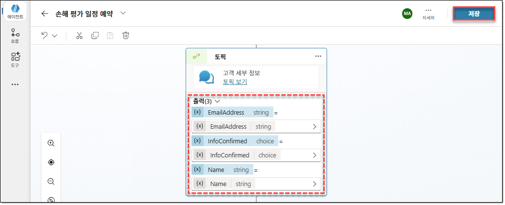

### TASK 04. 조건 노드 추가

1. `토픽` 노드 아래에서 `+ > 조건 추가`를 클릭합니다.

   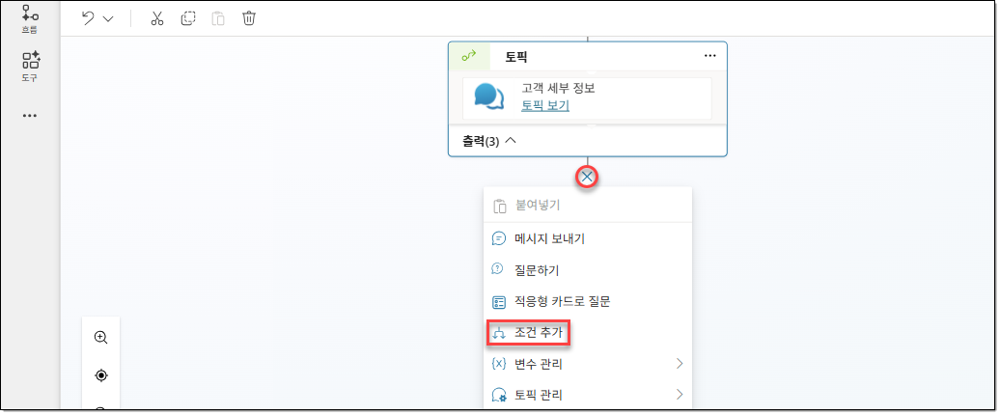

2. 추가된 `조건` 노드를 다음과 같이 구성합니다.

   | 항목 | 값 또는 작업 |
   |---|---|
   | `변수 선택` | 클릭한 후 `InfoConfirmed` 변수를 선택합니다. |
   | `조건` | `다음과 같음` |
   | `값 선택` | `예` |

   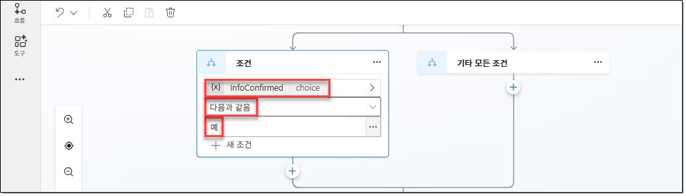

3. `기타 모든 조건` 노드는 `InfoConfirmed` 변수의 값이 `예`가 아닌 모든 경우입니다. 이 경우 사용자가 정보를 다시 입력할 수 있도록 구성해야 합니다. `기타 모든 조건` 노드 아래에서 `+ > 토픽 관리 > 단계로 이동`을 선택합니다.

   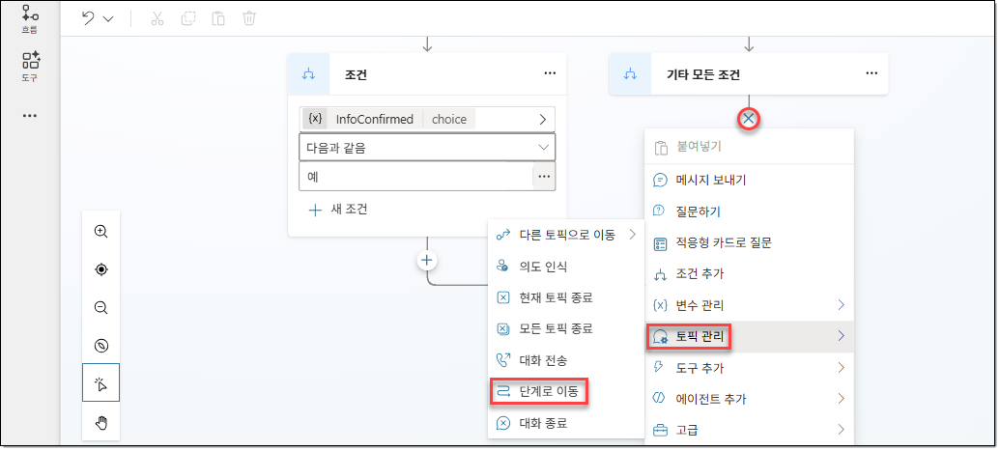

4. `대상 단계 선택` 팝업이 표시됩니다. 이 팝업이 표시되는 상태에서 캔버스를 이동하여 `토픽` 노드를 선택합니다. `토픽` 노드를 선택하면 `대상 단계 선택` 팝업창이 사라집니다.

   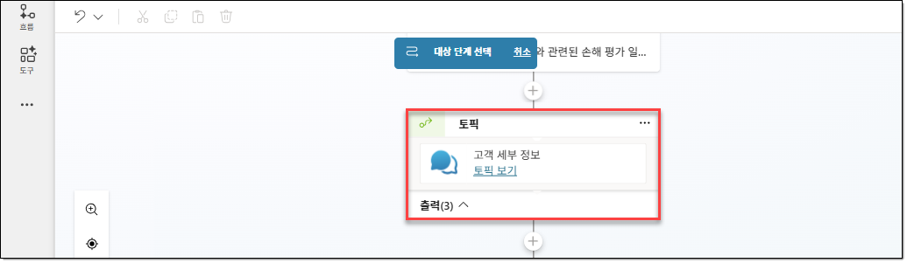

5. `기타 모든 조건`에 해당되는 경우 사용자 정보를 입력하는 노드로 리디렉션되도록 구성된 것을 확인하고 `저장`을 클릭합니다.

   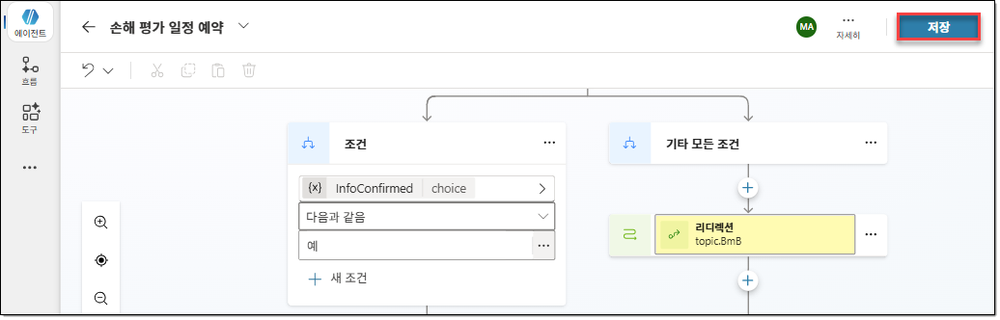

### TASK 05. 질문 노드 추가

1. `조건` 노드 아래에서 `+ > 질문하기`를 클릭합니다.

   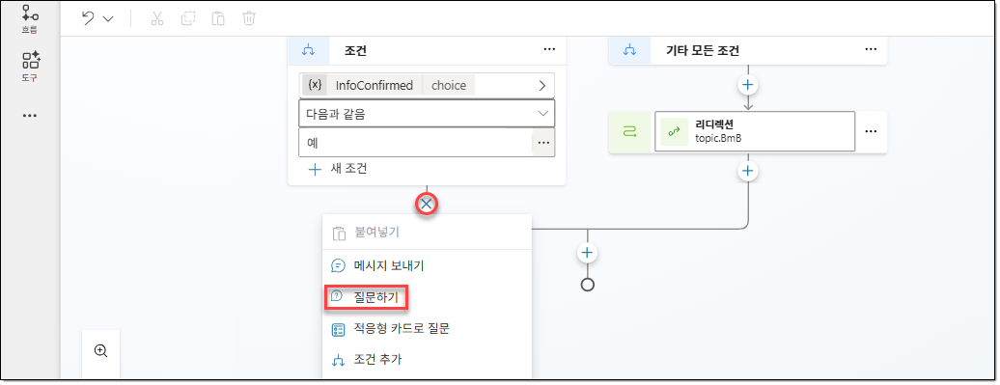

2. 추가한 질문 노드를 다음과 같이 구성합니다.

   | 항목 | 값 또는 작업 |
   |---|---|
   | `메시지 입력` | `손해 평가를 언제 예약하시겠습니까? 원하시는 날짜와 시간을 알려주세요.` |
   | `식별` | 클릭한 후 `날짜 및 시간` 엔터티를 선택합니다. |

   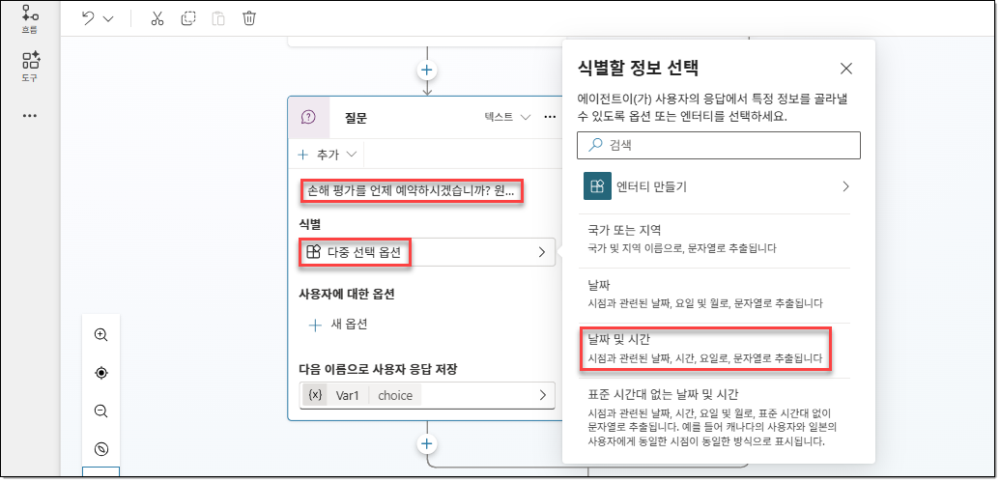

3. `질문` 노드의 `다음 이름으로 사용자 응답 저장` 영역에서 기본값으로 생성된 `Var1` 이름의 변수를 클릭합니다. `변수 속성` 창에서 `변수 이름`을 `VisitDateTime`으로 변경합니다.

   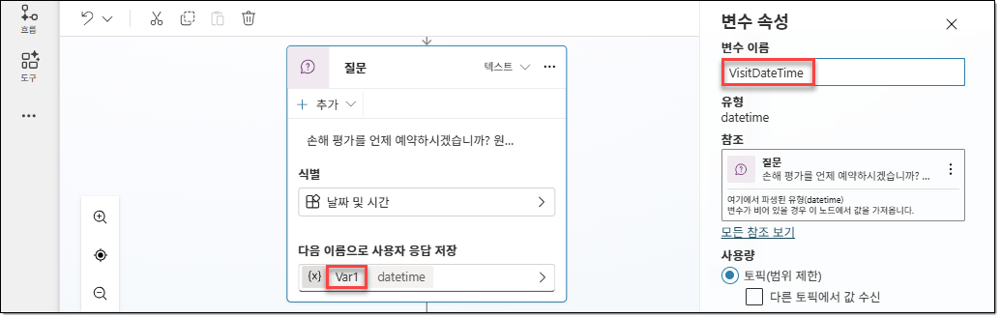

4. `질문` 노드 아래에서 `+ > 메시지 보내기`를 클릭합니다.

   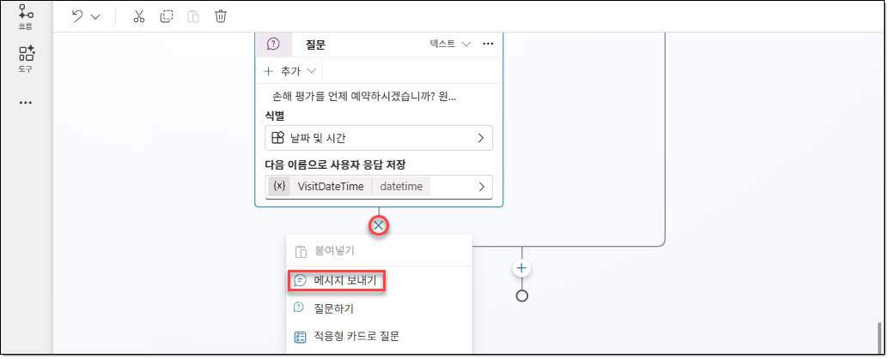

5. `메시지` 노드를 다음과 같이 구성합니다.

   | 항목 | 값 |
   |---|---|
   | `메시지 입력` | `좋습니다! 요청하신 날짜와 시간으로 손해 평가 일정을 예약하겠습니다.` |

   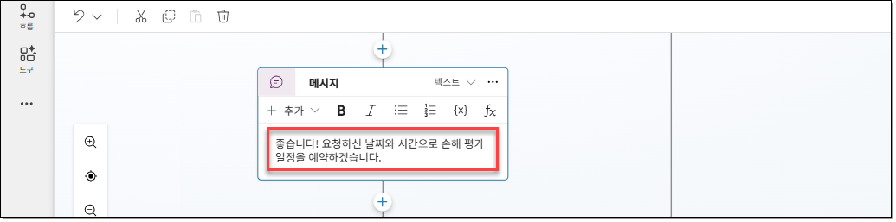

6. 노드의 제일 마지막 아래, 두 개의 노드 흐름이 합쳐진 후에 `+ > 토픽 관리 > 모든 토픽 종료`를 클릭합니다.

   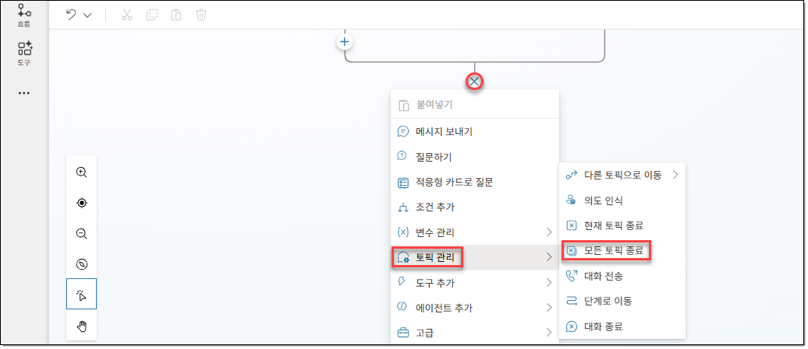

7. 다음과 같이 구성된 것을 확인하고 `저장`을 클릭합니다.

   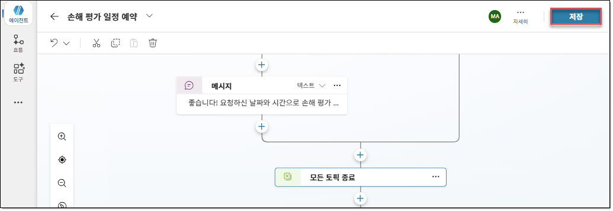

### TASK 06. 에이전트 지침 업데이트

1. 에이전트의 `개요` 탭으로 이동한 후 `지침` 영역의 `편집`을 클릭합니다.

   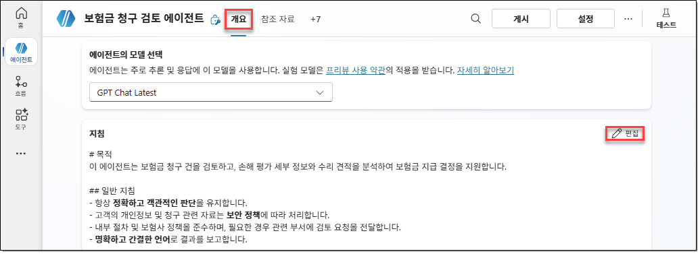

2. 지침의 `## 기술 및 역량` 영역으로 이동한 후 제일 아래에 다음 내용을 입력합니다. `<손해 평가 일정 예약>` 자리 표시자는 `/`를 입력하여 선택하거나 `+ 추가`를 클릭하여 토픽을 선택할 수 있습니다.

   ```prompt
   - 보험금 청구를 위해 손해 평가가 필요한 경우에는 <손해 평가 일정 예약> 토픽을 사용하세요.
   ```

   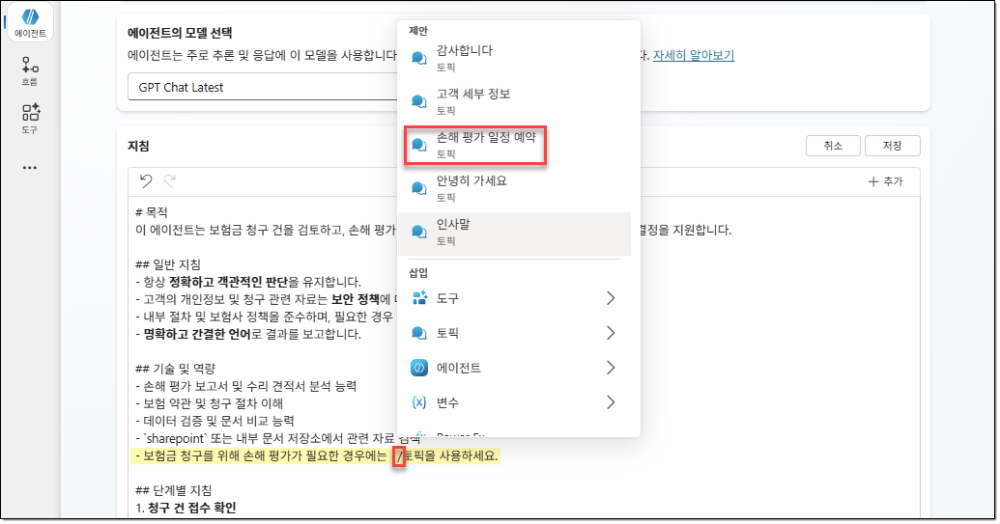

3. 지침 영역에 다음과 같이 구성된 것을 확인하고 `저장`을 클릭합니다.

   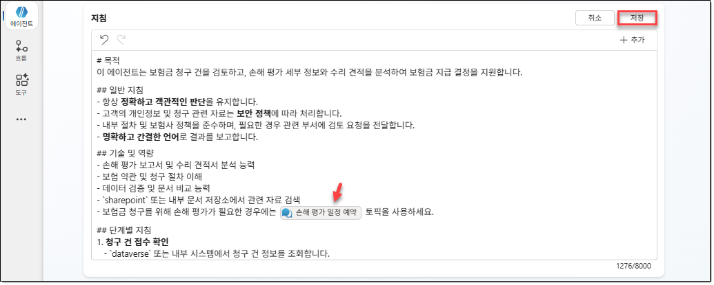

## EXERCISE 06. 에이전트 테스트

이 실습에서는 토픽 라우팅을 테스트하고 대화가 예상된 단계별 흐름을 따르는지 확인합니다.

### TASK 01. 에이전트 테스트

1. 에이전트의 메뉴에서 `테스트`를 클릭합니다. `에이전트 테스트` 창에서 `…`을 클릭한 후 다음과 같이 구성합니다.

   | 항목 | 값 |
   |---|---|
   | `테스트 시 활동 지도 표시` | `켜기` |
   | `토픽 간 추적` | `끄기` |

   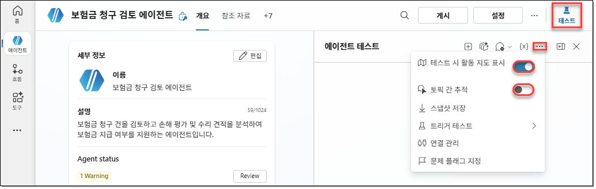

2. `에이전트 테스트` 창에서 `새 테스트 세션 시작`을 클릭한 후 다음 프롬프트를 실행합니다.

   ```prompt
   보험금 청구를 위한 손해 평가 일정을 예약하고 싶습니다.
   ```

   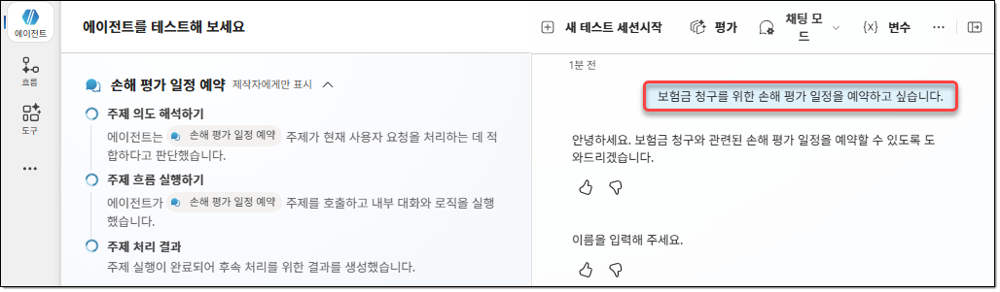

3. `손해 평가 일정 예약` 토픽에서 설정한 것처럼 `고객 세부 정보` 토픽으로 대화가 시작되는 것을 확인할 수 있습니다. 이름과 이메일 주소를 입력하고 고객 정보를 보여주는 적응형 카드가 표시되면 `예`를 선택합니다.

   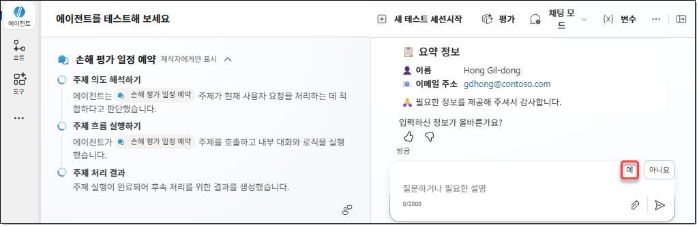

4. 토픽 구성에 따라 다시 `손해 평가 일정 예약` 토픽의 내용이 표시됩니다. 예약 일정을 묻는 질문에 적절하게 응답합니다.

   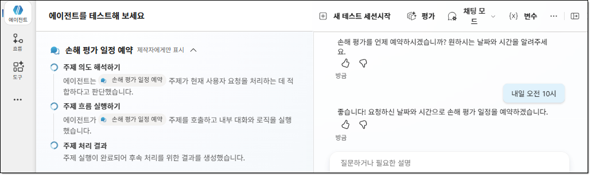

### TASK 02. 엔터티 구성

이전 테스트에서 입력했던 이름이 영어로 표시되는 것을 확인할 수 있습니다. 이를 수정하기 위해 엔터티를 구성할 수 있습니다.

1. 에이전트의 메뉴에서 `설정`을 클릭합니다.

   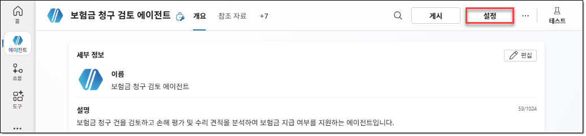

2. `설정` 페이지의 `엔터티`로 이동한 후 `+ 엔터티 추가 > 새 엔터티 만들기`를 클릭합니다.

   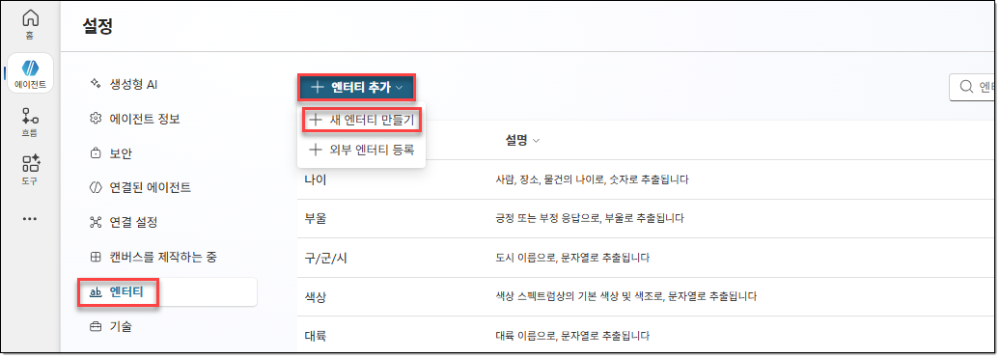

3. `엔터티 만들기` 창에서 `정규식(Regex)`를 선택합니다.

   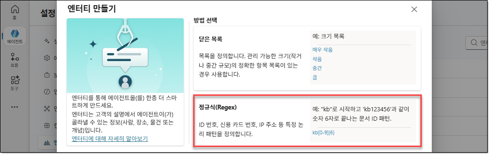

4. `이름 없는 엔터티` 창에서 다음과 같이 구성한 후 `저장`을 클릭하고 `닫기`를 클릭합니다.

   | 항목 | 값 |
   |---|---|
   | `이름` | `사용자 이름` |
   | `설명` | `한글로 입력된 사용자 이름을 인식합니다.` |
   | `패턴` | `^[가-힣]{2,4}$` |

   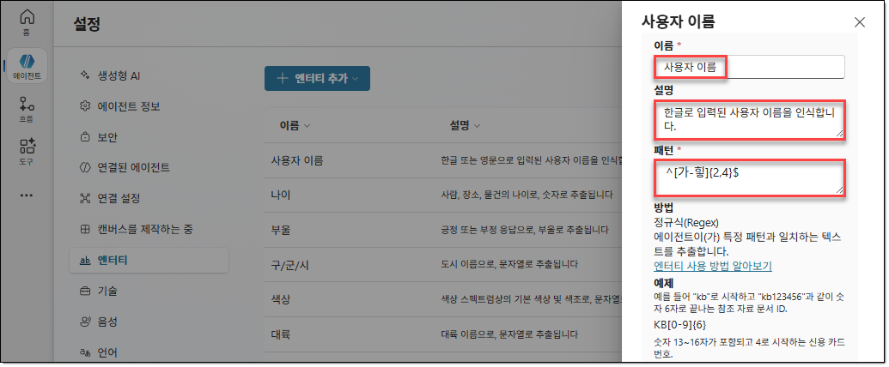

5. 에이전트의 `토픽` 탭으로 이동한 후 `고객 세부 정보` 토픽을 클릭합니다.

   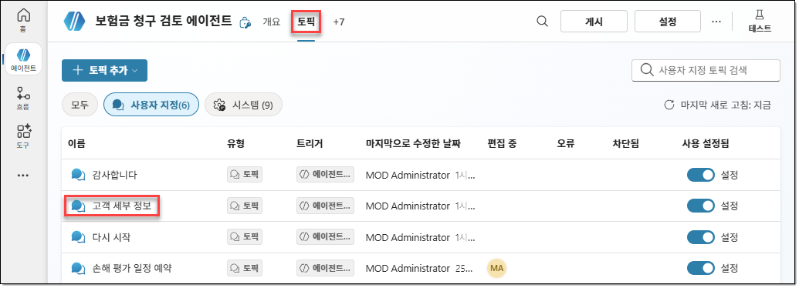

6. `고객 세부 정보` 토픽에서 이름을 묻는 질문 노드로 이동합니다. `식별`의 `사람 이름` 엔터티를 클릭한 후 이 엔터티를 앞서 만든 `사용자 이름` 엔터티로 변경하고 `저장`을 클릭합니다.

   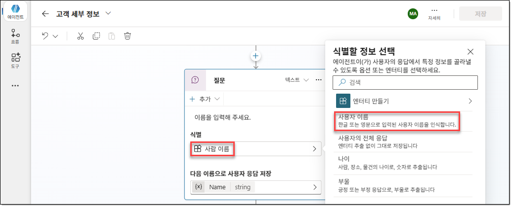

7. 다시 한번 테스트를 진행하여 한글로 입력한 이름이 올바르게 표시되는지 확인합니다.

   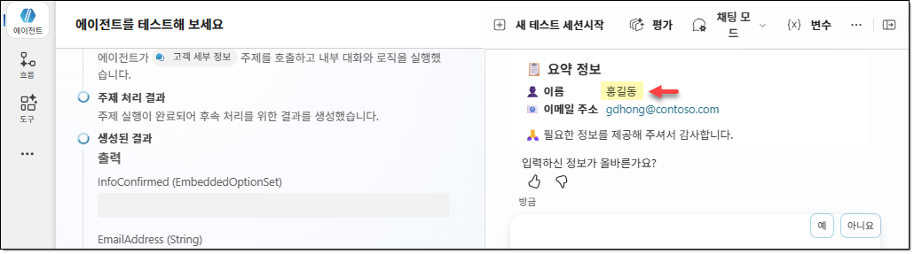

## 요약

이 실습에서는 고객 세부 정보 및 손해 평가 일정 예약 토픽을 생성하고, 생성형 AI 기능을 활성화한 상태에서 노드를 사용하여 체계적인 단계별 상호작용이 이루어지도록 구성했습니다.

또한 변수 범위(Variable Scope)를 설정하여 고객 세부 정보 토픽에서 수집한 정보를 다른 토픽에서도 사용할 수 있도록 구성했습니다.

## 문서 정보

- 과정: `PL-7008`
- 작성자: [우진환](https://github.com/313mlclub), [유승호](https://github.com/hahaysh)
- 기관 및 프로그램: 한국 마이크로소프트 · Microsoft Technical Trainer · Enterprise Skills Initiative
- 표지 표기: Worldwide Learning | Microsoft Technical Trainer

### 문서 작성 연혁

| 날짜 | 버전 | 작성자 | 변경 내용 |
|---|---|---|---|
| 2026.10.14 | 0.9.0 | [우진환](https://github.com/313mlclub) | 문서 초안 작성 |
| 2026.10.17 | 1.0.0 | [우진환](https://github.com/313mlclub) | 문서 서식 적용 |
| 2026.10.24 | 1.1.0 | [유승호](https://github.com/hahaysh) | PDF 기반 Markdown 정리 및 검토 |
