---
---

# LAB 03. Copilot Studio 에이전트에서 지식 관리

## 시나리오

이 실습에서는 다음 작업을 수행합니다.

- Dataverse 테이블 만들기
- 에이전트 만들기
- 지식 원본으로 사용할 파일 업로드
- 지식 원본으로 공개 웹 사이트 추가
- 지식 원본으로 Dataverse 테이블 추가
- 생성형 오케스트레이션 설정 구성
- 생성형 답변 만들기 노드 구성
- Microsoft Teams에 에이전트 게시

이 실습을 완료하는 데 약 **60분**이 소요됩니다.

## 핵심 개념 − 에이전트 구성 요소 및 동작

생성형 오케스트레이션을 사용하도록 설정하면 에이전트가 지침, 지식, 토픽 및 도구를 사용하여 응답을 동적으로 생성할 수 있습니다.

여러 유형의 지식 원본을 사용하여 에이전트의 답변 기반을 설정할 수 있으며, 여러 설정이 생성형 응답의 생성 방식에 영향을 줍니다.

## EXERCISE 01. Dataverse에 테이블 만들기

1. 브라우저에서 새 탭을 열고 Power Apps Maker 포털([https://make.powerapps.com/](https://make.powerapps.com/))로 이동합니다. 우측 상단의 `환경`을 클릭한 후 `CopilotLabEnv` 환경을 선택합니다.

   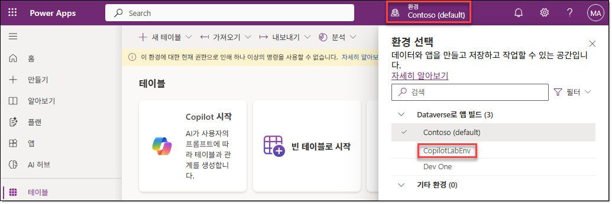

2. 왼쪽 내비게이션 메뉴에서 `테이블`로 이동한 후 `Copilot 시작` 타일을 선택합니다.

   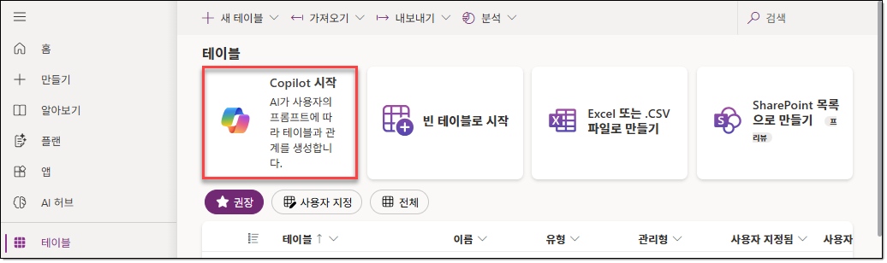

3. `Copilot 시작` 창에서 `테이블 옵션` 아이콘을 클릭한 후 `단일 테이블`을 선택합니다.

   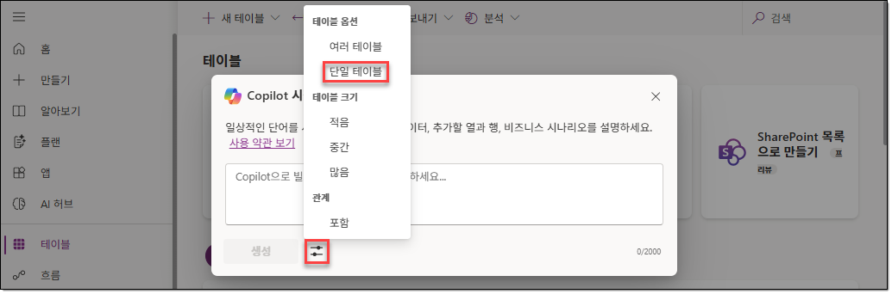

4. `Copilot 시작` 창에서 다음 프롬프트를 입력한 후 `생성`을 클릭합니다.

   ```prompt
   경비 청구를 저장하고 처리하기 위한 테이블을 만들어 주세요.
   다음 열을 포함해주세요.
   - 경비 제목
   - 경비 유형(숙박비, 식비, 접대비, 교통비)
   - 경비 발생일
   - 제출일
   - 승인일
   - 청구 금액
   - 승인 금액
   - 경비 상태(제출됨, 검토 중, 승인됨, 거부됨)
   ```

   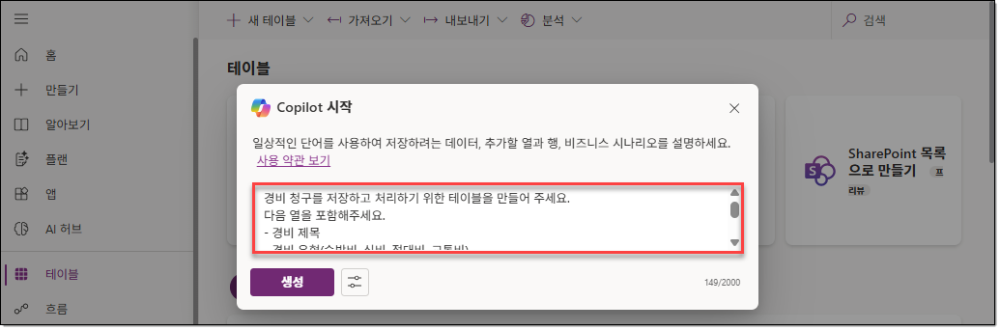

5. 새로운 테이블이 생성된 것을 확인합니다. 생성된 테이블 스키마는 약간 다를 수 있습니다. 생성형 AI로 만든 테이블이기 때문에 열 이름이나 서식에 사소한 차이가 있는 것은 정상입니다. 테이블 이름을 메모하고 `저장 후 종료`를 클릭합니다. `작업이 완료되었나요?` 창이 표시되면 `저장 후 종료`를 클릭합니다.

   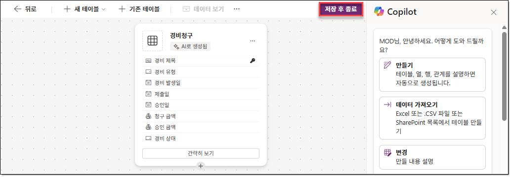

## EXERCISE 02. 에이전트 만들기

이 실습에서는 자연어를 사용하여 가상 기업의 경비 정책 관련 질문에 답변하는 새 에이전트를 만듭니다.

1. Copilot Studio 포털의 내비게이션 메뉴에서 `에이전트`로 이동한 후 프롬프트 창의 톱니바퀴 아이콘을 클릭합니다.

   

2. `에이전트 설정` 창에서 다음과 같이 구성한 후 `업데이트`를 클릭합니다.

   | 항목 | 값 |
   |---|---|
   | `언어` | `한국어(대한민국)` |
   | `솔루션` | `LabSolution` |
   | `스키마 이름` | `expenseagent` |

   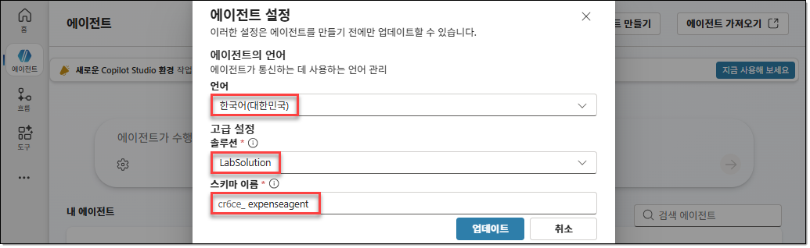

3. 프롬프트 창에 다음 프롬프트를 입력한 후 실행합니다.

   ```prompt
   당신은 직원의 경비 청구를 지원하는 에이전트이며, 경비 정책, 청구 절차 및 기타 경비 청구 관련 질문에 답변합니다.
   ```

   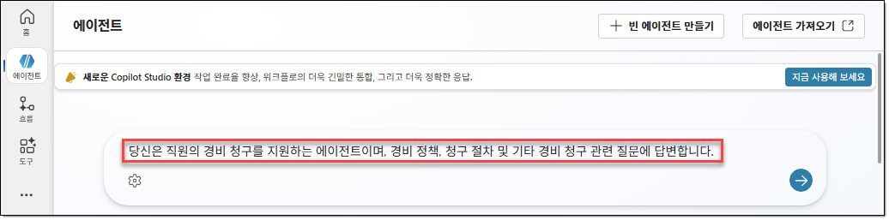

## EXERCISE 03. 에이전트에 지식 추가

### TASK 01. 문서를 지식 소스로 추가

1. 브라우저에서 새 탭을 열고 [https://raw.githubusercontent.com/313mlclub/pl-7008/refs/heads/main/Expenses_Policy_v2_KO.docx](https://raw.githubusercontent.com/313mlclub/pl-7008/refs/heads/main/Expenses_Policy_v2_KO.docx) 경로로 이동하여 경비 정책 문서를 로컬 컴퓨터에 다운로드합니다. 이 문서에는 가상 기업의 경비 정책에 대한 세부 정보가 포함되어 있습니다.

2. 새로 만든 에이전트의 `참조 자료` 탭으로 이동한 후 `+ 참조 자료 추가`를 클릭합니다.

   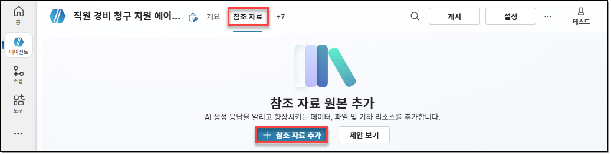

3. `참조 자료 추가` 창의 파일 업로드 영역에 다운로드한 파일을 추가한 후 `에이전트에 추가`를 클릭합니다.

   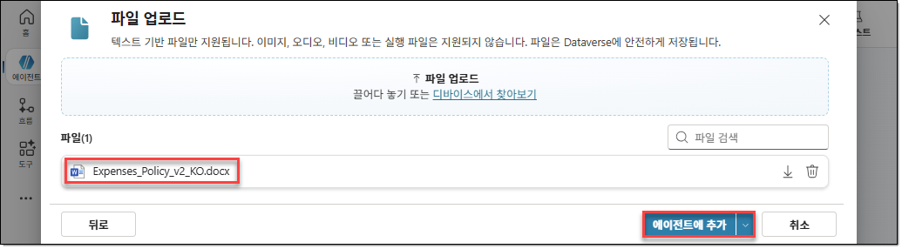

4. 파일을 업로드하면 Copilot Studio가 파일에 대한 인덱싱을 시작합니다. 이 작업에는 **10분 이상** 소요될 수 있습니다. 인덱싱 작업을 기다릴 필요 없이 다음 작업을 진행할 수 있습니다.

### TASK 02. 공개 웹 사이트를 참자 자료 소스로 추가

1. 에이전트의 `참조 자료` 탭에서 `+ 참조 자료 추가`를 클릭합니다.

   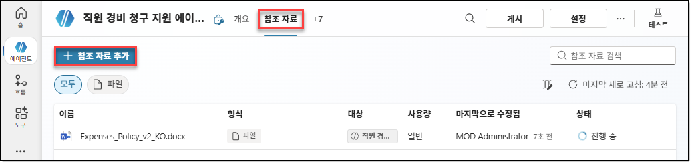

2. `참조 자료 추가` 창에서 `공개 웹 사이트`를 선택합니다.

   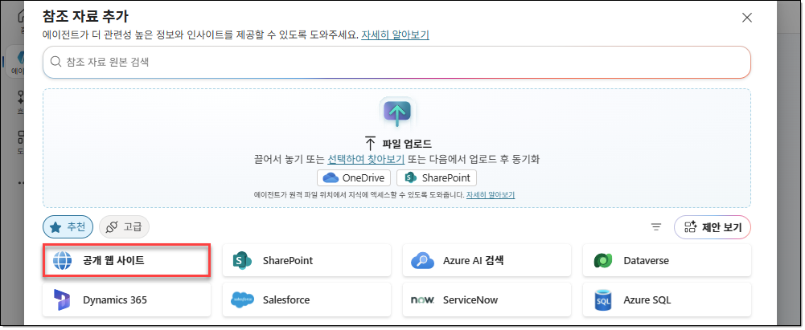

3. `공개 웹 사이트 추가` 창에서 [https://www.irs.gov/publications/p463](https://www.irs.gov/publications/p463) 주소를 입력한 후 `추가`를 클릭합니다. 그런 다음 아래 이름과 설명을 입력하고 `에이전트에 추가`를 클릭합니다.

   | 항목 | 값 |
   |---|---|
   | `이름` | `출장, 선물 및 차량 경비 \| 미국 국세청` |
   | `설명` | `출장 경비의 환급 및 처리 기준에 대한 정보를 제공합니다.` |

   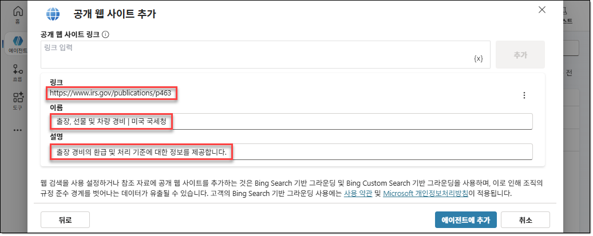

4. 공개 웹 사이트의 인덱싱에도 몇 분이 걸릴 수 있습니다.

### TASK 03. Dataverse 테이블을 지식 소스로 추가

1. 에이전트의 `참조 자료` 탭에서 `+ 참조 자료 추가`를 클릭합니다.

   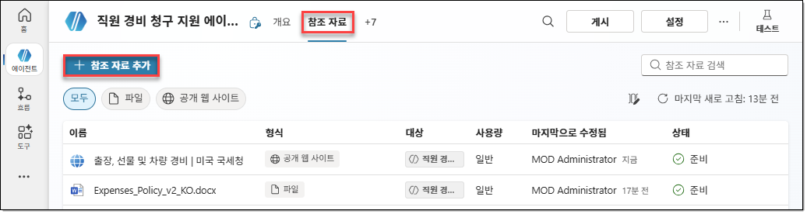

2. `참조 자료 추가` 창에서 `Dataverse`를 선택합니다.

   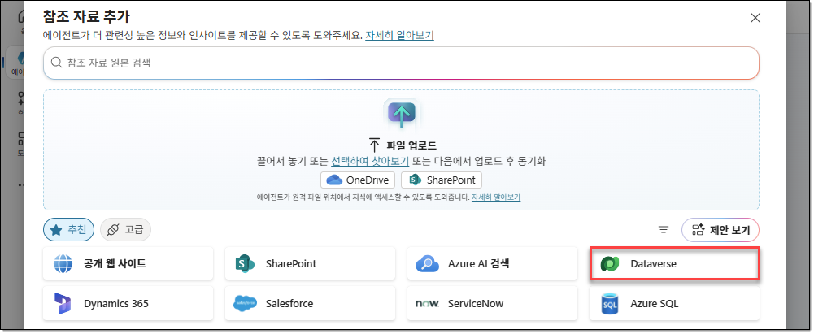

3. `Dataverse 참조 자료 원본` 창에서 앞서 만들었던 `경비청구` 테이블을 선택하고 `에이전트에 추가`를 클릭합니다.

   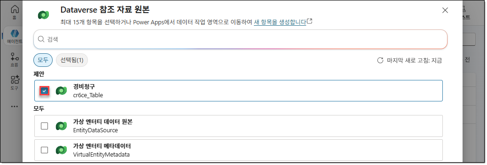

### TASK 04. Dataverse 지식 소스 구성

1. 에이전트의 `참조 자료` 탭에서 앞서 추가했던 Dataverse 참조 자료를 선택한 후 `… > 편집`을 클릭합니다.

   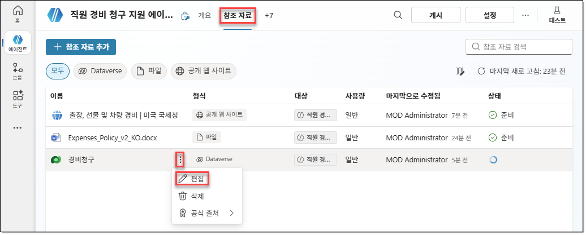

2. `경비청구` 페이지의 `세부 정보` 탭에서 `이름`을 `경비청구 데이터`로 변경합니다.

   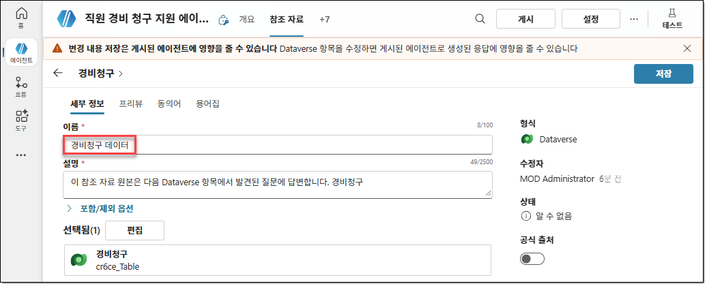

3. `경비청구` 페이지의 `동의어` 탭으로 이동한 후 `경비 유형` 열 우측의 `+ 동의어 추가`를 클릭합니다.

   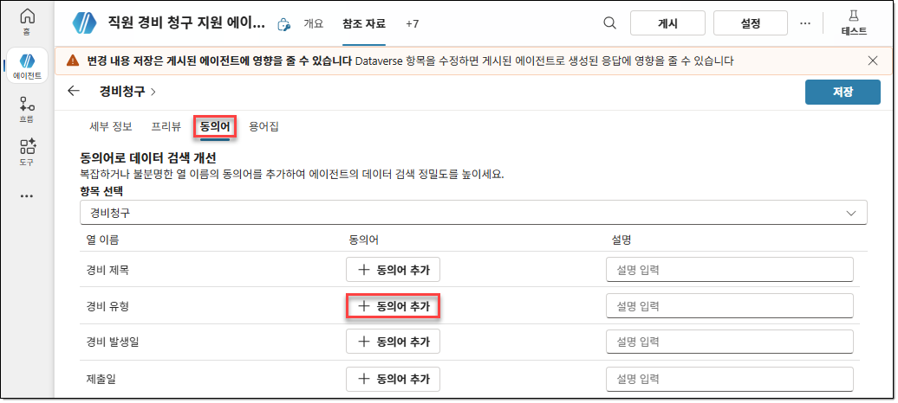

4. `동의어 추가` 창에서 `경비 항목`, `경비 분류`를 동의어로 추가한 후 `완료`를 클릭합니다.

   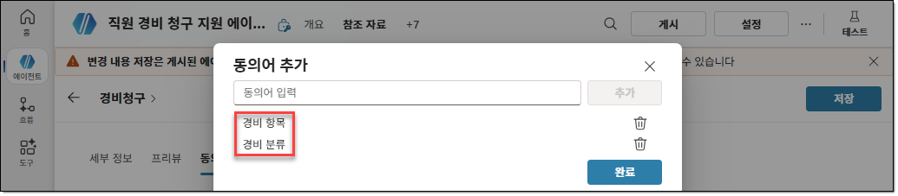

5. `경비청구` 페이지의 `용어집` 탭으로 이동한 후 다음 용어를 입력하고 `추가`를 클릭합니다. 그런 다음 `저장`을 클릭하여 Dataverse 참조 자료 구성을 완료합니다.

   | 항목 | 값 |
   |---|---|
   | `용어 입력` | `부대비용` |
   | `설명 입력` | `팁이나 수수료와 같이 주요 경비에 부수적으로 발생하는 소액의 필수 업무 비용입니다.` |

   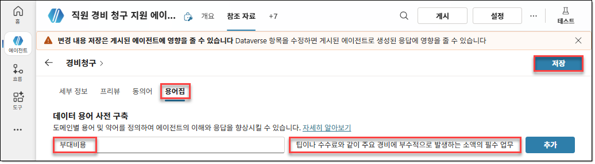

6. 에이전트의 `참조 자료` 탭에서 모든 참조 자료의 상태가 `준비`로 표시될 때까지 기다립니다. 인덱싱이 진행 중이면 몇 분 정도 기다린 후 페이지를 새로 고쳐 다시 확인합니다.

### TASK 05. 참조 자료 테스트

1. 에이전트의 메뉴에서 `테스트`를 클릭합니다. `에이전트 테스트` 창에서 `…`을 클릭한 후 다음 상태인지 확인합니다.

   | 항목 | 상태 |
   |---|---|
   | `테스트 시 활동 지도 표시` | `켜져 있음` |
   | `토픽 간 추적` | `꺼져 있음` |

   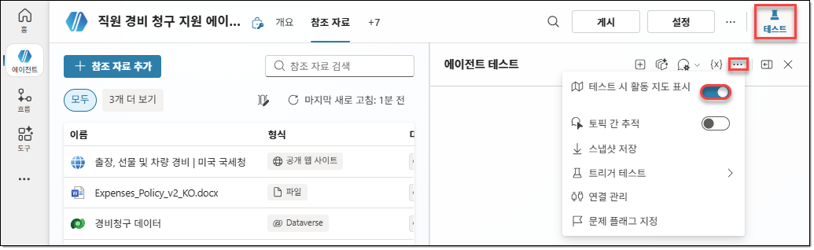

2. 새 테스트 세션을 시작하고 다음 프롬프트를 제출합니다. 응답은 업로드한 경비 정책 문서를 기반으로 해야 하며 다른 지식 소스를 참조할 수도 있습니다.

   ```prompt
   어떤 경비를 청구할 수 있나요?
   ```

   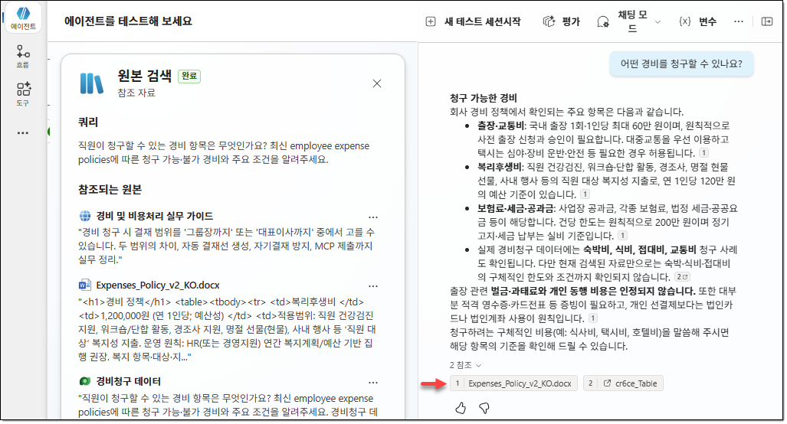

3. 새 테스트 세션을 시작한 후 다음 프롬프트를 실행합니다. 에이전트는 모든 지식 소스를 검색하고 Dataverse 테이블을 사용하여 응답을 생성해야 합니다.

   ```prompt
   경비 유형별 전체 청구 금액은 얼마인가요?
   ```

   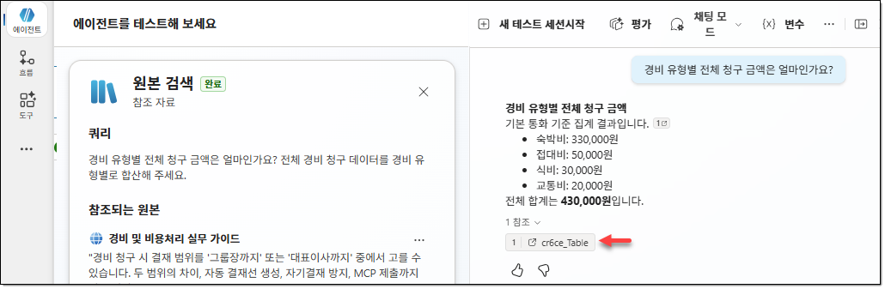

4. 새 테스트 세션을 시작한 후 다음 프롬프트를 실행합니다. 에이전트는 모든 지식 소스를 검색하고 공개 웹 사이트의 정보를 사용하여 응답을 제공해야 합니다.

   ```prompt
   미국 국세청 기준으로 부대 비용 한도는 얼마인가요?
   ```

   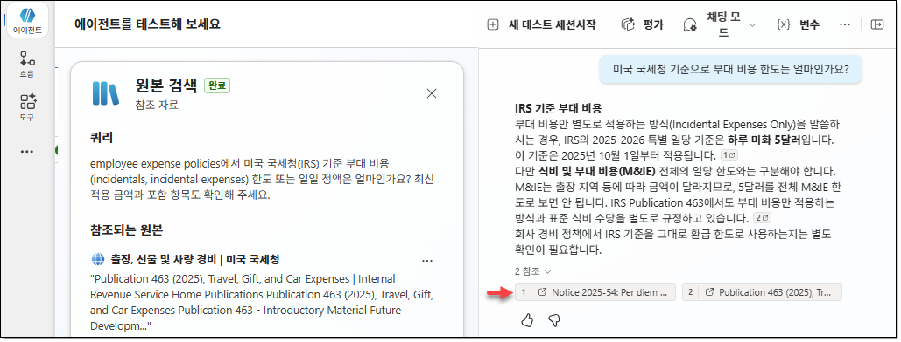

## EXERCISE 04. 생성형 AI 설정

이 실습에서는 에이전트와 생성형 답변 노드의 생성형 AI를 구성합니다.

### TASK 01. 에이전트 지식 설정 구성

1. 에이전트의 메뉴에서 `설정`을 클릭합니다.

   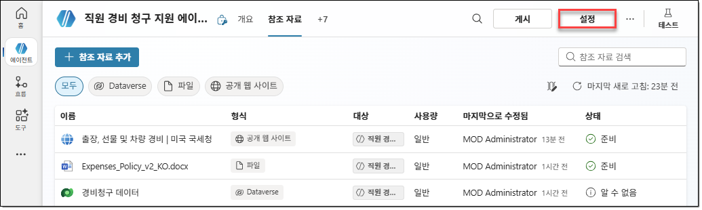

2. `설정` 페이지의 `생성형 AI` 탭에서 생성형 AI 오케스트레이션을 사용하도록 설정되어 있는지 확인합니다.

   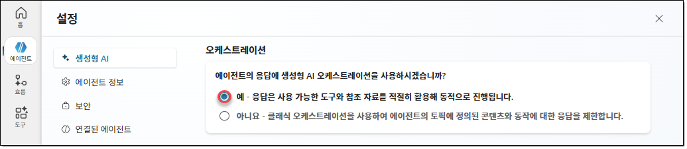

3. `설정 > 생성형 AI` 탭에서 페이지를 스크롤 다운하여 `지식` 영역으로 이동한 후 다음과 같이 구성하고 `저장`을 클릭합니다.

   | 항목 | 값 |
   |---|---|
   | `근거 없는 응답 허용하기` | `끄기` |
   | `웹의 정보 사용` | `끄기` |

   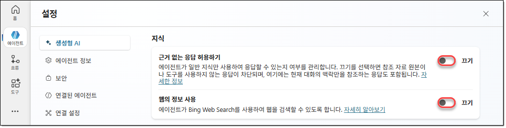

4. 에이전트의 `테스트` 메뉴를 열고 다음 프롬프트를 실행합니다. 에이전트가 응답을 생성할 때 파일 및 Dataverse, 참조 자료에 추가한 공개 웹사이트는 검색할 수 있지만, 다른 공개 웹 사이트는 사용하지 못하기 때문에 올바른 응답이 제공되지 않는 것을 확인합니다.

   공개 웹 사이트 참조 자료는 사이트를 실시간으로 조회하는 방식이 아니라 Bing에 인덱싱된 사이트의 콘텐츠를 기반으로 검색합니다.

   ```prompt
   미국 국세청 기준으로 부대 비용 한도는 얼마인가요?
   ```

   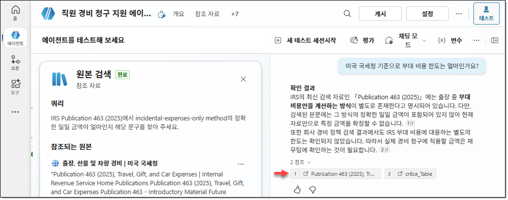

### TASK 02. 생성형 답변 노드 구성

1. 에이전트의 `토픽` 탭으로 이동한 후 `시스템` 토픽으로 필터링합니다. 그런 다음 `대화형 부스팅` 토픽을 클릭합니다.

   

2. `대화형 부스팅` 토픽에서 `생성형 답변 만들기` 노드의 `… > 속성`을 클릭합니다.

   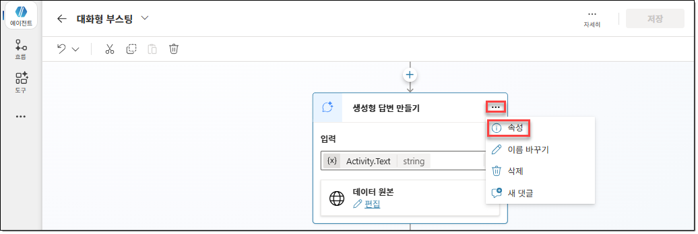

3. `생성형 답변 만들기 속성` 창의 `참조 자료 원본` 영역에서 다음과 같이 구성한 후 `저장`을 클릭합니다.

   | 항목 | 값 또는 작업 |
   |---|---|
   | `선택한 원본만 검색` | `켜기` |
   | `참조 자료 원본` | 공개 웹 사이트 참조 자료만 선택합니다. |
   | `웹 검색` | `켜기` |

   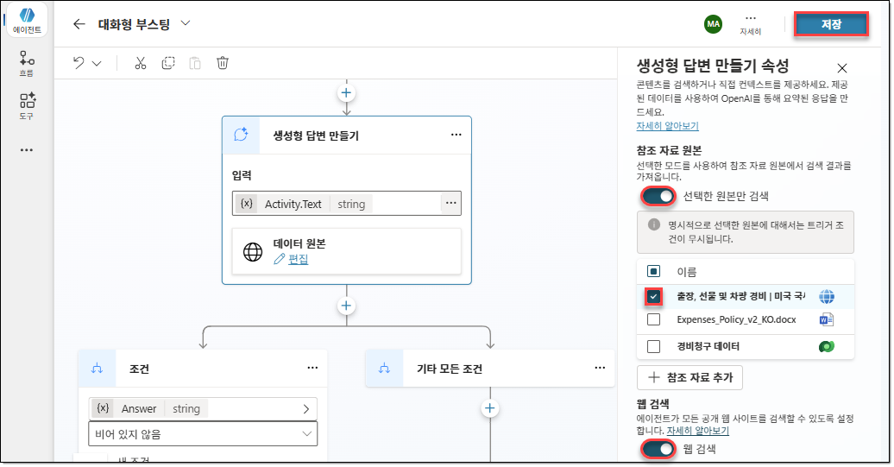

4. 에이전트의 `테스트` 메뉴를 열고 새 대화를 시작한 후 다음 프롬프트를 실행합니다. 지식 소스에서는 답변을 제공하지 못하지만 `대화형 부스팅` 토픽의 `생성형 답변` 노드에서 `웹 검색`이 켜져 있기 때문에 올바른 답변이 제공되는 것을 확인할 수 있습니다.

   ```prompt
   현재 미국 달러와 한국 원의 환율은 얼마인가요?
   ```

   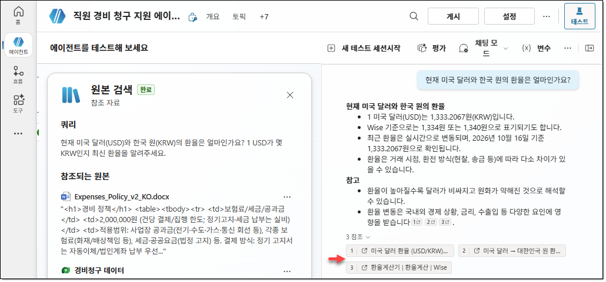

### TASK 03. 대체(Fallback) 토픽

1. 에이전트의 `토픽` 메뉴로 이동한 후 `대화형 부스팅` 토픽을 선택합니다.

   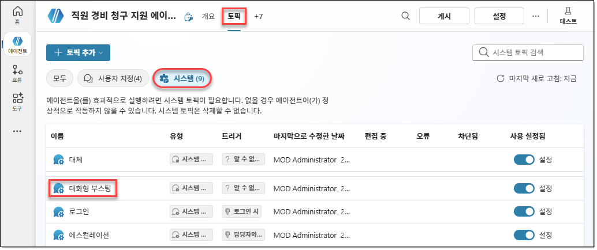

2. `대화형 부스팅` 토픽에서 `생성형 답변 만들기` 노드의 속성을 엽니다. `생성형 답변 만들기 속성` 창에서 `웹 검색`을 `끄기`로 설정한 후 `저장`을 클릭합니다.

   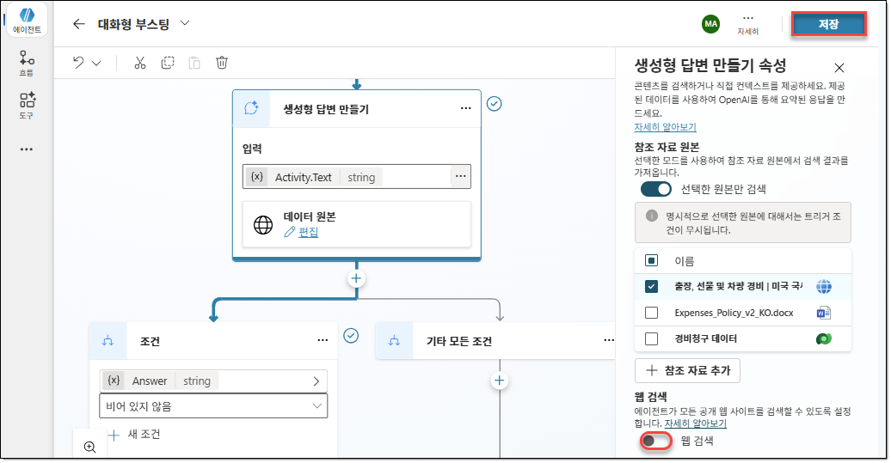

3. 에이전트의 `테스트` 창을 열고 새 테스트 세션을 시작한 후 다음 프롬프트를 실행합니다. 지식 소스와 생성형 답변에서 올바른 응답을 제공하지 못합니다. 적절한 기반 응답이나 생성형 응답이 없는 경우 대화가 `대체` 토픽으로 라우팅될 수 있습니다.

   ```prompt
   현재 미국 달러와 한국 원의 환율은 얼마인가요?
   ```

   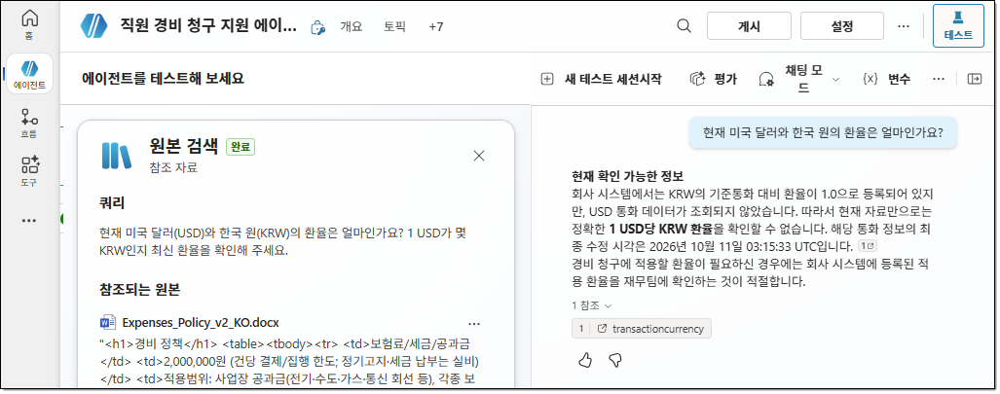

## EXERCISE 05. Microsoft Teams에 에이전트 게시

이 실습에서는 에이전트가 Microsoft Entra ID 인증을 사용하도록 설정되어 있는지 확인한 후 에이전트를 Microsoft Teams에 게시합니다.

### TASK 01. Microsoft Entra ID 인증

1. 에이전트의 메뉴에서 `설정`을 클릭합니다.

   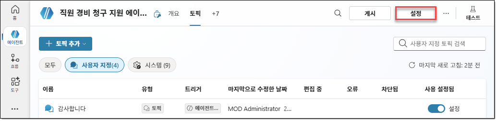

2. `설정` 페이지의 `보안` 탭으로 이동한 후 `인증`을 클릭합니다.

   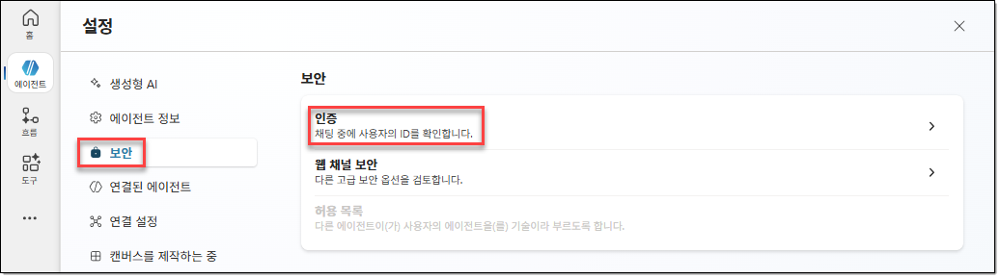

3. `인증` 페이지에서 인증 옵션이 `Microsoft로 인증`으로 선택되어 있는지 확인합니다. 다른 인증 옵션이 선택되어 있는 경우 `Microsoft로 인증`을 선택하고 `저장`을 클릭합니다.

   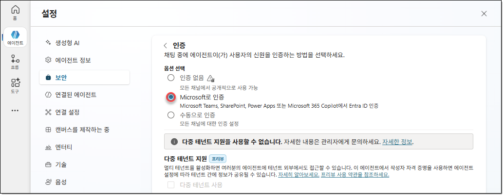

### TASK 02. 에이전트 게시

1. 에이전트의 메뉴에서 `게시`를 클릭합니다.

   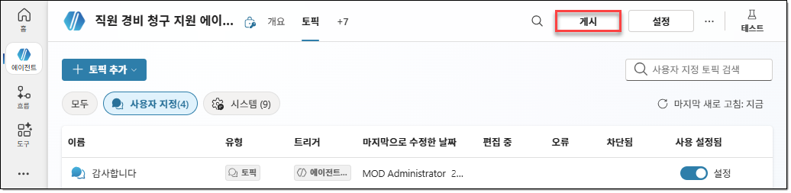

2. `이 에이전트 게시` 창이 표시되면 `게시`를 클릭합니다.

   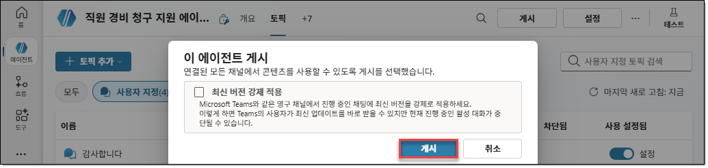

### TASK 03. Microsoft Treams 채널

> [!NOTE]
> 에이전트를 Teams에 게시하는 작업은 테스트를 위한 것입니다. 프로덕션 배포에는 추가 거버넌스, 보안 및 앱 승인 프로세스가 필요할 수 있습니다.

1. 에이전트의 메뉴에서 `채널` 탭으로 이동한 후 `Microsoft 365 및 Microsoft Teams` 타일을 선택합니다.

   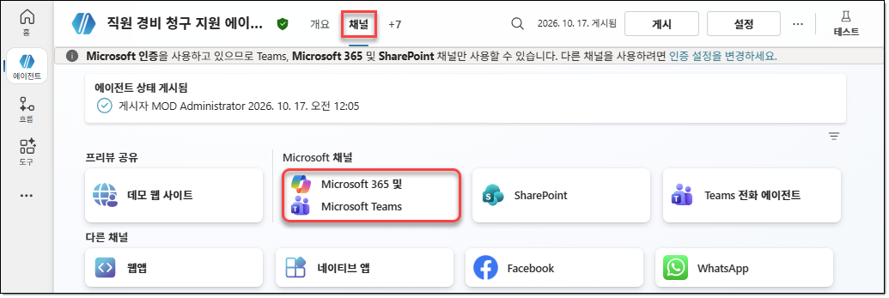

2. `Microsoft 365 및 Microsoft Teams` 창에서 `Microsoft 365 Copilot에서 에이전트이 사용 가능하도록 설정` 옵션을 체크 해제하고 `채널 추가`를 클릭합니다.

   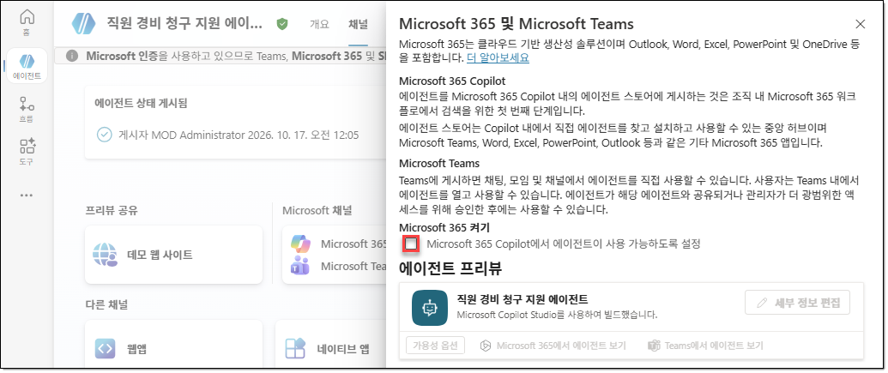

3. 채널 추가가 완료되면 `Teams에서 에이전트 보기`를 클릭합니다. `Microsoft Teams을(를) 여시겠습니까?` 팝업창이 표시되면 `취소`를 클릭하고 `웹 응용 프로그램을 대신 사용합니다`를 선택합니다.

   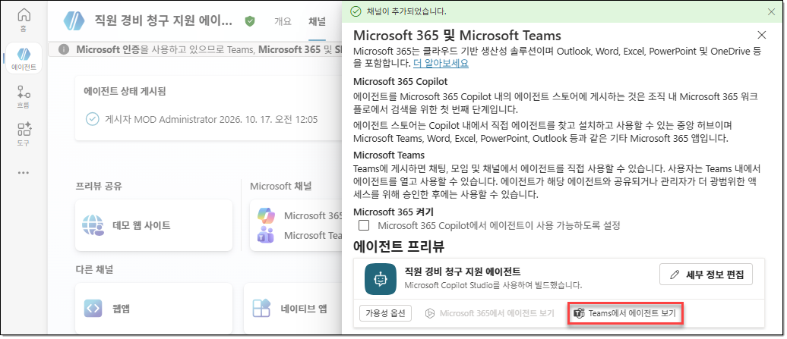

4. Teams 웹 앱에서 에이전트 추가 창이 표시되면 `추가`를 클릭합니다. 에이전트가 추가되면 `열기`를 클릭합니다.

   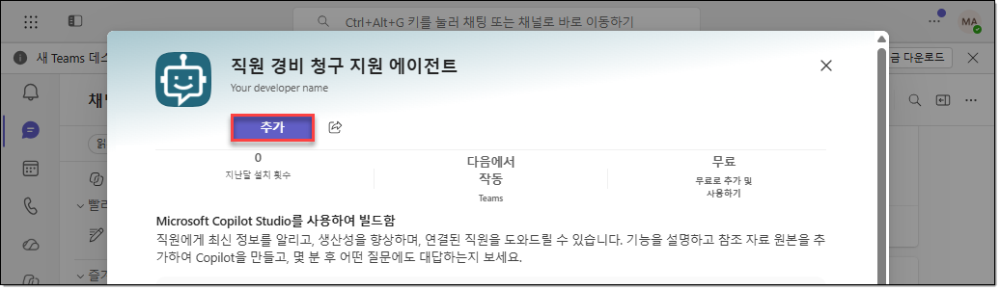

5. Microsoft Teams에서 게시된 에이전트를 테스트합니다.

   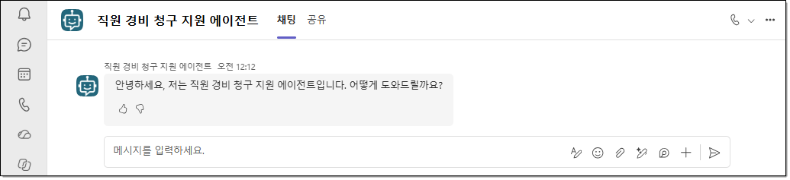

## 요약

이 실습에서는 에이전트에 참조 자료를 추가하고, 생성형 AI 설정에 따라 프롬프트의 응답을 생성할 때 참조 자료가 언제, 어떻게 사용되는지 살펴보았습니다.

## 문서 정보

- 과정: `PL-7008`
- 작성자: [우진환](https://github.com/313mlclub), [유승호](https://github.com/hahaysh)
- 기관 및 프로그램: 한국 마이크로소프트 · Microsoft Technical Trainer · Enterprise Skills Initiative
- 표지 표기: Worldwide Learning | Microsoft Technical Trainer

### 문서 작성 연혁

| 날짜 | 버전 | 작성자 | 변경 내용 |
|---|---|---|---|
| 2026.10.14 | 0.9.0 | [우진환](https://github.com/313mlclub) | 문서 초안 작성 |
| 2026.10.17 | 1.0.0 | [우진환](https://github.com/313mlclub) | 문서 서식 적용 |
| 2026.10.24 | 1.1.0 | [유승호](https://github.com/hahaysh) | PDF 기반 Markdown 정리 및 검토 |
