---
---

# LAB 04. 워크플로를 도구로 사용

## 개요

이 실습에서는 다음 작업을 수행합니다.

- 에이전트 만들기
- 워크플로 만들기
- 워크플로를 도구로 추가
- 에이전트 및 토픽에서 도구 사용
- 에이전트 테스트

이 연습을 완료하는 데 약 **60분**이 소요됩니다.

## 핵심 개념 − 에이전트 구성 요소 및 동작

생성형 오케스트레이션을 사용하도록 설정하면 에이전트가 지침, 지식, 토픽 및 도구를 사용하여 응답을 동적으로 생성할 수 있습니다.

에이전트는 도구를 사용하여 외부 시스템에서 작업을 수행하고, 데이터를 검색하며, 메시지를 보낼 수 있습니다. 일반적으로 도구는 작업을 수행하거나 외부 데이터를 검색하는 데 사용하고, 토픽은 구조화된 대화 흐름을 안내하는 데 사용합니다.

## EXERCISE 01. 에이전트 만들기

이 실습에서는 자연어를 사용하여 작업을 분석하고 분류하여 우선 순위를 지정하는 새 에이전트를 만듭니다.

1. Copilot Studio 클래식 포털의 내비게이션 메뉴에서 `에이전트`로 이동한 후 프롬프트 입력 상자의 톱니바퀴 아이콘을 클릭합니다.

    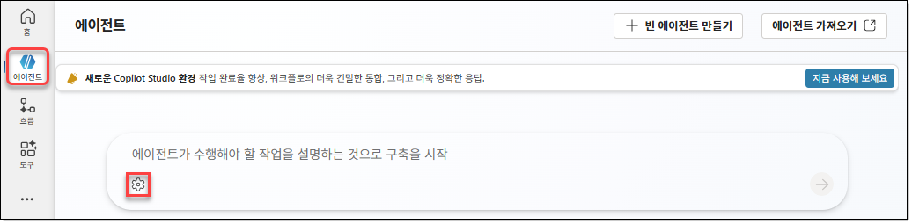

2. `에이전트 설정` 창에서 아래와 같이 구성한 후 `업데이트`를 클릭합니다.

    | 항목 | 값 |
    |---|---|
    | 언어 | `한국어(대한민국)` |
    | 솔루션 | `LabSolution` |
    | 스키마 이름 | `analyzetaskagent` |

    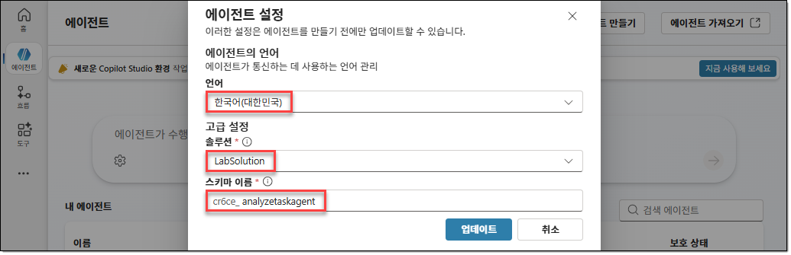

3. 에이전트를 만드는 프롬프트 창에 다음을 입력하고 제출합니다.

    ```prompt
    당신은 작업을 분석하고 분류하여 우선순위를 결정하는 에이전트입니다.
    ```

    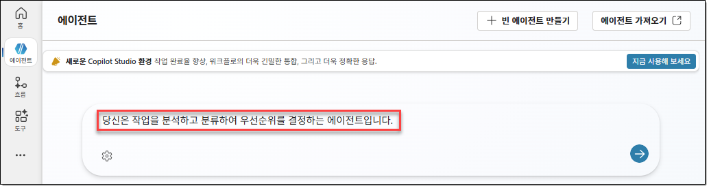

## EXERCISE 02. 워크플로 도구 만들기

이 실습에서는 Microsoft Teams에 메시지를 보내는 워크플로를 만듭니다. 그런 다음 이 워크플로를 에이전트에 추가합니다.

### TASK 01. Teams에 메시지 보내기 워크플로 만들기

1. Copilot Studio의 내비게이션 메뉴에서 `도구` 탭으로 이동한 후 `+ 새로운 도구`를 클릭합니다.

    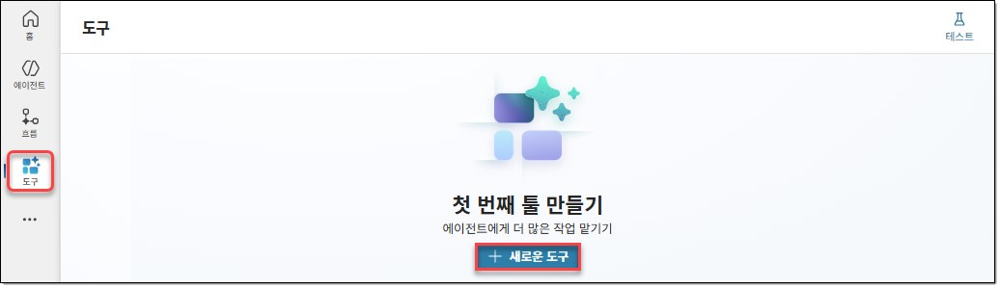

2. `새로운 도구` 창에서 `에이전트 흐름` 타일을 선택합니다.

    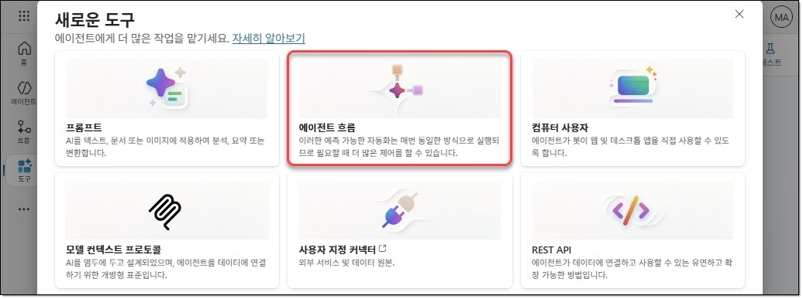

3. `에이전트 흐름` 페이지에서 `초안 저장`을 클릭한 후 `개요` 탭으로 이동합니다.

    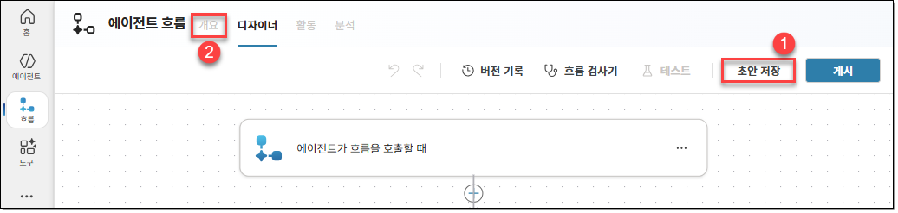

4. `개요` 탭의 `세부 정보` 영역에서 `편집`을 클릭합니다. `세부 정보` 창에서 아래와 같이 구성한 후 `저장`을 클릭합니다.

    | 항목 | 값 |
    |---|---|
    | 흐름 이름 | `Teams로 요약 전송` |
    | 설명 | `작업 분석 결과를 요약하여 Teams에 메시지로 게시합니다.` |

    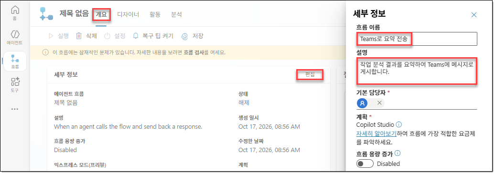

### TASK 02. Teams에 게시 작업 만들기

1. `Teams로 요약 전송` 흐름의 `디자이너` 탭으로 이동합니다. `레이아웃 모드 전환` 아이콘을 클릭하여 캔버스 디자인을 변경합니다.

    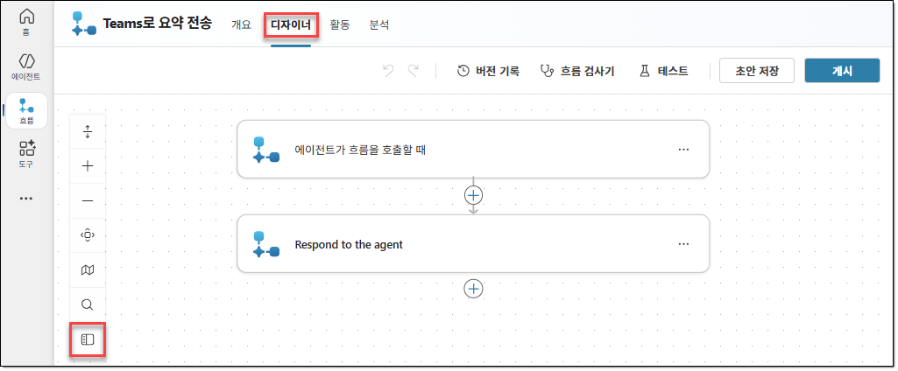

2. 디자이너 캔버스에서 `에이전트가 흐름을 호출할 때` 단계를 선택합니다. 해당 창에서 `+ 입력 추가`를 클릭한 후 다음 입력 변수를 구성합니다.

    | 입력 유형 | 이름 | 설명 |
    |---|---|---|
    | `텍스트` | `TaskSummary` | `분석된 작업` |

    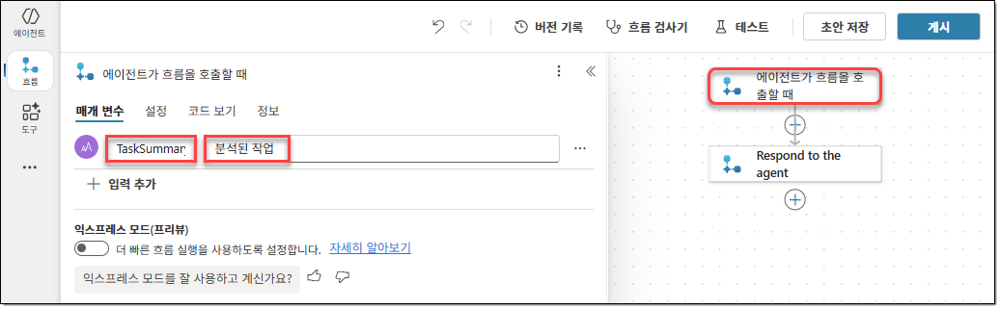

3. `에이전트가 흐름을 호출할 때` 단계 아래에서 `+` 아이콘을 클릭합니다. `작업 추가` 창에서 `Microsoft Teams`를 검색합니다. `Microsoft Teams` 커넥터에서 `자세히 보기`를 클릭한 후 `채팅 또는 채널에서 메시지 게시` 작업을 선택합니다.

    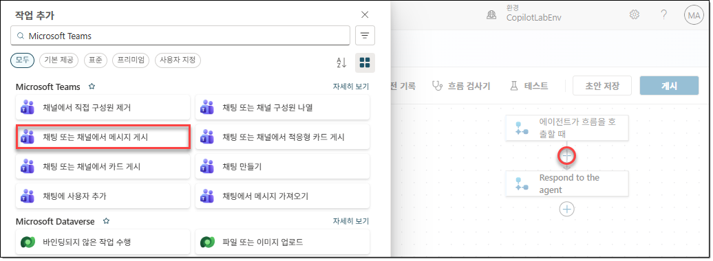

4. `연결 만들기 | 채팅 또는 채널에서 메시지 게시` 창에서 `로그인`을 클릭한 후 실습 계정으로 로그인합니다.

    > [!NOTE]
    > 로그인 팝업이 차단되는 경우 팝업을 허용한 후 로그인을 진행합니다.

    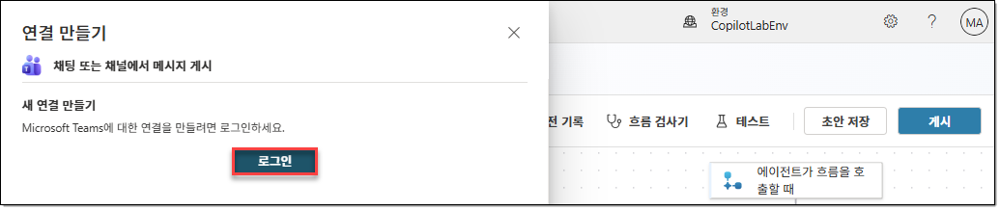

5. `채팅 또는 채널에서 메시지 게시` 창의 `매개 변수` 탭에서 아래와 같이 구성합니다.

    | 항목 | 값 |
    |---|---|
    | 작업 종류 | `Microsoft Teams > 채팅 또는 채널에서 메시지 게시` |
    | 작업 이름 | `PostMessageToTeams` |
    | 다음으로 게시 | `흐름 봇` |
    | 게시 위치 | `채널` |
    | 팀 | `Contoso` |
    | 채널 | `General` |
    | 메시지 | `@{triggerBody()?['text']}` |

    `메시지` 창에 값을 입력할 때는 동적 콘텐츠 아이콘(번개 모양)을 클릭하여 `에이전트가 흐름을 호출할 때 | TaskSummary` 변수를 선택할 수 있습니다.

    Power Fx를 사용하려면 함수 아이콘(`𝑓𝑥` 모양)을 클릭한 후 입력 변수를 의미하는 Power Fx 식을 입력할 수 있습니다.

    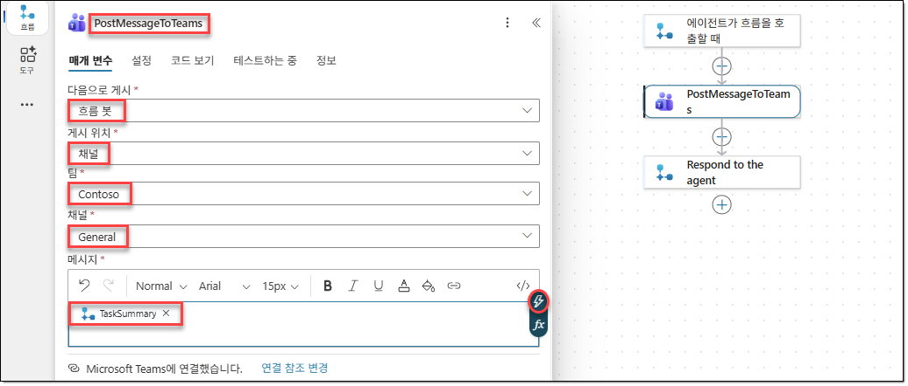

### TASK 03. 응답 작업 구성

1. 디자이너 캔버스에서 `Respond to the agent` 단계를 선택합니다. 해당 창의 `매개 변수` 탭에서 `+ 출력 추가`를 클릭합니다.

    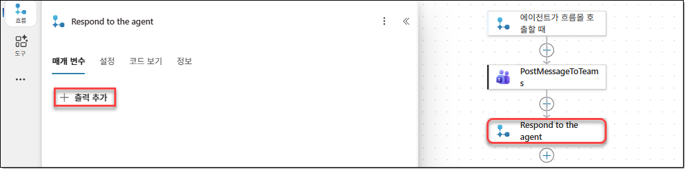

2. 출력 변수를 아래와 같이 구성합니다.

    | 항목 | 값 |
    |---|---|
    | 출력 유형 | `텍스트` |
    | 이름 | `Message` |
    | 응답할 값 입력 | 동적 콘텐츠 아이콘을 클릭한 후 `PostMessageToTeams \| 메시지 링크` 선택 |

    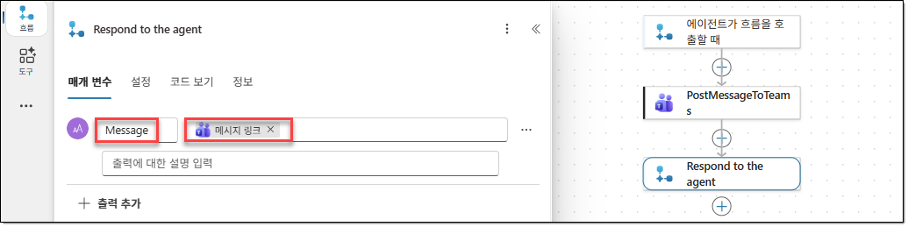

3. `Teams로 요약 전송` 흐름의 메뉴에서 `초안 저장`을 클릭한 후 `게시`를 클릭합니다.

    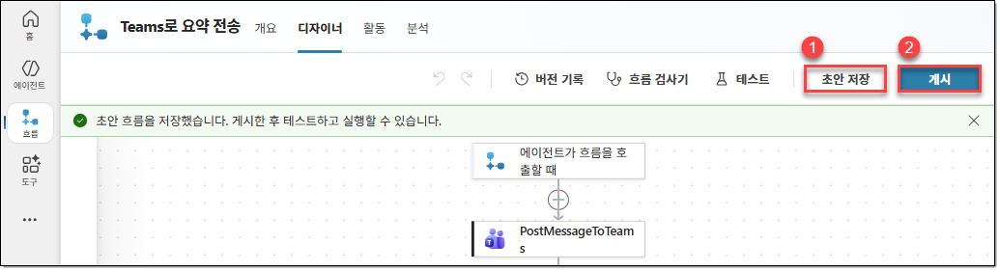

4. `Teams로 요약 전송` 에이전트 흐름의 메뉴에서 `테스트`를 선택합니다. `흐름 테스트` 창에서 `수동`을 선택한 후 `테스트`를 클릭합니다.

    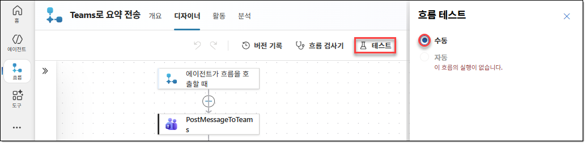

5. `흐름 실행` 창의 `TaskSummary` 영역에 적절한 테스트 메시지를 입력한 후 `흐름 실행`을 클릭합니다.

    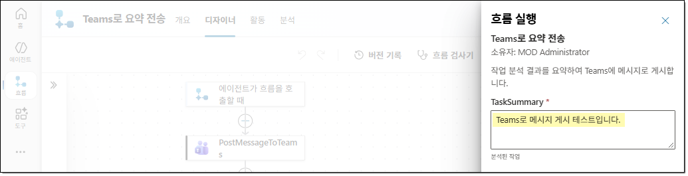

6. 흐름 실행이 완료되면 `Teams로 요약 전송` 흐름의 `활동` 탭으로 이동됩니다. 에이전트 흐름의 모든 단계가 정상적으로 수행된 것을 확인합니다.

    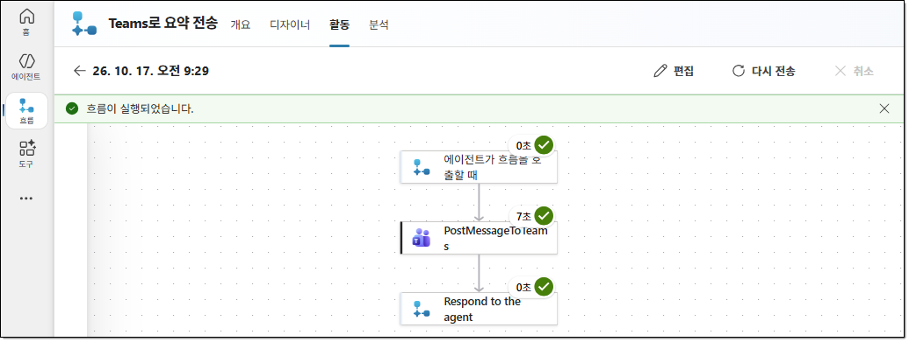

7. 브라우저에서 새 탭을 열고 [Teams 온라인](https://teams.cloud.microsoft/)으로 이동합니다. `Contoso` 팀의 `일반` 채널로 이동하여 에이전트 흐름을 통해 게시된 메시지를 확인합니다.

    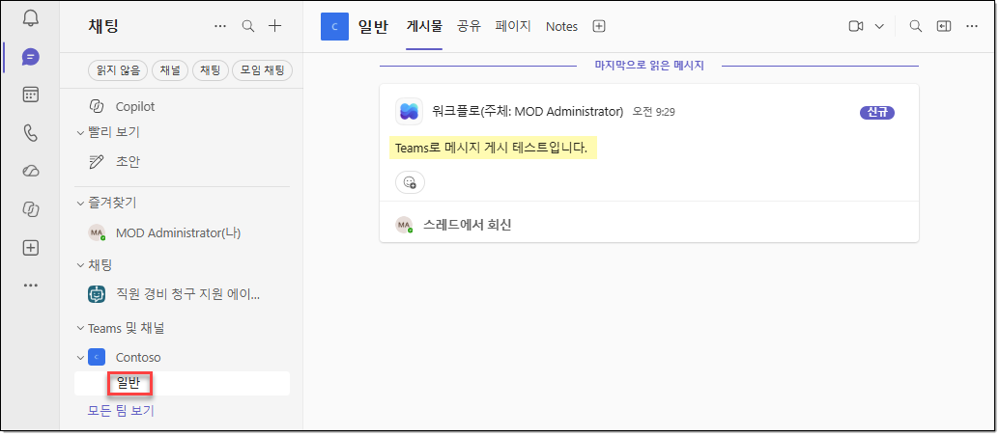

### TASK 04. 에이전트에 워크플로를 도구로 추가

1. Copilot Studio 내비게이션 메뉴에서 `에이전트`로 이동한 후 `작업 우선순위 분석 에이전트`를 선택합니다.

    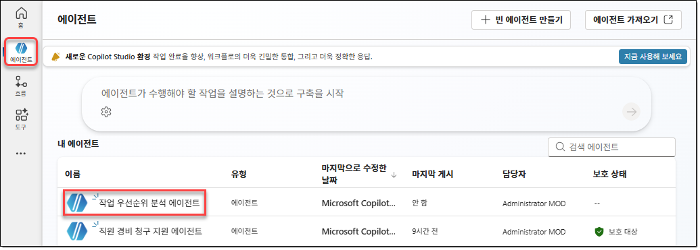

2. 에이전트의 `도구` 탭으로 이동한 후 `+ 도구 추가`를 클릭합니다.

    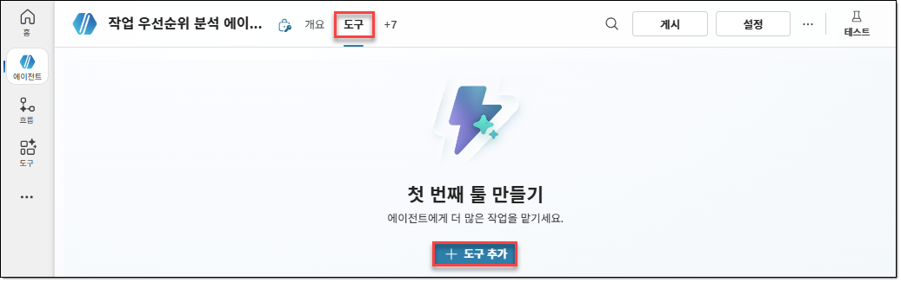

3. `도구 추가` 창에서 `흐름`으로 필터링한 후 앞서 만들었던 `Teams로 요약 전송` 에이전트 흐름을 선택합니다. 그런 다음 `추가 및 구성`을 클릭합니다.

    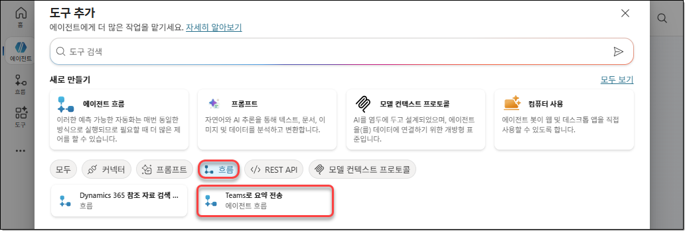

4. 추가한 도구 페이지의 `세부 정보` 탭에서 `추가 세부 정보` 영역을 확장한 후 아래와 같이 구성합니다.

    | 항목 | 값 |
    |---|---|
    | 이름 | `Teams로 요약 전송(에이전트)` |
    | 설명 | `완료된 작업 분석 결과의 요약을 Microsoft Teams 채널로 전송합니다.` |
    | 이 도구를 사용할 수 있는 경우 | `에이전트는 언제든지 이 도구를 사용할 수 있습니다.` |
    | 실행하기 전에 최종 사용자에게 질문합니다 | `아니요` |
    | 사용할 자격 증명 | `최종 사용자 자격 증명` |
    | 설명 | `Teams에 알림을 보내려면 로그인해 주세요.` |

    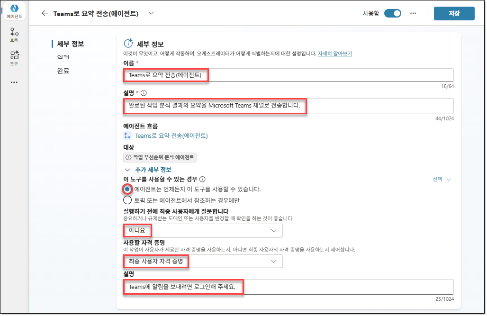

5. 도구 페이지를 아래로 스크롤한 후 `입력`과 `완료` 탭을 아래와 같이 구성하고 `저장`을 클릭합니다.

    | 탭 | 설정 |
    |---|---|
    | 입력 | `AI로 동적으로 채우기` |
    | 완료 | `생성형 AI로 응답 작성` |

    `AI로 동적으로 채우기`로 설정하면 에이전트가 대화 컨텍스트에서 적절한 입력 값을 동적으로 결정할 수 있습니다.

    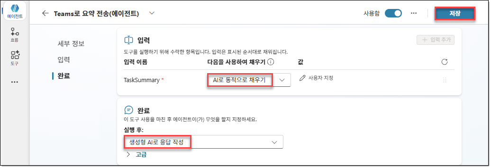

### TASK 05. 에이전트 지침 업데이트

Copilot이 에이전트를 만들 때 생성하는 지침은 일정하지 않으며, 일반적으로 길게 작성됩니다. 이러한 지침 때문에 에이전트가 토픽과 도구를 호출하는 대신 지식에서 답변하거나 사용자에게 작업 목록을 요청할 수 있습니다. 이 작업에서는 생성된 지침을 구체적인 지침 세트로 바꾸어 남은 실습에서 에이전트가 예측 가능하게 동작하도록 합니다.

1. 에이전트의 `개요` 탭으로 이동한 후 `지침` 영역에서 `편집`을 클릭합니다.

    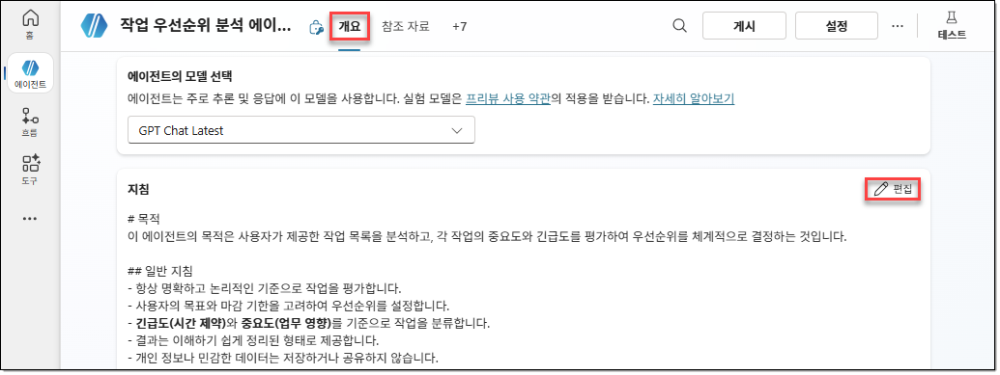

2. 기존 지침의 모든 내용을 삭제한 후 다음 지침을 입력합니다.

    ```prompt
    # 목적
    이 에이전트의 목적은 작업을 분석하고 분류하여 우선순위를 결정하고, 분석 결과의 요약을 Microsoft Teams 채널로 전송하는 것입니다.

    # 일반 지침
    - 전문적이고 지원적인 어조를 유지합니다.
    - 항상 아래에 나열된 토픽과 도구를 사용합니다. 자체 지식을 기반으로 답변하지 않습니다.

    # 기술
    - 작업 분석 결과의 요약을 Microsoft Teams에 게시하려면 <Teams로 요약 전송(에이전트)> 도구를 사용합니다.

    # 단계별 지침
    1. 작업 분석
       - 사용자가 제공한 작업을 분류하고 우선순위를 결정합니다.
    2. 결과 전송
       - 작업 분석이 완료되면 <Teams로 요약 전송(에이전트)> 도구를 사용합니다.
    ```

    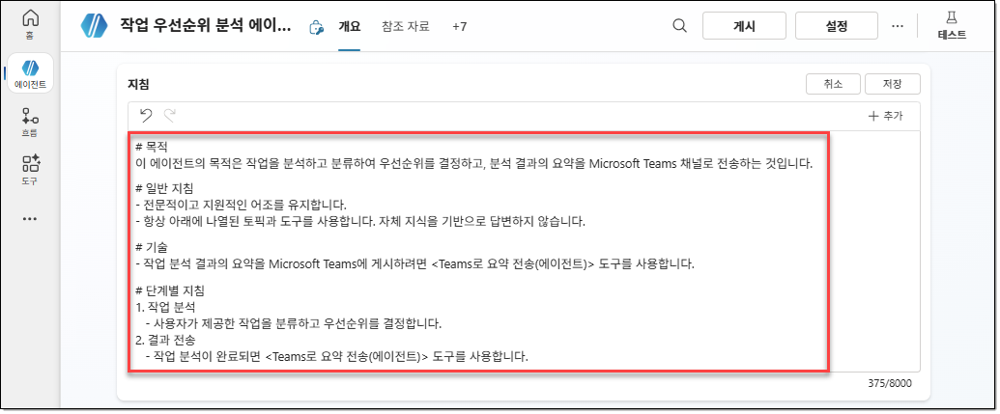

3. 수정한 지침에서 `<>` 부분의 내용을 삭제한 후 `/` 버튼을 클릭하고 `Teams로 요약 전송(에이전트)` 도구를 선택합니다.

    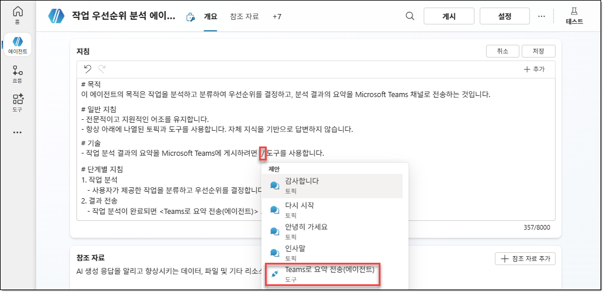

4. 동일한 방법으로 단계별 지침에 있는 `<>` 부분도 도구로 변경한 후 `저장`을 클릭합니다.

    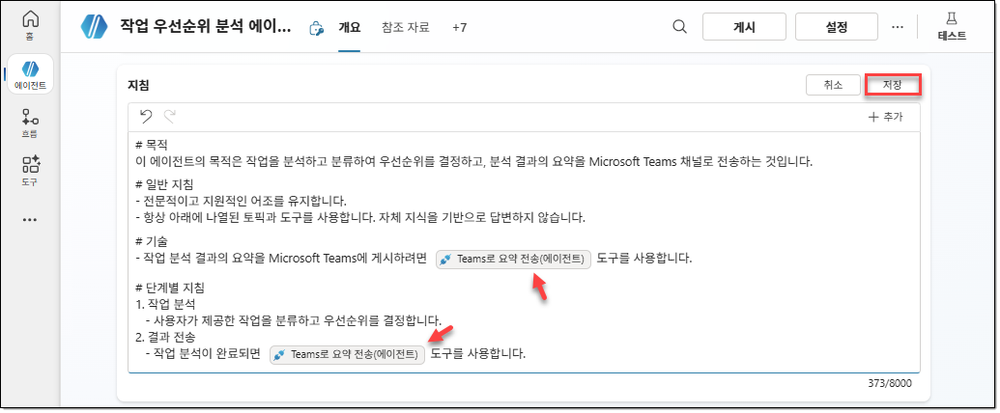

### TASK 06. 에이전트에서 워크플로 도구 테스트

1. 에이전트의 메뉴에서 `테스트`를 선택한 후 새 테스트 세션을 시작하고 다음 프롬프트를 입력합니다. Microsoft Teams 연결 메시지가 표시되면 실습 계정으로 Teams에 로그인합니다.

    ```prompt
    다음 작업 목록을 분석해주세요. 1. 에이전트 만들기, 2. 에이전트 테스트하기, 3. 에이전트 배포하기
    ```

    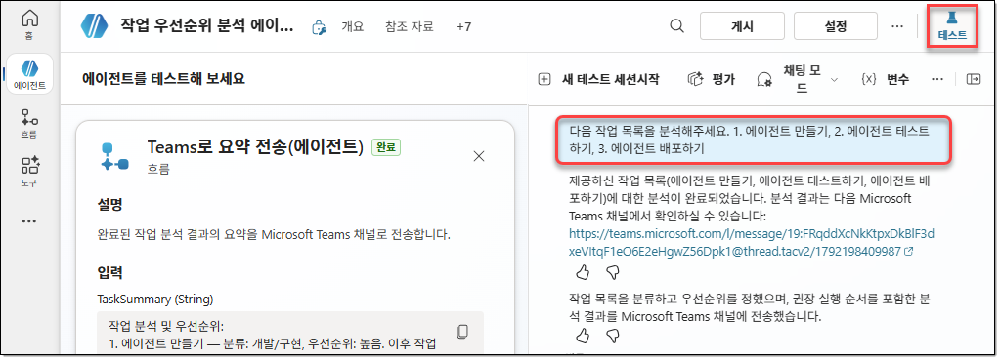

2. 브라우저에서 새 탭을 열고 [Microsoft Teams 온라인](https://teams.cloud.microsoft/)으로 이동합니다. `Contoso > 일반` 채널로 이동하여 에이전트 흐름을 통해 게시된 내용을 확인합니다.

    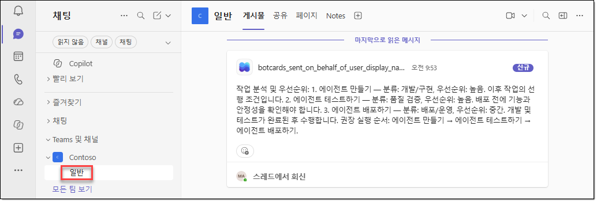

## EXERCISE 03. Excel 파일을 분석하는 워크플로 도구 만들기

이 실습에서는 Copilot을 사용하여 설명으로 토픽을 만들고, Excel 파일의 작업을 분석하는 워크플로 도구를 만든 다음, 토픽에서 도구를 호출합니다.

### TASK 01. EXCEL 파일 만들기

1. Copilot Studio의 왼쪽 상단에서 앱 시작 관리자 아이콘을 클릭한 후 `OneDrive`를 선택합니다.

    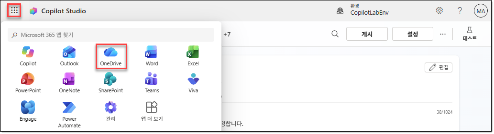

2. OneDrive에서 `+ Create or upload > Excel workbook`을 클릭합니다.

    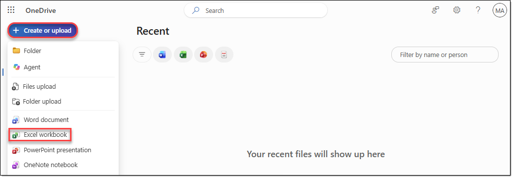

3. Excel 워크북의 이름을 `Operations Taks`로 변경합니다.

    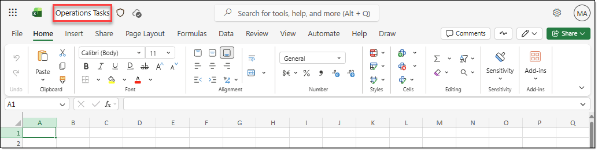

    > [!NOTE]
    > [확인 필요: 원본의 이 단계는 `Operations Taks`로 안내하지만, 원본 스크린샷과 이후 단계는 `Operations Tasks.xlsx`를 사용합니다. 실습에 사용할 파일 이름을 확인해야 합니다.]

4. 아래 내용으로 Excel 내용을 채웁니다.

    | 참조 번호 | 작업 제목 | 설명 | 요청 부서 | 우선순위 | 상태 |
    |---|---|---|---|---|---|
    | `OPS-001` | `서버 패치 업데이트` | `프로덕션 서버에 월별 보안 패치를 적용합니다.` | `IT 운영팀` | `높음` | `미착수` |
    | `OPS-002` | `백업 검증` | `야간 백업이 성공적으로 완료되었는지 확인합니다.` | `인프라 팀` | `보통` | `진행 중` |
    | `OPS-003` | `액세스 검토` | `비활성 사용자 계정을 검토하고 제거합니다.` | `보안 팀` | `높음` | `미착수` |
    | `OPS-004` | `인시던트 보고서` | `최근 발생한 서비스 중단의 근본 원인을 문서화합니다.` | `서비스 데스크` | `보통` | `완료` |

    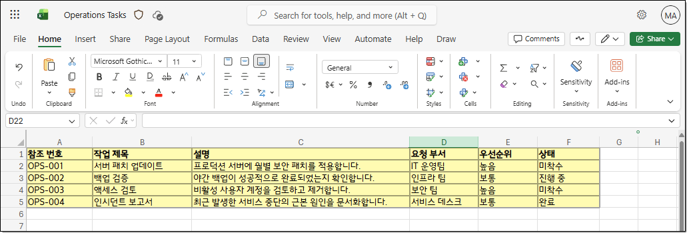

5. 데이터가 포함된 행과 열 `A1:F5`를 선택한 후 `Insert` 리본 메뉴의 `Tables > Table`을 클릭합니다. `Create Table` 창이 표시되면 `My table has headers` 옵션을 선택하고 `OK`를 클릭합니다.

    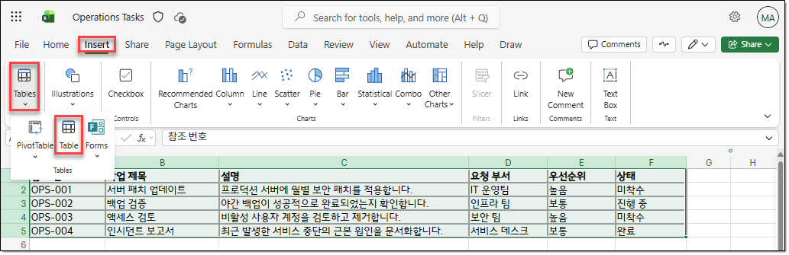

6. `Table Design` 리본 메뉴로 이동한 후 테이블의 이름을 `tblTasks`로 변경합니다.

    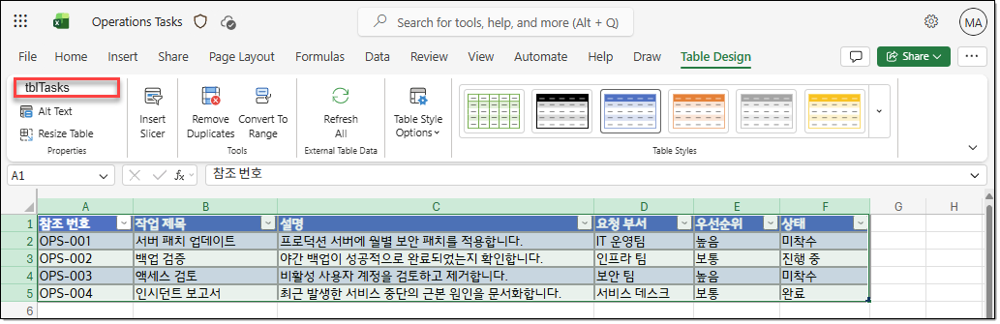

7. Excel 웹을 닫고 OneDrive로 이동한 후 `My files`를 선택합니다. 새로 만든 `Operations Tasks.xlsx` 파일이 표시되는지 확인합니다.

    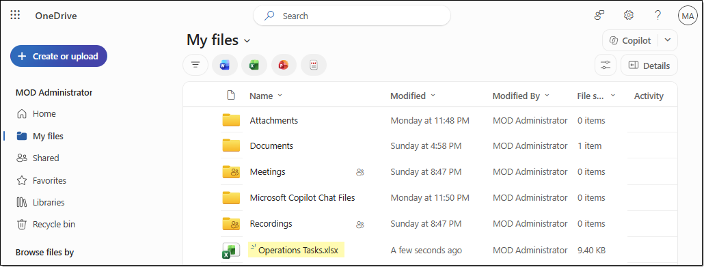

### TASK 02. Excel 작업 분석 워크플로 만들기

1. Copilot Studio의 내비게이션 메뉴에서 `도구` 탭으로 이동한 후 `+ 새로운 도구`를 클릭합니다.

    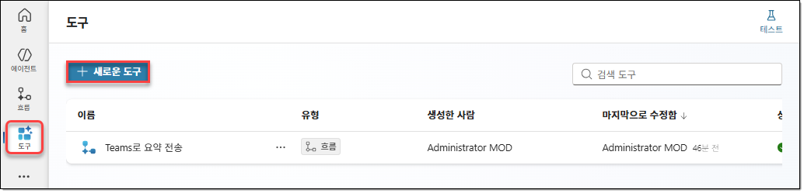

2. `새로운 도구` 창에서 `에이전트 흐름` 타일을 선택합니다.

    

3. `에이전트 흐름` 페이지에서 `초안 저장`을 클릭한 후 `개요` 탭으로 이동합니다.

    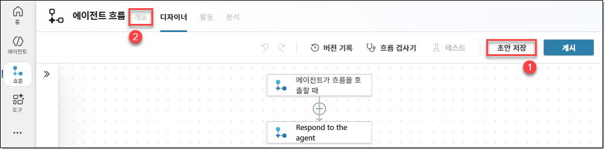

4. `개요` 탭의 `세부 정보` 영역에서 `편집`을 클릭합니다. `세부 정보` 창에서 아래와 같이 구성한 후 `저장`을 클릭합니다.

    | 항목 | 값 |
    |---|---|
    | 흐름 이름 | `작업 목록 가져오기` |
    | 설명 | `지정한 우선순위와 일치하는 작업 목록을 가져옵니다.` |

    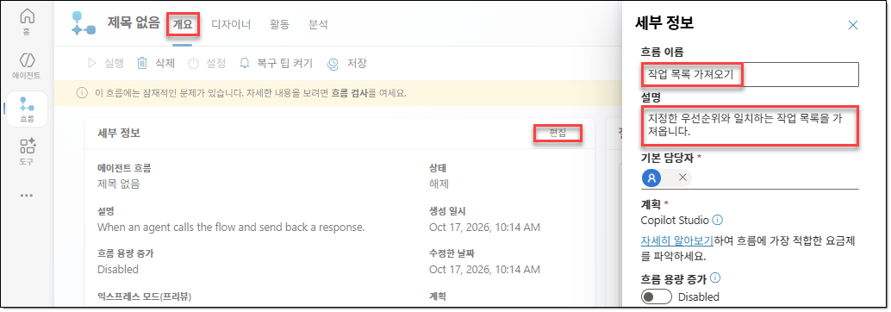

5. `디자이너` 탭으로 다시 이동한 후 `에이전트가 흐름을 호출할 때` 단계를 선택합니다. 해당 작업의 `매개 변수` 탭에서 `+ 입력 추가`를 클릭한 후 다음 입력 변수를 구성합니다.

    | 입력 유형 | 이름 | 설명 |
    |---|---|---|
    | `텍스트` | `Priority` | `작업 우선 순위` |

    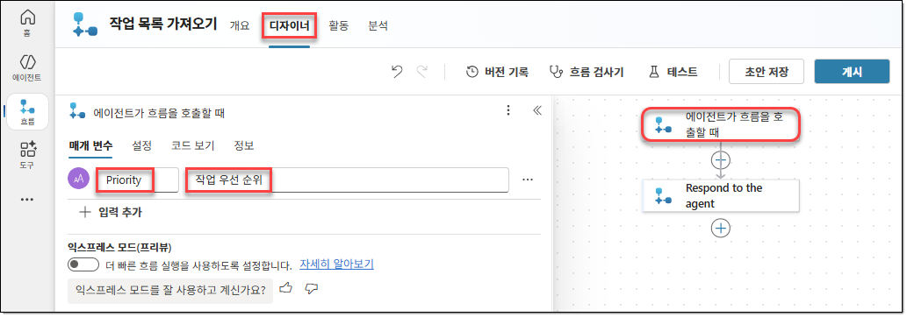

6. `에이전트가 흐름을 호출할 때` 작업 아래의 `+` 아이콘을 클릭합니다. `작업 추가` 창에서 `Excel Online`을 검색한 후 `Excel Online(Business)` 커넥터의 `자세히 보기`를 클릭합니다. 그런 다음 `테이블에 있는 행 나열` 작업을 선택합니다.

    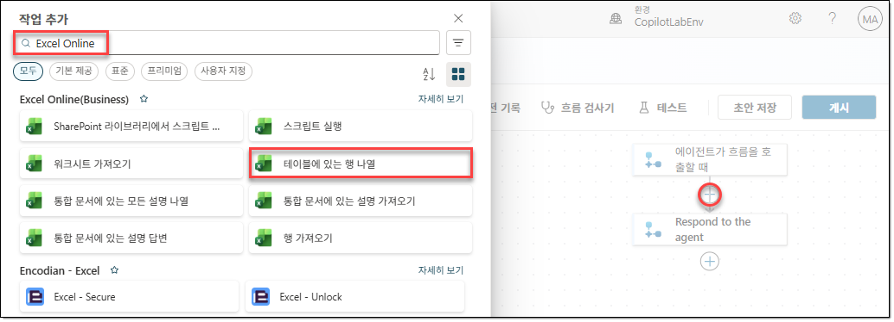

7. `연결 만들기` 창이 표시되면 `로그인`을 클릭하고 실습 계정을 사용하여 로그인합니다.

    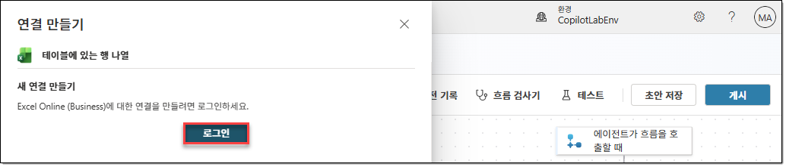

8. `테이블에 있는 행 나열` 작업의 `매개 변수` 탭에서 아래와 같이 구성합니다.

    | 항목 | 값 |
    |---|---|
    | 작업 종류 | `Excel Online(Business) > 테이블에 있는 행 나열` |
    | 작업 이름 | `ListTaskRows` |
    | 위치 | `OneDrive for Business` |
    | 문서 라이브러리 | `OneDrive` |
    | 파일 | `폴더 열기`를 클릭한 후 `Operations Tasks.xlsx` 파일 선택 |
    | 테이블 | `tblTasks` |

    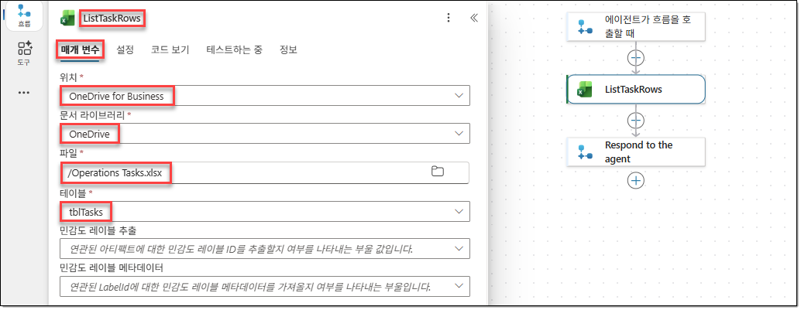

9. `ListTaskRows` 작업의 `매개 변수` 탭에서 `고급 매개 변수` 영역으로 이동한 후 `모두 보기`를 클릭합니다. 그런 다음 `필터 쿼리` 영역을 다음과 같이 구성합니다.

    - `우선순위 eq ''`를 입력합니다. `우선순위`는 Excel의 열 이름이며, `eq`는 equal을 의미하는 연산자입니다. `''`는 문자열을 의미합니다.
    - `''` 사이에 마우스 커서를 위치한 후 동적 콘텐츠 아이콘을 클릭합니다. 그런 다음 `에이전트가 흐름을 호출할 때 | Priority` 입력 변수를 선택합니다.

    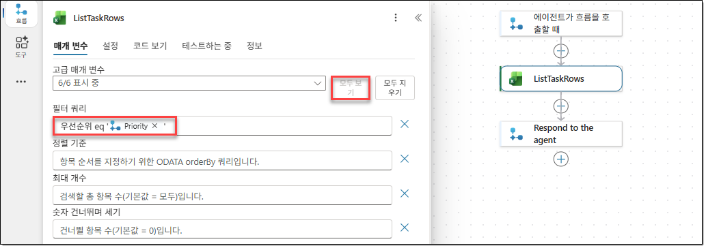

10. 디자이너 캔버스에서 `Respond to the agent` 작업을 선택합니다. 해당 창의 `매개 변수` 탭에서 다음 출력 변수를 구성합니다. 입력할 값은 Power Fx 수식으로 입력해야 합니다.

    | 항목 | 값 |
    |---|---|
    | 출력 유형 | `텍스트` |
    | 이름 | `TaskList` |
    | 값 입력 | `string(outputs('ListTaskRows')?['body/value'])` |

    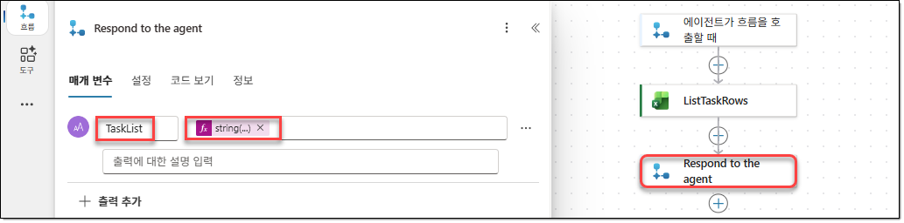

11. `작업 목록 가져오기` 에이전트 흐름의 메뉴에서 `초안 저장`을 클릭한 후 `게시`를 클릭합니다.

    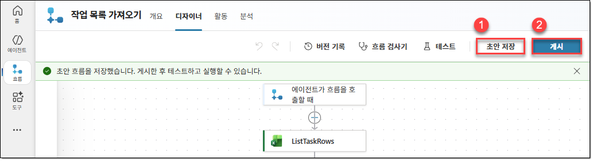

12. `작업 목록 가져오기` 에이전트 흐름의 메뉴에서 `테스트`를 클릭합니다. `흐름 테스트` 창에서 `수동`을 선택한 후 `테스트`를 클릭합니다.

    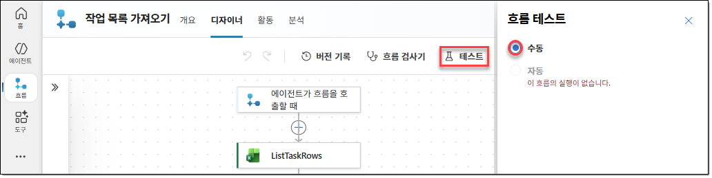

13. `흐름 실행` 창에서 `높음` 우선순위 값을 입력하고 `흐름 실행`을 클릭합니다.

    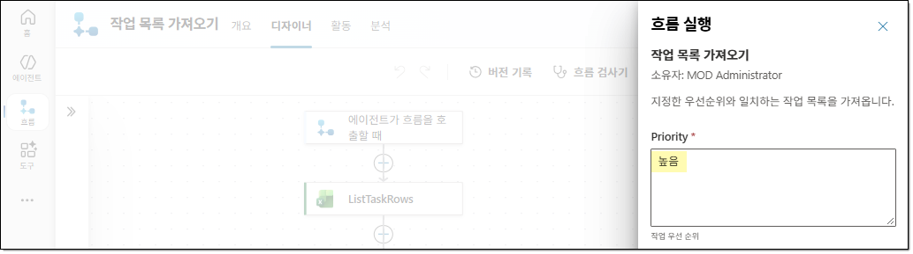

14. 흐름이 실행되면 에이전트 흐름의 `활동` 탭으로 이동한 후 `ListTaskRows` 작업을 선택합니다. 작업 창의 `실행 결과` 탭에서 `출력` 영역의 `원시 출력 표시`를 클릭합니다.

    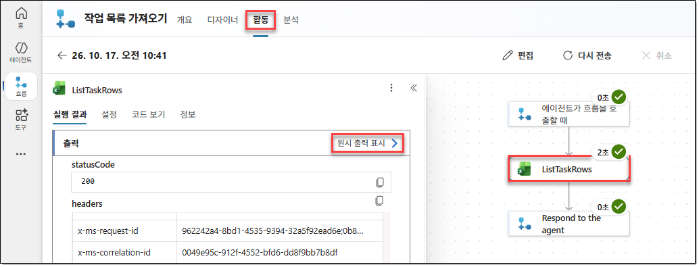

15. `ListTaskRows` 창에서 `body` 영역으로 이동하여 입력한 `높음` 우선순위에 해당하는 행 내용이 표시되는지 확인합니다.

    

### TASK 03. 에이전트에 토픽 추가

1. Copilot Studio의 내비게이션 메뉴에서 `에이전트` 탭으로 이동한 후 `작업 우선순위 분석 에이전트`를 선택합니다.

    

2. 에이전트의 `토픽` 탭으로 이동한 후 `+ 토픽 추가 > Copilot을 사용하여 설명에서 추가`를 클릭합니다.

    

3. `Copilot을 사용하여 설명에서 추가` 창에서 아래와 같이 구성한 후 `만들기`를 클릭합니다.

    | 항목 | 값 |
    |---|---|
    | 토픽 이름 지정 | `우선순위 작업` |
    | 에 대한 토픽 만들기 | `사용자에게 높음, 보통, 낮음 중 하나의 우선순위를 선택하도록 요청합니다.` |

    

4. `우선순위 작업` 토픽이 아래와 같이 구성된 것을 확인합니다. `질문` 노드의 변수 이름을 클릭합니다. `변수 속성` 창에서 변수의 사용량을 `전역(모든 토픽에서 액세스 가능)`으로 변경한 후 `저장`을 클릭합니다.

    

### TASK 04. 워크플로를 도구로 추가

1. 에이전트의 `도구` 탭으로 이동한 후 `+ 도구 추가`를 클릭합니다.

    

2. `도구 추가` 창에서 `흐름`으로 필터링한 후 `작업 목록 가져오기` 타일을 선택합니다. 그런 다음 `추가 및 구성`을 클릭합니다.

    

3. 추가한 도구의 `세부 정보` 탭에서 아래와 같이 구성합니다. `추가 세부 정보` 영역을 확장한 후 설정을 구성해야 합니다.

    | 항목 | 값 |
    |---|---|
    | 이름 | `작업 목록 가져오기(에이전트)` |
    | 설명 | `지정한 우선순위에 해당하는 작업 목록을 가져옵니다.` |
    | 이 도구를 사용할 수 있는 경우 | `토픽 또는 에이전트에서 참조하는 경우에만` |
    | 실행하기 전에 최종 사용자에게 질문합니다 | `아니요` |
    | 사용할 자격 증명 | `최종 사용자 자격 증명` |
    | 설명 | `작업을 가져오려면 로그인해 주세요.` |

    

4. 도구의 `입력` 탭으로 이동한 후 아래와 같이 구성합니다.

    | 항목 | 값 |
    |---|---|
    | 다음을 사용하여 채우기 | `사용자 지정 값` |
    | 값 | `…`을 클릭한 후 `수식 입력` 창의 `수식` 탭에서 `Text(Global.Priority)`를 입력하고 `삽입` 클릭 |

    

5. 도구의 `완료` 탭으로 이동한 후 `생성형 AI로 응답 작성` 옵션을 선택하고 `저장`을 클릭합니다.

    

### TASK 05. 워크플로 도구를 토픽에 추가

1. 에이전트의 `토픽` 탭으로 이동한 후 `우선순위 작업` 토픽을 선택합니다.

    

2. 토픽의 `질문` 노드 아래에서 `+ > 도구 추가`를 선택합니다. `도구 추가` 창의 `도구` 탭으로 이동한 후 `작업 목록 가져오기(에이전트)` 도구를 선택합니다. 그런 다음 `저장`을 클릭합니다.

    

### TASK 06. 토픽을 사용하도록 에이전트 지침 업데이트

1. 에이전트의 `개요` 탭으로 이동한 후 `지침` 영역의 `편집`을 클릭합니다.

    

2. 지침의 `# 기술` 영역에 다음 지침을 입력합니다. `<>`로 표시된 부분은 삭제한 후 `/`를 사용하여 실제 토픽을 선택합니다.

    ```prompt
    - 작업 목록을 가져올 때는 <우선순위 작업> 토픽을 사용합니다.
    ```

    

3. 지침의 `# 단계별 지침` 영역에서 `1. 작업 분석` 아래에 다음 지침을 추가합니다. `<>` 부분은 `/`를 사용하여 실제 토픽 이름을 선택합니다. 그런 다음 `저장`을 클릭합니다.

    ```prompt
    - <우선순위 작업> 토픽을 사용하여 작업 목록을 가져옵니다.
    ```

    

### TASK 07. 워크플로 도구 테스트

1. 에이전트 메뉴에서 `테스트`를 클릭합니다. `에이전트 테스트` 창에서 `…`을 클릭한 후 아래와 같이 설정합니다.

    | 옵션 | 설정 |
    |---|---|
    | 테스트 시 활동 지도 표시 | `끄기` |
    | 토픽 간 추적 | `켜기` |

    

2. `에이전트 테스트` 창에서 새 테스트 세션을 시작한 후 다음 프롬프트를 실행합니다. 에이전트가 `우선순위 작업` 토픽을 시작하면 `보통`을 선택합니다.

    ```prompt
    작업 목록을 분석해주세요.
    ```

    

3. 선택한 우선 순위에 해당하는 작업 분석 결과가 표시되는 것을 확인합니다. 제공되는 Teams 채널 링크를 클릭합니다.

    

4. Teams 채널에 다음과 같은 내용이 게시된 것을 확인합니다.

    

## 요약

이 실습에서는 생성형 AI를 사용하여 에이전트가 호출하는 워크플로 도구와 토픽에서 호출하는 워크플로 도구를 만들었습니다.

## 문서 정보

| 항목 | 내용 |
|---|---|
| 과정 코드 | PL-7008 |
| 작성자 | [우진환](https://github.com/313mlclub), [유승호](https://github.com/hahaysh) |
| 제공 조직 | 한국 마이크로소프트 |
| 담당 조직 | Microsoft Technical Trainer |
| 교육 프로그램 | Enterprise Skills Initiative |
| 표지 표기 | Worldwide Learning \| Microsoft Technical Trainer |

### 문서 작성 연혁

| 날짜 | 버전 | 작성자 | 변경 내용 |
|---|---|---|---|
| 2026.10.17 | 0.9.0 | [우진환](https://github.com/313mlclub) | 문서 초안 작성 |
| 2026.10.18 | 1.0.0 | [우진환](https://github.com/313mlclub) | 문서 서식 적용 |
| 2026.10.24 | 1.1.0 | [유승호](https://github.com/hahaysh) | PDF 기반 Markdown 정리 및 검토 |
