---
---

# LAB 05. 새로운 Copilot Studio 환경을 사용하여 에이전트 만들기

## 개요

이 실습에서는 다음 작업을 수행합니다.

- 새로운 Copilot Studio 환경으로 전환
- 자연어 지침을 사용하여 에이전트 만들기
- 에이전트가 자율적으로 사용할 수 있는 미리 빌드된 작업 추가
- 에이전트를 테스트하고 추론 동작 관찰
- 테스트 결과에 따라 지침 개선

이 실습을 완료하는 데 약 **30분**이 소요됩니다.

## 핵심 개념 − 지침 기반 에이전트

새로운 Copilot Studio 환경은 토픽 제작 캔버스를 더 간단한 지침 기반 모델로 대체합니다.

| 구분 | 클래식 환경 (Standard Harness) | 새로운 환경 (GitHub Copilot Harness) |
|---|---|---|
| 에이전트 동작 정의 | 토픽, 트리거, 조건 및 지침을 통해 에이전트 동작 정의 | 자연어 지침과 목표를 중심으로 에이전트 동작 정의 |
| 대화 흐름 구성 | 제작자가 토픽과 노드를 사용하여 명시적인 대화 흐름 구성 가능 | 에이전트가 지침과 사용자 요청을 분석하여 필요한 작업 단계를 동적으로 계획 |
| 작업 및 도구 선택 | 토픽과 조건으로 작업을 제어하거나 생성형 오케스트레이션으로 도구를 동적 선택 | 향상된 오케스트레이션을 통해 지침, 지식 및 도구를 활용하고 실행 결과에 따라 작업 조정 |
| 커넥터 사용 | 사전 빌드된 커넥터를 도구 또는 토픽에 직접 추가하여 사용 가능 | 사전 빌드된 커넥터 및 MCP 도구를 에이전트에 직접 추가하여 사용 가능 |
| 워크플로 제작 | 복잡한 작업이 필요한 경우 Power Automate 기반 `Agent Flow`를 직접 제작하여 호출 | 복잡한 작업이 필요한 경우 `Workflow`를 직접 제작하여 에이전트에서 호출 |
| 주요 활용 시나리오 | 명확한 규칙과 정해진 절차를 따르는 반복적인 업무 및 구조화된 대화 | 복잡한 다단계 업무, 반복적인 추론 및 상황에 따라 실행 경로가 달라지는 작업 |

새로운 환경은 개방형이며 컨텍스트에 따라 달라지는 대화를 처리해야 하는 에이전트에 가장 적합합니다. 클래식 환경은 구조화된 데이터를 특정 순서로 수집하는 경우처럼 보장되고 감사 가능한 단계 순서가 필요할 때 여전히 적합합니다.

## EXERCISE 01. 새로운 Copilot Studio 환경으로 전환

1. Copilot Studio 클래식 환경에서 `지금 사용해 보세요`를 클릭합니다.

    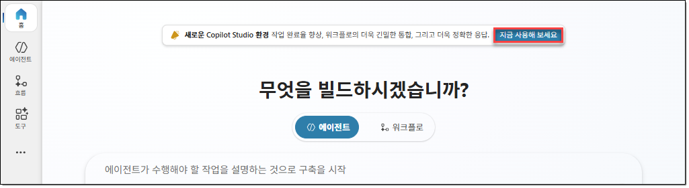

2. 새로운 Copilot Studio 환경 좌측 하단에서 환경 이름을 클릭한 후 `CopilotLabEnv` 환경이 선택되어 있는지 확인합니다.

    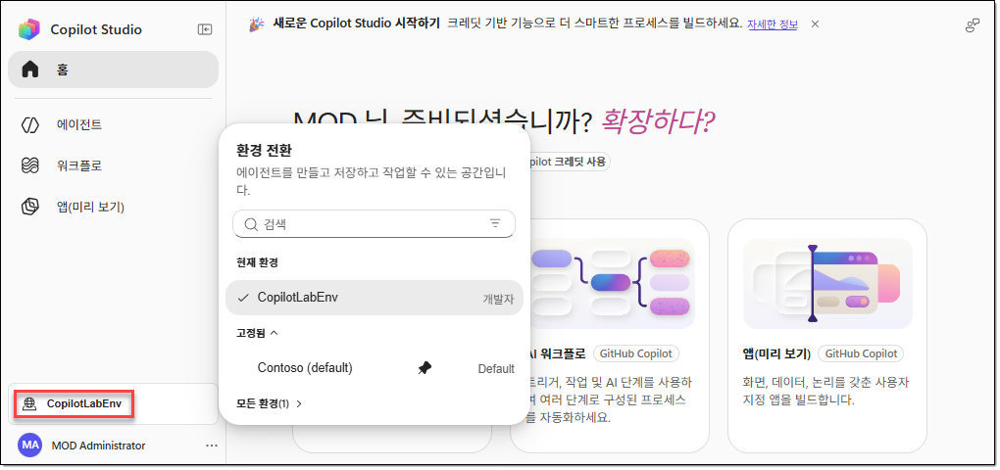

3. `에이전트` 탭으로 이동한 후 기존 에이전트가 표시되고 이 에이전트가 `표준` 하네스로 구성되어 있는 것을 확인합니다. 새로운 환경에서는 토픽이 없으며, 작업과 지침이 토픽을 대신합니다.

    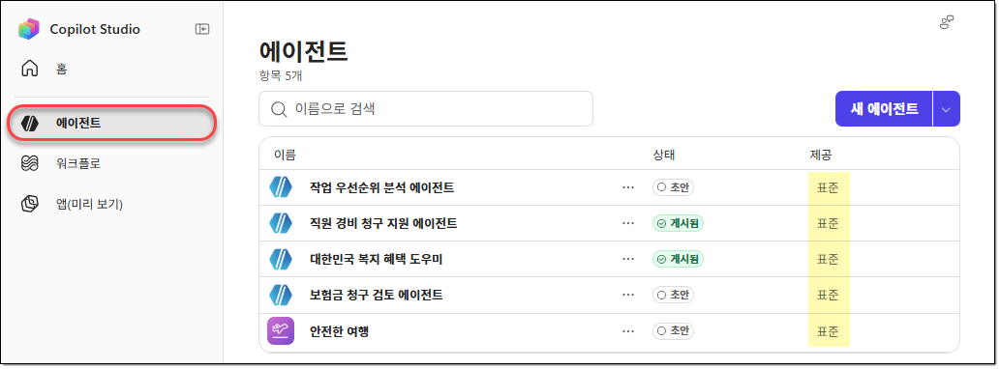

## EXERCISE 02. 에이전트 만들기

이 실습에서는 가상 회사인 Contoso의 IT 지원 에이전트를 만듭니다. 이 에이전트는 직원이 일반적인 IT 문제를 해결하고 지원 티켓을 제출하도록 도와줍니다.

### TASK 01. 에이전트 만들기

1. `홈` 탭으로 이동한 후 빌드 프롬프트 상자가 표시되는지 확인합니다.

    > [!NOTE]
    > 일부 환경에서는 표준 URL을 통해 Copilot Studio에 액세스할 때 `홈` 탭에서 빌드 프롬프트 상자가 표시되지 않을 수 있습니다. 빌드 프롬프트 상자가 표시되지 않는다면 [https://copilotstudio.preview.microsoft.com/](https://copilotstudio.preview.microsoft.com/) 주소로 액세스합니다.

    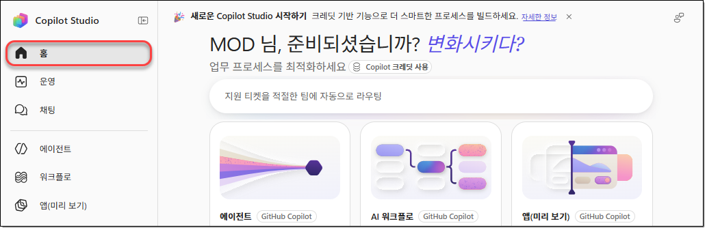

2. 빌드 프롬프트 상자에 다음을 입력한 후 제출합니다.

    ```prompt
    당신은 Contoso의 IT 지원 에이전트입니다.
    - 직원들이 비밀번호 재설정, 소프트웨어 설치 문제, 네트워크 연결 오류 등 일반적인 IT 문제를 해결할 수 있도록 지원합니다.
    - 문제를 직접 해결할 수 없는 경우, 직원이 IT 지원 티켓을 제출할 수 있도록 안내하고 지원합니다.
    ```

    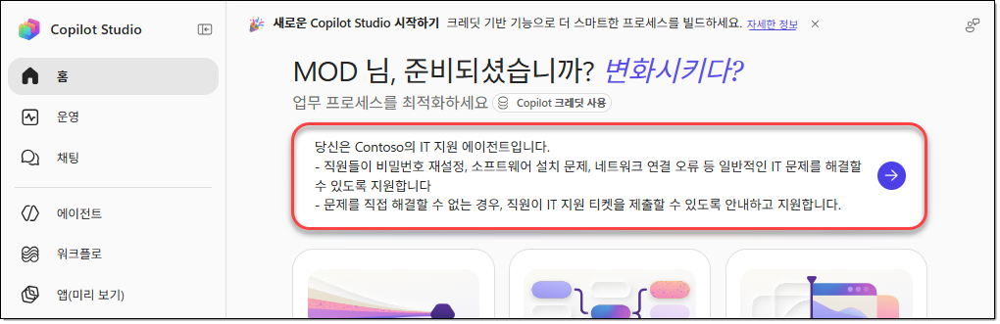

3. 에이전트를 명확하게 하기 위한 질문이 표시되면 더 정확한 지침을 생성할 수 있도록 답변합니다.

    - IT 지원 티켓을 제출하는 방법을 묻는 경우 `ServiceNow`, `Jira`, `Dynamics 365` 또는 `Zendesk` 대신 IT 지원 센터에 지원 요청 전자 메일을 보내는 옵션을 선택합니다.
    - 에이전트가 기술 자료, SharePoint 사이트 또는 웹 사이트를 참조해야 하는지 묻는 경우 외부 지식 원본이 필요하지 않음을 나타내는 옵션을 선택합니다.

    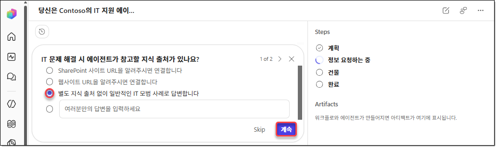

4. 설명과 환경에 따라 명확히 하기 위한 질문이 달라지거나 전혀 표시되지 않을 수 있습니다. 정확히 동일한 질문이나 답변 옵션을 기대하기보다 실습 시나리오에 맞게 답변합니다.

5. 에이전트가 지원 요청을 보낼 때 사용할 이메일 주소를 입력하라는 메시지가 표시되면 실습 계정의 메일 주소를 입력한 후 `Submit`을 클릭합니다.

6. 에이전트와 에이전트에 필요한 기술이 함께 생성된 것을 확인합니다. 오른쪽 아티팩트 패널에서 `Contoso IT 지원 에이전트` 에이전트를 선택합니다.

    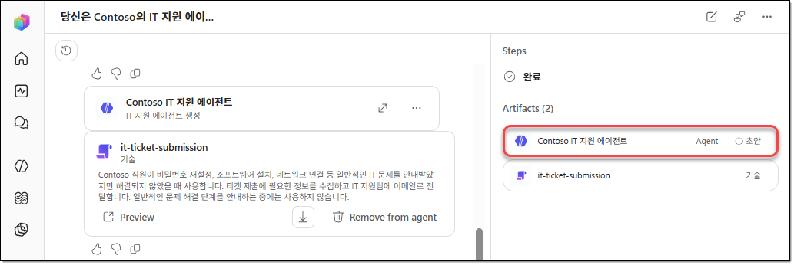

### TASK 02. 자동 생성된 지침 검토 및 개선

1. 에이전트 페이지에서 설명을 기반으로 자동 생성된 지침을 검토합니다. 지침에는 에이전트의 목적, 어조 및 일반적인 동작이 설명되어 있어야 합니다.

2. 기존 지침에 다음 지침을 추가하고 `저장`을 클릭합니다.

    <!--  -->

    - `{{Send an email}}` 부분은 에이전트에 추가된 이메일 발송 도구 이름으로 변경합니다.
    - `{{Help Desk email}}` 부분은 실습 계정의 이메일 주소로 변경합니다.

    ```prompt
    ## 지침 (Guidelines)
    - 항상 전문적이고 친절한 어조로 응답합니다.
    - 직원이 비밀번호 재설정을 요청하는 경우, IT 지원 티켓을 생성하기 전에 먼저 셀프 서비스 비밀번호 재설정 포털(https://aka.ms/sspr)을 이용하도록 안내합니다.
    - 직접 해결할 수 없는 문제가 발생한 경우, 지원 티켓을 제출하기 전에 직원의 이름, 이메일 주소 및 문제에 대한 간략한 설명을 수집합니다.
    - 하드웨어 고장의 원인을 추측하지 않습니다. 물리적인 하드웨어 문제가 발생한 경우, 항상 IT 헬프데스크에 직접 문의하도록 안내합니다.
    - 직원의 문제를 해결할 수 없는 경우, `{{Send an email}}` 도구를 사용하여 IT 헬프데스크({{Help Desk email}})에 이메일 알림을 보냅니다. 이메일에는 직원의 이름, 이메일 주소 및 문제에 대한 설명을 포함합니다.
    ```

    <!--  -->

    지침에 포함된 포털: [셀프 서비스 비밀번호 재설정 포털](https://aka.ms/sspr).

    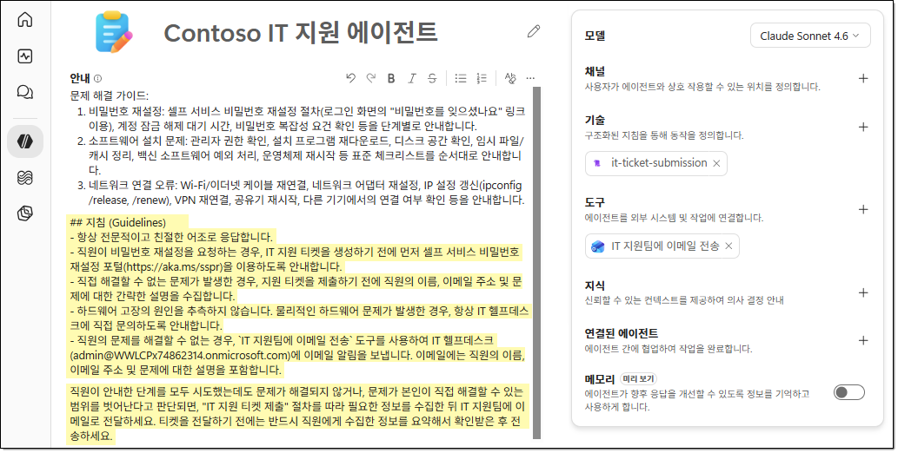

3. Copilot Studio의 새로운 환경에서는 지침이 에이전트 동작을 제어하는 기본 수단입니다. 잘 작성된 지침은 추가 구성의 필요성을 줄이고 에이전트의 예측 가능성을 높입니다.

## EXERCISE 03. 테스트 및 개선

이 실습에서는 에이전트를 테스트하고 응답하기 전에 에이전트가 추론하는 방식을 관찰합니다.

### TASK 01. 지침 테스트

1. 에이전트의 메뉴에서 `미리 보기`를 선택합니다. 에이전트를 테스트하면 각 응답 위에 추론 요약이 자동으로 표시되어 수행할 작업을 어떻게 결정했는지 보여줍니다. 각 요약에서 `자세히 보기`를 선택하여 전체 추론 추적을 펼칠 수 있습니다.

    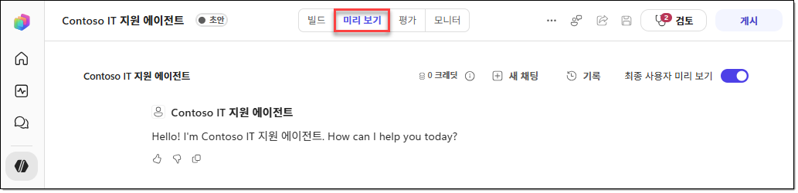

2. 새 채팅에서 다음 프롬프트를 입력하고 실행합니다. 작성한 지침에 따라 에이전트는 티켓을 생성하기 전에 셀프 서비스 포털을 안내해야 합니다.

    ```prompt
    암호를 잊어버려 로그인할 수 없습니다.
    ```

    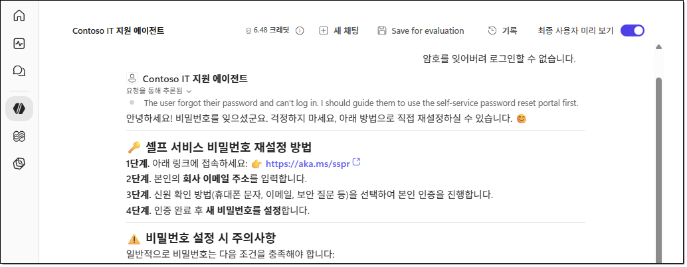

3. `새 채팅`을 클릭한 후 다음 프롬프트를 실행합니다. 작성한 지침에 따라 에이전트는 하드웨어 오류의 원격 문제 해결을 거부하고 IT 지원 센터에 직접 문의하도록 권장해야 합니다. 에이전트가 사용자를 대신해 지원 티켓을 제출하겠다고 제안할 수도 있습니다.

    ```prompt
    노트북 전원이 전혀 켜지지 않습니다.
    ```

    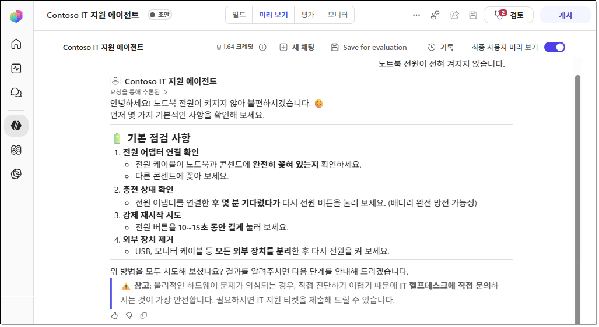

    > [!NOTE]
    > [확인 필요: 원본 절차는 하드웨어 오류의 원격 문제 해결을 거부하도록 안내하지만, 원본 스크린샷에는 전원 어댑터 연결, 충전 상태와 강제 재시작 등의 점검 안내가 표시됩니다. 본문의 기대 동작과 예시 응답의 일치 여부를 확인해야 합니다.]

4. `새 채팅`을 시작한 후 다음 프롬프트를 실행합니다. 에이전트의 안내에 따라 필요한 정보를 입력하고 지원 티켓 제출을 완료합니다.

    ```prompt
    지원 티켓을 제출하고 싶습니다.
    ```

    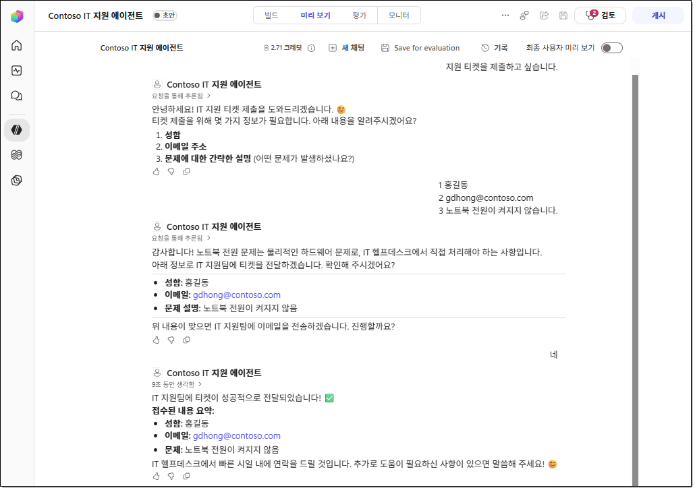

5. 새 탭을 열고 [Outlook 온라인](https://outlook.office.com/)으로 이동한 후 지원 티켓 제출 내용이 수신되었는지 확인합니다.

    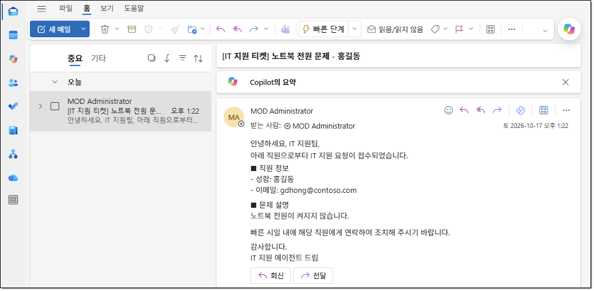

### TASK 02. 지침 개선 및 게시

1. 에이전트의 응답이 의도한 동작과 일치하지 않으면 에이전트의 `빌드` 탭으로 이동한 후 지침 영역에서 관련 지침을 조정합니다. 예를 들어 에이전트가 암호 재설정 시 셀프 서비스 포털을 언급하지 않았다면 지침을 더 명확하게 작성합니다.

    ```prompt
    - 암호와 관련된 모든 요청에 대해, 다른 지원을 제공하기 전에 항상 첫 번째 단계로 https://aka.ms/sspr 을 안내합니다.
    ```

    포털 주소: [https://aka.ms/sspr](https://aka.ms/sspr).

    > [!NOTE]
    > [확인 필요: 원본 PDF의 이 예시에서 링크 대상은 `https://aka.ms/sspr을`로 지정되어 있으나 지침 본문 주소는 `https://aka.ms/sspr`입니다. 링크 대상의 일치 여부를 확인해야 합니다.]

2. 에이전트의 메뉴에서 `게시`를 클릭하고 `게시` 창에서 `에이전트 게시`를 클릭합니다.

    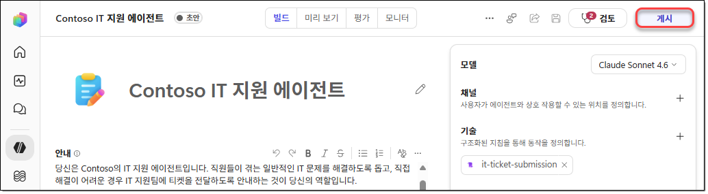

3. 게시가 완료되면 이전에 수행했던 테스트를 다시 수행합니다.

    - 지침을 반복해서 수정하는 작업은 새로운 Copilot Studio 환경에서 사용하는 기본 튜닝 메커니즘입니다.
    - 표현을 조금만 변경해도 에이전트 동작이 크게 달라질 수 있습니다.

## 요약

이 실습에서는 새로운 Copilot Studio 환경을 사용하여 지침 기반 IT 지원 에이전트를 만들었습니다. 자연어 지침만으로 동작을 구성하고, Power Automate 워크플로를 만들거나 페이지를 벗어나지 않고도 Copilot Studio에서 미리 빌드된 커넥터 작업을 직접 추가했습니다.

도구를 추가하기 위해 워크플로를 제작하고 입력과 출력을 구성한 후 별도로 게시해야 했던 이전 실습과 비교하면, 새로운 환경에서는 간단한 작업의 제작 노력이 크게 줄어듭니다. 또한 미리 보기 창의 추론 추적을 사용하여 에이전트가 응답을 생성하기 전에 수행할 작업을 결정한 방식을 관찰했습니다.

이제 클래식 환경과 새로운 환경을 모두 사용해 보았으므로, 개방형 대화에는 지침 기반 접근 방식을 사용하고 보장되고 감사 가능한 단계 순서가 필요한 경우에는 클래식 토픽과 워크플로를 사용하는 등 각 시나리오에 적합한 방식을 선택할 수 있습니다.

## 문서 정보

| 항목 | 내용 |
|---|---|
| 과정 코드 | PL-7008 |
| 작성자 | [우진환](https://github.com/313mlclub), [유승호](https://github.com/hahaysh) |
| 제공 조직 | 한국 마이크로소프트 |
| 담당 조직 | Microsoft Technical Trainer |
| 교육 프로그램 | Enterprise Skills Initiative |
| 표지 표기 | Worldwide Learning \| Microsoft Technical Trainer |

### 문서 작성 연혁

| 날짜 | 버전 | 작성자 | 변경 내용 |
|---|---|---|---|
| 2026.10.17 | 0.9.0 | [우진환](https://github.com/313mlclub) | 문서 초안 작성 |
| 2026.10.18 | 1.0.0 | [우진환](https://github.com/313mlclub) | 문서 서식 적용 |
| 2026.10.24 | 1.1.0 | [유승호](https://github.com/hahaysh) | PDF 기반 Markdown 정리 및 검토 |
